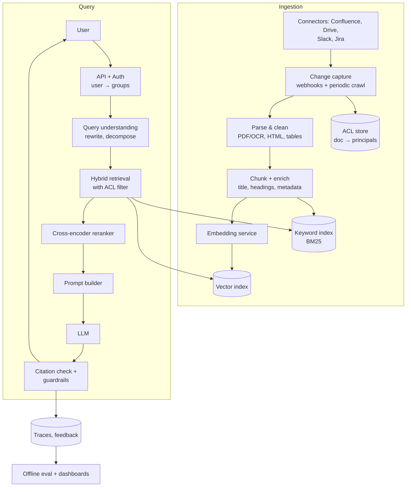

# AI 1. Design a RAG-based Enterprise Q&A Assistant

## Interview question

> Design an assistant that answers employee questions using the company's internal knowledge — Confluence, Google Drive, Slack, Jira, PDFs. Answers must cite sources and must never reveal documents the user isn't allowed to see. 50k employees, 20M documents.

## Clarifying questions

| Question | Assumed answer |
|----------|----------------|
| Users & load? | 50k employees, ~200k queries/day, peak ~20 QPS |
| Sources? | Confluence, Drive, Slack, Jira, uploaded PDFs; ~20M docs, ~200M chunks |
| Freshness? | New/edited docs searchable within ~15 minutes |
| Permissions? | Must mirror source-system ACLs exactly |
| Latency? | First token < 2 s, full answer < 10 s |
| Quality bar? | Grounded answers with citations; say "I don't know" rather than hallucinate |
| Model? | Hosted frontier LLM via API, or self-hosted open model if data can't leave the VPC |

## Requirements

**Functional:** natural-language question → grounded answer with citations; follow-up questions (conversation); filter by source/date; feedback (👍/👎).
**Non-functional:** permission-correct (security bug = critical); answer quality measured continuously; cost-bounded per query; observable.

## Estimation

- 200M chunks × 1024-dim float32 embeddings = 200M × 4 KB = **800 GB** of vectors. With int8/PQ compression → ~100–200 GB. Shardable vector index.
- Ingestion: ~1M doc changes/day → ~10M chunk re-embeddings/day ≈ 115/s — a modest embedding fleet (or API).
- Per query: ~10 retrieved chunks × 500 tokens = 5k context tokens + 500 output tokens. At 200k queries/day → ~1B input tokens/day → significant cost; caching and model routing matter.

## High-level design



## Deep dive 1: ingestion & chunking

- **Parsing** is where quality is won or lost: extract structure (headings, tables, lists), OCR for scanned PDFs, strip boilerplate (nav bars, signatures).
- **Chunking strategies:**
  - Fixed-size tokens (e.g., 400–800 tokens with 10–20% overlap) — simple baseline.
  - **Structure-aware** (split by headings/sections, keep tables intact) — usually best for docs.
  - Slack: group by thread, not by message.
- **Enrichment:** prepend doc title and section path to each chunk ("Contextual chunk headers"), or generate a short LLM summary of the chunk's context. Store metadata: source, author, updated_at, URL, ACL.
- **Incremental updates:** hash each chunk; only re-embed changed chunks; delete chunks of deleted docs promptly (deletes are a security concern too).
- **Embedding model versioning:** changing models requires re-embedding everything → run dual indexes during migration.

## Deep dive 2: retrieval

1. **Query rewriting:** turn a follow-up ("what about for contractors?") into a standalone query using the chat history; optionally decompose multi-part questions.
2. **Hybrid search:** dense vectors catch semantic matches; BM25 catches exact terms (error codes, product names, acronyms). Fuse with **Reciprocal Rank Fusion**: `score = Σ 1/(k + rank_i)`.
3. **Retrieve ~50–100 candidates → rerank** with a cross-encoder to the top 5–10. Rerankers give large precision gains for small latency (~50–100 ms).
4. **Recency/authority boosts:** prefer the latest version of a policy, official spaces over personal notes.

## Deep dive 3: permissions (the hardest part)

**Rule: filter before generation, never after.** If an unauthorized chunk reaches the LLM, it can leak into the answer.

- Sync ACLs from each source into an ACL store: `doc_id → allowed principals (users, groups)`. Resolve user → groups at query time (cached from the IdP, e.g., Okta/Azure AD).
- Store ACL principals as filterable metadata on each chunk; the vector search applies a **pre-filter** `allowed_principals ∩ user_groups ≠ ∅`.
- ACL changes must propagate quickly (permission removals are urgent): update chunk metadata without re-embedding.
- **Defense in depth:** after retrieval, re-check each chunk's doc against the live ACL store before building the prompt.
- Per-tenant/business-unit index isolation for extremely sensitive data (HR, legal).

## Deep dive 4: generation & grounding

Prompt structure:
```
System: You answer using ONLY the provided sources. Cite sources as [n].
If the sources don't contain the answer, say you don't know.
Sources:
[1] (Title, URL, updated 2026-05-02) ...chunk text...
[2] ...
Conversation so far: ...
Question: ...
```

- **Citation verification:** check each cited claim maps to a source (string overlap or an NLI/LLM-judge check); drop or flag unsupported sentences.
- **Abstain** when retrieval scores are low.
- **Prompt injection via documents:** a doc may contain "ignore previous instructions…". Treat retrieved text as data (clear delimiters), don't give the assistant dangerous tools, and scan for injection patterns.
- Stream tokens to the user for perceived latency.

## Deep dive 5: evaluation

| Layer | Metric | How |
|-------|--------|-----|
| Retrieval | Recall@k, MRR, nDCG | Labeled set of (question → relevant docs), built from SMEs + synthetic Q generation |
| Generation | Faithfulness/groundedness, answer relevance, correctness | LLM-as-judge calibrated against human labels |
| Safety | Permission leakage rate (must be 0) | Red-team test users with restricted access |
| Product | 👍/👎 rate, deflection of support tickets, follow-up rate | Online logs |

Run the offline eval suite on every change (chunking, embedding model, prompt, LLM version) — see [LLM Evaluation](10-llm-evaluation-guardrails.md).

## Cost & latency optimizations

- Semantic cache for frequent questions (keyed by embedding similarity *and* the user's permission set).
- Model routing: small model for simple lookups, large model for synthesis.
- Limit context to top reranked chunks; compress long chunks.
- Latency budget: auth 20 ms, rewrite 300 ms, retrieval 100 ms, rerank 100 ms, LLM TTFT ~700 ms.

## Trade-offs

| Choice | Pro | Con |
|--------|-----|-----|
| RAG vs fine-tuning | Fresh data, citations, ACLs | Retrieval quality limits answers |
| Small chunks | Precise retrieval | Lose context → use parent-document retrieval (retrieve small, feed parent section) |
| Pre-filter ACL in vector DB | Secure | Filtered ANN can hurt recall/latency with very selective filters |
| Hosted LLM | Best quality | Data residency; mitigate with zero-retention contracts or self-hosting |

## Follow-up interview questions

**Q: Why not just fine-tune an LLM on all company docs?**
A: Fine-tuning doesn't reliably teach facts, can't enforce per-user permissions, can't cite, and goes stale immediately. RAG keeps knowledge external, updatable, and access-controlled. Fine-tuning can still help style or domain jargon.

**Q: Users complain answers cite outdated policies. Fix?**
A: Add recency and "is latest version" metadata, boost/filter by it, dedupe near-duplicate docs keeping the newest, and show `updated_at` in citations. Add these cases to the eval set.

**Q: How do you handle questions requiring aggregation ("how many open P0 bugs in Jira?")?**
A: RAG is bad at aggregation. Route such intents to a tool: text-to-SQL or the Jira API with the user's credentials, then let the LLM summarize the results (agentic RAG).

**Q: How do you detect retrieval failure vs generation failure?**
A: Trace every request (query, retrieved chunks, scores, prompt, output). For bad answers, check whether the right chunk was in the retrieved set: if not → retrieval problem; if yes → generation/prompting problem.

**Q: How do you scale to 10× the documents?**
A: Shard the vector index, use compressed vectors (PQ/int8), tiered storage for cold sources, and keep metadata filtering efficient (partition by tenant/source).
