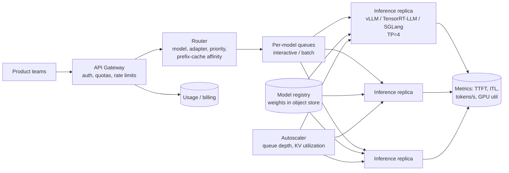

# AI 2. Design an LLM Inference Serving Platform

## Interview question

> Design a platform that serves several open-weight LLMs (8B to 70B+ parameters) to internal product teams via an API, with streaming. Peak load: 2,000 concurrent requests. Optimize for latency SLOs and GPU cost.

## Clarifying questions

| Question | Assumed answer |
|----------|----------------|
| Models? | A few base models + many fine-tuned LoRA adapters |
| Workload? | Chat (interactive, latency-sensitive) and batch (summarization jobs, latency-tolerant) |
| SLOs? | Interactive: time-to-first-token (TTFT) p95 < 1 s, inter-token latency (ITL) < 50 ms |
| Context length? | Up to 128k tokens; typical prompt 2k, output 500 |
| Hardware? | Pool of H100 80GB GPUs (8 per node) |
| Multi-tenancy? | Many teams; quotas and fair sharing |

## Requirements

**Functional:** OpenAI-compatible API (`/v1/chat/completions`, streaming via SSE); model selection; LoRA adapters; structured output (JSON); token usage reporting.
**Non-functional:** meet TTFT/ITL SLOs; maximize throughput per GPU; isolation between tenants; zero-downtime model rollouts; observability.

## LLM inference basics (say these in the interview)

- **Prefill:** process the whole prompt in parallel → compute-bound. Determines TTFT.
- **Decode:** generate one token at a time, each step reads all weights + KV cache → **memory-bandwidth-bound**. Determines ITL.
- **KV cache:** keys/values for every past token, per layer. Grows with batch × sequence length and is usually what limits concurrency.

## Estimation (70B model)

- Weights FP16: 140 GB → needs **tensor parallelism across ≥ 2 GPUs** (use 4 or 8 for headroom). FP8: 70 GB.
- KV cache per token (Llama-70B-like with GQA, 80 layers, 8 KV heads, head dim 128, FP16): 2 × 80 × 8 × 128 × 2 B ≈ **0.33 MB/token**.
- On an 8×H100 node (640 GB) with FP8 weights (70 GB): ~500 GB for KV → ~1.5M tokens → e.g., ~600 concurrent sequences at 2.5k tokens.
- Decode speed: roughly bandwidth / bytes read per step. Batching amortizes weight reads across many sequences → throughput scales nearly linearly with batch size until compute-bound.
- 2,000 concurrent × ~2.5k tokens → ~5M tokens of KV → **~4 nodes** for the 70B tier + headroom.

## High-level design



## Deep dive 1: batching

- **Static batching:** wait for N requests, run together. Bad — short requests wait for long ones.
- **Continuous (in-flight) batching:** the scheduler adds new requests to the running batch at every decode step and evicts finished ones. 5–20× throughput gain. Standard in vLLM, TGI, TensorRT-LLM.
- **Chunked prefill:** split long prompts into chunks interleaved with decode steps so a 100k-token prompt doesn't stall everyone's token stream (protects ITL).
- **Prefill/decode disaggregation:** run prefill and decode on separate GPU pools and transfer the KV cache. Lets you tune each pool independently; helps when prompts are long.

## Deep dive 2: KV cache memory management

- **PagedAttention:** allocate KV cache in fixed-size blocks (like OS virtual memory) instead of contiguous max-length buffers → near-zero fragmentation, 2–4× more concurrent sequences.
- **Prefix caching:** share KV blocks for common prefixes (system prompts, few-shot examples, multi-turn chat history). The router sends requests with the same prefix to the same replica (**cache-aware routing**, consistent hashing on prefix hash). Huge TTFT win.
- **Preemption:** when KV memory is full, pause lowest-priority sequences (swap KV to CPU memory or recompute later).
- **KV cache quantization** (FP8) doubles capacity at small quality cost.

## Deep dive 3: model optimizations

| Technique | Effect | Trade-off |
|-----------|--------|-----------|
| Weight quantization (FP8, INT4 AWQ/GPTQ) | 2–4× less memory, faster decode | Small quality loss; validate on evals |
| Tensor parallelism | Fits big models, lower latency | All-reduce overhead; needs NVLink |
| Pipeline parallelism | Spans nodes | Bubbles; worse latency |
| Speculative decoding (draft model / Medusa / EAGLE) | 2–3× faster decode at low batch | Gains shrink at high batch; extra memory |
| FlashAttention kernels | Faster, memory-efficient attention | — |
| Multi-LoRA serving (S-LoRA / Punica) | Hundreds of adapters on one base model | Adapter swap overhead; batch mixing kernels |

## Deep dive 4: scheduling, multi-tenancy & SLOs

- Separate priority classes: interactive > batch. Batch jobs soak up idle capacity (e.g., overnight) and are preempted first.
- **Admission control:** if estimated queue wait would breach the SLO, reject early with 429 rather than accept and time out.
- Per-tenant token-based quotas (tokens/min, not requests/min — requests vary 1000× in cost).
- Fairness: weighted fair queuing across tenants within a priority class.

## Deep dive 5: autoscaling & operations

- Scale on **queue depth, KV-cache utilization, and TTFT**, not CPU. GPU util alone is misleading.
- Cold start is slow (loading 140 GB of weights): keep warm pools, stream weights from local NVMe or a peer, use fast formats (safetensors), pre-pull container images.
- Rollouts: canary new model versions/engine builds at a few % traffic; compare quality evals + latency; shadow traffic for big changes.
- Failure handling: health checks with a real tiny generation; a stuck GPU (Xid errors) → drain replica; clients get resumable/retryable errors.

## Streaming API

```http
POST /v1/chat/completions
{ "model": "llama-70b-instruct", "messages": [...], "stream": true, "max_tokens": 512 }

data: {"choices":[{"delta":{"content":"Hello"}}]}
data: {"choices":[{"delta":{"content":" world"}}]}
data: {"usage":{"prompt_tokens":2048,"completion_tokens":2}}
data: [DONE]
```

## Key metrics

TTFT, ITL (time per output token), end-to-end latency, throughput (tokens/s/GPU), goodput (requests meeting SLO), KV utilization, prefix-cache hit rate, queue wait, cost per 1M tokens.

## Trade-offs

| Tension | Discussion |
|---------|------------|
| Throughput vs latency | Bigger batches = more tokens/s/GPU but higher ITL. Pick batch caps per SLO class |
| Quality vs cost | Quantization and smaller models cut cost; gate with evals |
| Dedicated vs shared GPUs per tenant | Isolation vs utilization |
| Self-host vs API provider | Control/data residency vs ops burden; self-hosting pays off at sustained high utilization |

## Follow-up interview questions

**Q: TTFT spikes when someone sends a 100k-token prompt. Why and how to fix?**
A: The long prefill monopolizes the GPU. Use chunked prefill, cap per-request prompt size per tier, route long-context requests to a dedicated pool, or use prefill/decode disaggregation.

**Q: How do you serve 500 fine-tuned variants cheaply?**
A: Fine-tune as LoRA adapters on a shared base; serve with multi-LoRA batching — adapters are small (MBs), cached in GPU memory with LRU, loaded from CPU/disk on demand.

**Q: How would you guarantee valid JSON output?**
A: Constrained decoding: compile the JSON schema to a grammar/FSM and mask invalid tokens at each step (e.g., XGrammar, Outlines). Guarantees syntactic validity with small overhead.

**Q: When is speculative decoding not worth it?**
A: At high batch sizes the GPU becomes compute-bound and spare compute for verifying draft tokens disappears; also when the draft model's acceptance rate is low (very different distributions).

**Q: How do you estimate GPUs needed?**
A: Measure per-replica max goodput (requests/s meeting SLO) with a realistic prompt/output length distribution via load tests, then divide peak load by goodput, add N+1 redundancy and headroom for spikes.
