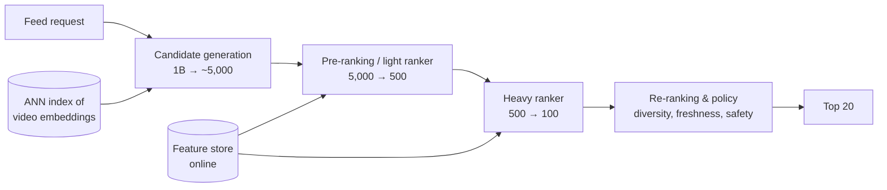
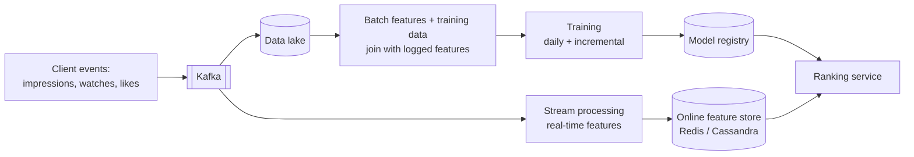

# AI 3. Design a Recommendation System (YouTube / TikTok home feed)

## Interview question

> Design the system that picks videos for a user's home feed. 500M DAU, a corpus of 1B videos, and new videos uploaded constantly. Optimize for long-term user satisfaction, not just clicks.

## Clarifying questions

| Question | Assumed answer |
|----------|----------------|
| Objective? | Long-term engagement/satisfaction: watch time, likes, shares, retention; penalize "not interested", skips |
| Latency? | Feed response < 200 ms |
| Corpus? | 1B items, ~1M new per day |
| Signals? | Watch history, likes, follows, search, demographics, context (device, time) |
| Cold start? | New users and new videos must be handled |
| Constraints? | Diversity, freshness, policy/safety filtering |

## ML problem framing

- **Input:** user + context. **Output:** ranked list of ~20 videos.
- Formulated as multi-task prediction: P(click), E[watch time], P(like), P(share), P(skip), P(not interested).
- Final score: weighted combination, e.g. `score = w1·E[watch_time] + w2·P(like) + w3·P(share) − w4·P(not_interested)`. Weights tuned through online experiments against long-term metrics (retention, survey satisfaction).

## Funnel architecture

You can't score 1B items per request. Use a multi-stage funnel:

| Stage | Model | Latency budget |
|-------|-------|----------------|
| Candidate generation | Two-tower embeddings + ANN, plus heuristic sources | ~30 ms |
| Pre-ranking | Small two-tower/GBDT | ~20 ms |
| Ranking | Large multi-task DNN (e.g., MMoE/DCN, transformer over user history) | ~60 ms |
| Re-ranking | Rules + diversity algorithm | ~10 ms |

## Deep dive 1: candidate generation

Multiple **retrieval sources** merged, each catching something different:
- **Two-tower model:** user tower (history, demographics) and item tower (content, metadata) produce embeddings; trained so dot product predicts engagement, with in-batch negatives + sampled negatives (and logQ correction for popularity bias). Item embeddings precomputed and indexed in ANN (HNSW / ScaNN); user embedding computed at request time.
- **Item-to-item:** "similar to videos you just watched" (co-engagement embeddings).
- **Social/subscription:** new uploads from followed creators.
- **Trending/fresh:** popular in your region; new uploads with an exploration budget.

## Deep dive 2: ranking model

- **Features:**
  - User: watch history (sequence of item IDs → embeddings), long/short-term interests, demographics.
  - Item: embeddings, creator, age, length, historical CTR/watch rate (smoothed).
  - Cross features: user–creator affinity, user–topic affinity, "has user seen similar".
  - Context: time, device, network.
- **Architecture:** shared bottom + task towers (MMoE) predicting each objective; sequence modeling of recent history (transformer / target attention like DIN).
- **Labels:** derived from logged impressions — click, watch fraction, like, etc. Watch time trained with weighted logistic regression or regression on log watch time.
- **Position bias:** items shown higher get clicked more regardless of quality. Add position as a feature in training (shallow tower) and set it to a constant at serving.

## Deep dive 3: features & data pipeline

- **Log features at serving time** and join with labels later ("feature logging") to avoid training-serving skew.
- Real-time features (last 10 videos watched in this session) are crucial for TikTok-style responsiveness.
- Train continuously / incrementally (hours-fresh models) because the content distribution shifts fast.

## Deep dive 4: re-ranking & business logic

- Filter: already watched, blocked creators, policy-violating or borderline content, age restrictions.
- **Diversity:** MMR or determinantal point processes to avoid 5 near-identical videos; cap items per creator/topic.
- Freshness boosts; insert exploration slots.

## Deep dive 5: cold start & exploration

- **New users:** popular/trending by region and language, onboarding interest picker, quickly adapt from first few interactions (session-based features).
- **New videos:** content embeddings (from video/audio/title models) let the item tower embed items with zero interactions; allocate guaranteed exploration impressions; bandit strategies (Thompson sampling / epsilon-greedy) to learn quality quickly.
- Exploration also fights the **feedback loop** where the model only learns about what it already shows.

## Evaluation

| Offline | Online |
|---------|--------|
| Recall@K for retrieval; AUC / log loss / NDCG per task for ranking; calibration | A/B tests: watch time per user, DAU retention, likes/shares, "not interested" rate, satisfaction surveys, creator-side metrics |

Offline gains don't always transfer online — the A/B test is the source of truth. Watch for novelty effects; run experiments for weeks for retention metrics.

## Scaling numbers

- 500M DAU × ~20 feed requests/day = 10B requests/day ≈ **115k QPS** (peak ~300k).
- Ranking 500 candidates per request → ~60M model inferences/s at peak → GPU inference with batching, or distilled models on CPU.
- Embedding tables for 1B items × 128 dims × fp16 = 256 GB → sharded parameter servers / embedding caches.

## Trade-offs

| Choice | Pro | Con |
|--------|-----|-----|
| Optimize clicks | Easy, fast feedback | Clickbait; hurts long-term satisfaction |
| Optimize watch time | Better proxy | Favors long videos; needs normalization |
| More funnel stages | Better quality per compute | Complexity; stage mismatch |
| Real-time training | Freshness | Stability, harder to validate |

## Follow-up interview questions

**Q: How do you avoid recommending the same type of content forever (filter bubble)?**
A: Diversity constraints in re-ranking, exploration budget, long-term objectives (survey satisfaction) in the reward, and explicit "show me less of this" controls.

**Q: Your new model has better AUC but the A/B test shows lower watch time. Why?**
A: Possible causes: offline metric not aligned with online objective, training-serving skew in features, the model ranks well on logged data biased by the old model (selection bias), calibration shift affecting downstream score blending, or latency increases reducing engagement.

**Q: How do you handle a viral video that was uploaded 10 minutes ago?**
A: Real-time engagement features (streaming counters), a trending candidate source, and item embeddings computed from content at upload time.

**Q: How do you choose the weights in the final score?**
A: Start with heuristics, then tune via online experiments or Bayesian optimization against the north-star metric; some teams learn them with a value model predicting long-term retention.
