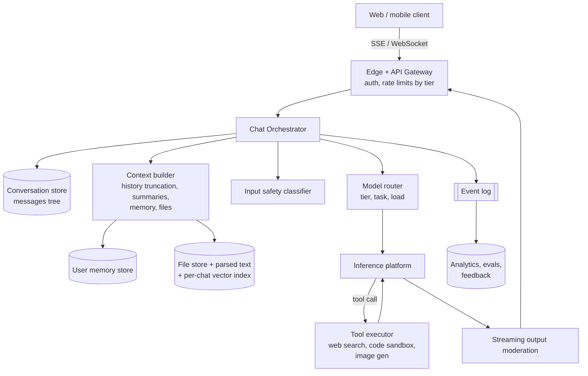

# AI 4. Design a ChatGPT-style Conversational Assistant

## Interview question

> Design a consumer chat assistant product like ChatGPT or Claude.ai: users have multi-turn conversations, responses stream in real time, the assistant can use tools (web search, code execution, file uploads), and remembers user preferences across chats. 50M DAU.

## Clarifying questions

| Question | Assumed answer |
|----------|----------------|
| Scale? | 50M DAU, ~10 messages each → 500M messages/day |
| Models? | We call an inference platform (see [LLM Inference Serving](02-llm-inference-serving.md)); multiple model tiers |
| Features? | Streaming chat, history, file uploads, web search, code interpreter, long-term memory |
| Tiers? | Free and paid with different models and limits |
| Safety? | Policy enforcement on inputs and outputs, abuse prevention |

## Requirements

**Functional:** create/continue conversations; stream responses; stop/regenerate/edit; conversation history list & search; attachments; tools; memory; share conversation links.
**Non-functional:** TTFT < 1 s; streaming resilient to network blips; durable history; cost control; safety; privacy (deletion, data controls).

## Estimation

- 500M messages/day ≈ **6k msgs/s**, peak ~15k/s.
- Tokens: avg prompt (with history) 3k tokens, output 400 → ~1.7T input + 200B output tokens/day → the dominant cost. Context management and prefix caching are first-order design concerns.
- Concurrent streams: 15k/s × ~10 s per response ≈ **150k concurrent streaming connections**.
- Storage: 500M × 2 KB = 1 TB/day of conversation text.

## High-level design



## Deep dive 1: streaming & resilience

- Server-Sent Events (simple, HTTP-friendly) or WebSockets. Each token chunk is forwarded as soon as it's generated.
- **Decouple generation from the connection:** the orchestrator writes tokens into a per-message buffer (e.g., Redis stream keyed by message_id) as it generates. If the client disconnects (phone locks), generation continues; the client reconnects and resumes from its last offset. Final message persisted to the conversation store.
- "Stop generating" → cancel signal to the inference request (frees GPU).

## Deep dive 2: conversation data model

Edits and regenerations create **branches**, so a conversation is a tree:

```
conversations(conv_id, user_id, title, created_at, updated_at, model, is_archived)
messages(message_id, conv_id, parent_id, role, content_parts[], model, tokens, created_at, status)
-- current view = path from root to the selected leaf
```

Store in a horizontally scalable DB partitioned by `user_id` (e.g., Cassandra/DynamoDB, or sharded Postgres). Conversation list sorted by `updated_at`; title generated asynchronously by a small model after the first exchange.

## Deep dive 3: context management

Context windows are large but tokens cost money and long contexts degrade quality.
1. System prompt (+ tool definitions) — stable prefix → **prefix-cache friendly**. Keep it byte-identical across requests.
2. Relevant memories about the user.
3. Conversation history: keep recent turns verbatim; summarize older turns (rolling summary) once over a budget.
4. File content: small files inline; large files chunked into a per-conversation vector index and retrieved (mini-RAG).
5. Current user message.

Ordering stable content first maximizes KV prefix-cache hits on the inference side, cutting TTFT and cost dramatically for long chats.

## Deep dive 4: tools / function calling

- The model emits a structured tool call (`{"name":"web_search","arguments":{...}}`); the orchestrator executes it and appends the result, then continues generation. Loop until a final answer (cap iterations).
- **Code interpreter:** run in isolated sandboxes (gVisor/Firecracker microVMs), no network by default, CPU/memory/time limits, per-conversation ephemeral filesystem.
- **Web search:** call a search API, fetch pages, extract text; treat fetched content as untrusted (prompt injection risk) — the model shouldn't follow instructions inside pages, and sensitive actions require user confirmation.
- Stream tool status to UI ("Searching the web…").

## Deep dive 5: long-term memory

- After conversations, a background job uses an LLM to extract durable facts/preferences ("prefers Python", "is vegetarian") → store with embeddings in a per-user memory store.
- At request time, retrieve the top relevant memories into context.
- User controls: view, edit, delete memories; turn memory off; temporary chats that never write memory. Avoid storing sensitive categories unless explicitly asked.

## Deep dive 6: safety & abuse

- Input classifiers (fast, small models) for clear policy violations; the main model is also trained to refuse.
- Output moderation on the stream in windows (buffer a few tokens / sentences) so harmful content can be cut mid-stream.
- Abuse: rate limits per account/IP/device, anomaly detection for automated scraping, CAPTCHA for suspicious traffic, account-level enforcement.
- See [LLM Evaluation & Guardrails](10-llm-evaluation-guardrails.md).

## Deep dive 7: model routing & cost

- Free tier → smaller/cheaper model, stricter limits; paid → larger models.
- Route by task complexity (a classifier decides if a "quick" model suffices), and fall back to another model/region when one is overloaded.
- Usage limits measured in messages or tokens per window per tier.

## Privacy

- Encrypt at rest; deletion propagates to conversation store, memories, file stores, and backups within a defined window.
- Opt-out of training data use; enterprise tier with zero data retention and tenant isolation.

## Trade-offs

| Choice | Pro | Con |
|--------|-----|-----|
| SSE vs WebSocket | SSE simpler, works over HTTP/2 | One-directional; separate POST for cancel |
| Summarize old history | Cheaper, fits context | Loses details; summaries can drift |
| Memory | Personalization | Privacy risk, creepy-factor, wrong memories |
| Output moderation on stream | Can stop harm mid-stream | Adds latency, false positives cut good answers |

## Follow-up interview questions

**Q: How would you implement "regenerate response"?**
A: Create a sibling message with the same parent and re-run generation with sampling; UI lets users flip between siblings. Feedback across siblings gives preference data (useful for training).

**Q: Inference capacity is suddenly reduced by 30%. What do you do?**
A: Graceful degradation: prioritize paid tiers, lower max output tokens, route free users to smaller models, queue with an honest "high demand" message, disable expensive tools temporarily.

**Q: How do you measure if a new model version is better for users?**
A: Offline eval suites + side-by-side human/LLM-judge preference evals, then A/B tests on engagement, thumbs ratio, regeneration rate, conversation length, and retention, with safety metrics as guardrails.

**Q: How do you search over a user's chat history?**
A: Index messages in a per-user partitioned full-text index (plus optional embeddings for semantic search), updated asynchronously on message completion.
