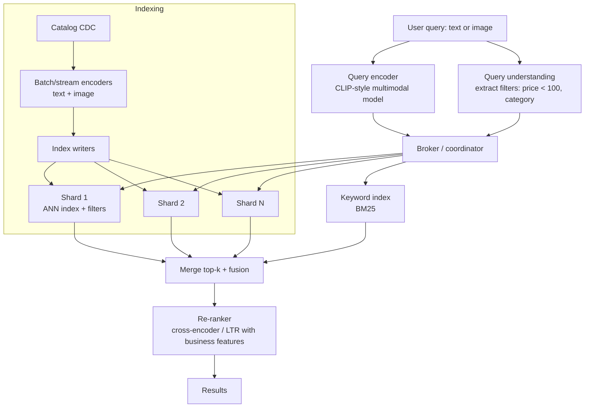

# AI 6. Design Semantic Search / a Vector Database

## Interview question

> Design a semantic search service for an e-commerce catalog of 1B products (text + images). Users search in natural language ("comfy shoes for standing all day") or by photo. Also explain how the underlying vector database works at this scale.

## Clarifying questions

| Question | Assumed answer |
|----------|----------------|
| Corpus? | 1B items, ~10M updates/day (price, stock, new listings) |
| Query load? | 50k QPS peak |
| Latency? | Search p99 < 150 ms end-to-end; vector retrieval < 30 ms |
| Filters? | Category, price, brand, in-stock, region — must be combinable with vector search |
| Modalities? | Text queries and image queries |
| Recall target? | ANN recall@100 ≥ 95% vs exact search |

## Requirements

**Functional:** text/image query → ranked products; metadata filters; near-real-time index updates; deletes.
**Non-functional:** low latency at high QPS; high recall; horizontal scalability; cost efficiency (memory is the main cost).

## Estimation

- Embeddings: 1B × 768 dims × 4 B = **3 TB** in float32. Options:
  - int8 scalar quantization: 768 GB
  - Product quantization (PQ, 64 bytes/vector): **64 GB** (+ re-ranking with full vectors on SSD)
- HNSW graph overhead: ~M×2×4 B per vector (M=32 → ~256 B) → 256 GB.
- 50k QPS × (searches across N shards) → many shard-level queries; replicas scale QPS.

## High-level design

## Deep dive 1: embeddings

- Use a **multimodal dual encoder** (CLIP/SigLIP-style) so text queries and product images live in the same space; also a text encoder over title + attributes + description.
- **Fine-tune** on in-domain data: (query, clicked/purchased product) pairs from search logs, with hard negatives (shown but not clicked). Off-the-shelf models underperform on catalog jargon.
- Version embeddings: a model change means re-encoding 1B items (a big batch job on GPUs) and building a new index side by side, then switching traffic.

## Deep dive 2: ANN index choices

| Index | How it works | Pros | Cons |
|-------|--------------|------|------|
| Flat (brute force) | Compare against all | Exact | O(N) — too slow at 1B |
| **HNSW** | Multi-layer proximity graph; greedy search from top layer down | Excellent recall/latency | Memory-heavy; slower builds; deletes are tricky |
| **IVF** | k-means into ~√N clusters; search the `nprobe` nearest clusters | Smaller, fast builds | Lower recall at low nprobe |
| **IVF-PQ** | IVF + product-quantized vectors | Very compact (fits 1B in RAM) | Lossy → re-rank top candidates with full vectors |
| DiskANN (Vamana) | Graph index on SSD with compressed vectors in RAM | Billion-scale on one machine | SSD latency; more engineering |

**Chosen:** per shard, HNSW over int8/PQ-compressed vectors held in RAM, with full-precision vectors on SSD to re-score the top ~200 candidates. Tune `efSearch` (HNSW) or `nprobe` (IVF) to trade latency for recall.

## Deep dive 3: filtering with vector search

Filters (e.g., `category = shoes AND price < 100 AND in_stock`) are the most common practical problem.
- **Post-filtering:** ANN top-k, then drop non-matching → may return too few results for selective filters.
- **Pre-filtering:** compute the matching ID set (bitmap from inverted indexes), then search only within it. For very selective filters, brute-force over the small set is faster than ANN.
- **Filtered graph traversal (chosen):** traverse HNSW while skipping non-matching nodes but still using them for navigation; fall back to brute force when the filter matches < ~1% of the shard.
- **Partitioning** by a high-selectivity, always-present attribute (e.g., region or top-level category) reduces search space.

## Deep dive 4: sharding, replication, updates

- **Sharding:** random/hashed sharding by item ID → each query fans out to all shards (scatter-gather), balanced load. Alternative: cluster-based sharding (route the query only to shards whose centroids are near) → fewer shards per query, but hot spots and lower recall.
- **Replication:** each shard has R replicas for QPS and availability; tail latency mitigated by hedged requests.
- **Updates:** new vectors go to a small mutable in-memory segment (brute-force or small HNSW) searched alongside large immutable segments; periodically merged/rebuilt (LSM-like). Deletes via tombstone bitmaps applied at query time, purged on compaction.
- Fast-changing attributes (price, stock) live in the filter/attribute store, not in the vector — no re-embedding needed.

## Deep dive 5: ranking quality

Vector similarity alone is not enough for commerce:
- **Hybrid retrieval:** BM25 for exact matches (model numbers, brands) + vectors for semantic intent, fused via RRF or learned weights.
- **Re-ranker:** a learning-to-rank model (GBDT or cross-encoder) using relevance score + business features (CTR, conversion rate, ratings, price, availability, personalization).
- **Metrics:** offline NDCG@10 / recall on judged query sets; online CTR, add-to-cart, conversion, zero-result rate, query reformulation rate.

## Trade-offs

| Tension | Lever |
|---------|-------|
| Recall vs latency | `efSearch`/`nprobe`, re-rank depth |
| Memory vs accuracy | Quantization level (float32 → int8 → PQ) |
| Freshness vs efficiency | Mutable segment size, merge frequency |
| Fan-out vs routing | Hash sharding (simple, all shards) vs cluster routing (cheaper, risky recall) |

## Follow-up interview questions

**Q: When would you use pgvector instead of a dedicated vector DB?**
A: When data is ≤ tens of millions of vectors, you already run Postgres, and you want transactional consistency with relational data and joins. At 1B vectors with 50k QPS, a purpose-built distributed system is more efficient.

**Q: How do you measure ANN recall in production?**
A: Periodically sample queries, run exact brute-force search offline on the same shard snapshot, and compute overlap of top-k. Alert if recall drops (e.g., after index parameters change or data distribution shifts).

**Q: Cosine vs dot product vs L2?**
A: Use what the model was trained with. With L2-normalized vectors, cosine and dot product are equivalent and L2 ranking is identical. Unnormalized dot product also encodes magnitude (e.g., popularity), which can be desirable for recommendation.

**Q: How do you handle a query like "red dress under $50"?**
A: Query understanding extracts structured filters (color=red is soft; price<50 is hard) with a parser/LLM; hard constraints become filters, the rest goes into the embedding query.
