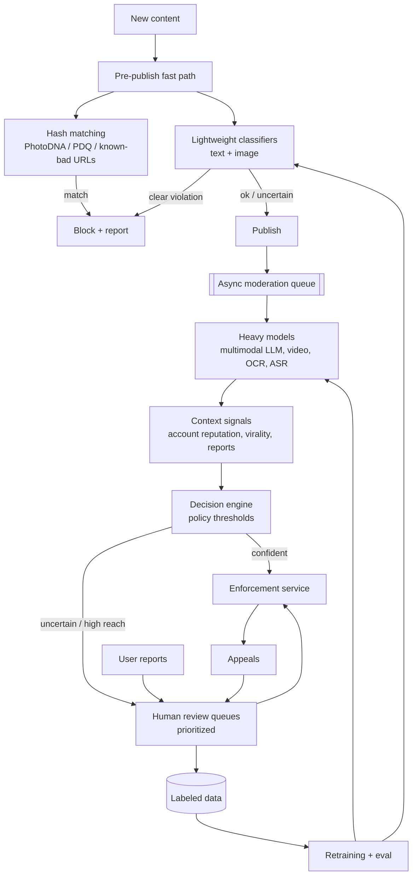

# AI 7. Design a Content Moderation System

## Interview question

> Design a system that detects and acts on policy-violating content (hate speech, nudity, violence, spam, scams) across posts, comments, images, and videos on a social platform. 1B new pieces of content per day, in 50+ languages.

## Clarifying questions

| Question | Assumed answer |
|----------|----------------|
| Content types? | Text, images, video, live streams (follow-up) |
| Timing? | Pre-publication blocking for severe harms (CSAM, malware links); post-publication for the rest |
| Actions? | Remove, reduce distribution, age-gate, warning label, account strike, escalate to law enforcement (CSAM) |
| Human reviewers? | ~10k reviewers globally |
| Appeals? | Required |
| Metrics? | Prevalence of violating views, precision (avoid over-removal), time-to-action |

## Requirements

**Functional:** classify content against a policy taxonomy; take graduated actions; route uncertain cases to humans; user reporting; appeals; policy updates.
**Non-functional:** pre-publish check < 200 ms for text/images; high recall for severe harms; high precision for automated removals; scalable; auditable and explainable decisions; reviewer wellbeing.

## Estimation

- 1B items/day ≈ **12k/s** (peak ~30k/s); ~70% text, 25% images, 5% video.
- Video: frame sampling (1 fps) + audio transcription → expensive; cascade aggressively.
- Human review capacity: 10k reviewers × ~800 items/day = **8M reviews/day** → < 1% of content. Automation must handle > 99%, and the queue needs prioritization.

## ML framing

- Multi-label classification per policy category with severity: `P(hate)`, `P(nudity)`, `P(violence)`, `P(spam)`, ...
- Decision per category uses **thresholds tuned to a precision target**: e.g., auto-remove if P > 0.98 (precision ≥ 99%), send to review if 0.7 < P < 0.98, reduce distribution if 0.5 < P < 0.7.

## High-level design

## Deep dive 1: classifier cascade

Cost grows ~10–1000× from stage to stage, so most content should exit early:
1. **Hash matching** (perceptual hashes like PDQ for images, video hashes; industry hash-sharing databases for CSAM/terror content): near-zero cost, near-perfect precision for known content.
2. **Fast classifiers:** distilled multilingual text transformer, small CNN/ViT for images — run on everything, ~ms each.
3. **Heavy models:** large multimodal models (image+text jointly — a benign image with a hateful caption), OCR on images (text-in-image spam), ASR for video/audio, LLM-based policy reasoning for nuanced categories. Run only on candidates flagged by stage 2, high-reach content, or reported content.

## Deep dive 2: context matters

Content alone isn't enough:
- **Account signals:** age, prior strikes, network of accounts (coordinated inauthentic behavior detected via graph models).
- **Distribution signals:** predicted/actual reach — a borderline post going viral deserves more scrutiny than one seen by 3 people.
- **Conversation context:** the parent post for a comment; reclaimed slurs vs attacks.

## Deep dive 3: human review

- **Prioritization:** queue ordered by `severity × predicted reach × model uncertainty`. Severe harms (self-harm, CSAM) go to specialized trained teams with SLAs in minutes.
- **Routing:** by language, region, policy expertise.
- **Tooling:** policy guidance inline, blurred-by-default media, grayscale, exposure limits per reviewer for wellbeing.
- **Quality:** multiple reviewers on a sample to measure agreement; golden-set audits; reviewer accuracy tracking.
- Decisions become **training labels** (with care: reviewer disagreement → soft labels).

## Deep dive 4: training data & evaluation

- Labeled data: reviewer decisions, appeals outcomes (corrections), targeted labeling of model-uncertain samples (**active learning**), synthetic data generation from LLMs for rare categories/languages.
- **Class imbalance:** violations are rare (<1%) → stratified sampling, focal loss, evaluate with precision/recall at operating points (not accuracy).
- **Metrics:**
  - Prevalence: fraction of *views* on violating content (estimated by sampling random views and labeling) — the north-star.
  - Proactive rate: % actioned before any user report.
  - Precision of automated actions (measured by appeals overturn + audits).
  - Per-language/per-dialect fairness slices (avoid over-enforcing on dialects like AAVE).
- **Adversarial drift:** spammers adapt (leetspeak, text in images, misspellings) → monitor score distributions, rapid retraining, LLM-based zero-shot classifiers for new trends.

## Deep dive 5: policy agility with LLMs

- Policies change (new scam type, election rules). Training a classifier takes weeks.
- Use an **LLM with the written policy in the prompt** as a zero/few-shot classifier for new policies or to label data quickly; then distill into a cheap classifier once enough labels exist.
- Keep policy definitions versioned; decisions logged with policy version for auditability.

## Enforcement

- Graduated actions: label → downrank → remove → strike → suspension.
- Notify users with the specific policy and appeal path (legal requirements like the EU DSA require statements of reasons and transparency reports).
- Idempotent enforcement service; propagates to caches/CDN (purge removed media).

## Trade-offs

| Tension | Discussion |
|---------|------------|
| Precision vs recall | Over-removal harms speech and trust; under-removal harms users. Different thresholds per severity |
| Pre- vs post-publish | Pre-publish adds latency and must be fast; post-publish allows brief exposure |
| Automation vs humans | Humans are accurate on nuance but slow and costly; reserve them for uncertainty and high impact |
| Global model vs per-language | Multilingual models generalize; low-resource languages need targeted data |

## Follow-up interview questions

**Q: How would you moderate live video streams?**
A: Sample frames every few seconds + streaming ASR on audio; run fast classifiers continuously; escalate high-risk streams (by account reputation and viewer count) to human monitors who can end the stream; hash-match against known violent footage.

**Q: A new scam spreads using images of text to evade text classifiers. Response?**
A: Add OCR into the pipeline for images with text, write the policy into an LLM classifier for immediate coverage, hash-cluster the near-duplicate images (one review → action on all), and collect labels to retrain the fast classifiers.

**Q: How do you know if your models are biased against a dialect or group?**
A: Build evaluation slices per language/dialect/topic with balanced labeled sets; compare false-positive rates; review appeal overturn rates by slice; fix with targeted data and per-slice thresholds where justified.

**Q: How do you prevent brigading through mass reporting?**
A: Weight reports by reporter reliability (historical accuracy), dedupe coordinated reporters, never auto-remove based on report count alone.
