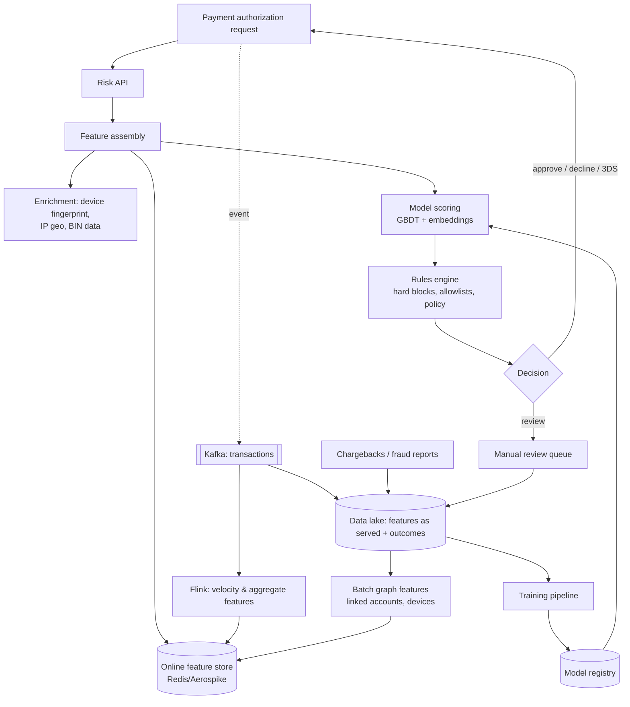

# AI 8. Design a Real-time Fraud Detection System

## Interview question

> Design a system that scores every card payment for fraud risk in real time before authorization, for a payments company processing 5,000 transactions per second at peak. Decide approve / decline / step-up authentication (3-D Secure) within 100 ms.

## Clarifying questions

| Question | Assumed answer |
|----------|----------------|
| Decision latency? | p99 < 100 ms for the whole risk check (model ~10–20 ms) |
| Labels? | Chargebacks arrive 30–90 days later; some confirmed fraud reports faster |
| Fraud rate? | ~0.1% of transactions |
| Cost asymmetry? | Missed fraud costs the amount + fees; false declines lose revenue and customers |
| Actions? | Approve, decline, step-up (3DS/OTP), manual review for high-value |
| Explainability? | Needed for analysts and some regulatory contexts |

## Requirements

**Functional:** score each transaction; apply rules + model decision; manual review queue; analyst tools; feedback from chargebacks.
**Non-functional:** low latency; high availability (fail to a safe fallback, not to "approve everything"); correct real-time features; auditable decisions.

## Estimation

- 5k TPS peak; ~200M transactions/day at ~2.3k avg.
- Features per transaction: ~500, many from streaming aggregates (velocity counters).
- Training data: 200M/day × 90 days = 18B rows; fraud positives ~18M. Downsample negatives for training.

## High-level design



## Deep dive 1: features

Fraud detection is mostly a **feature engineering** problem.

| Group | Examples |
|-------|----------|
| Transaction | amount, currency, merchant category (MCC), card-present vs not, time of day |
| Velocity (streaming) | # transactions on card in last 1 min / 1 h / 24 h; # distinct merchants in 1 h; amount sum in 24 h; # cards used on this device in 24 h |
| Behavioral deviation | amount vs card's typical amount (z-score); new merchant for this card; distance from last transaction location / time (impossible travel) |
| Device & network | device fingerprint age, emulator flags, IP reputation, proxy/VPN/Tor, IP–billing country mismatch |
| Entity graph | shared devices/emails/addresses between accounts; proximity to known fraudsters (graph embeddings / label propagation) |
| Merchant | merchant's historical fraud rate, new merchant |

**Real-time correctness:** velocity features must include the transactions from seconds ago. Use Flink with keyed state per card/device/IP, sliding windows, updating the online store within ~1 s. For the most critical counters, increment synchronously in the risk path (Redis `INCR` with TTL buckets).

**Training-serving skew:** log the exact feature vector used at decision time and train on those logged values (point-in-time correctness). Recomputing features later leaks future information.

## Deep dive 2: modeling

- **Baseline/workhorse: gradient-boosted trees** (XGBoost/LightGBM) — strong on tabular data, fast (< 5 ms), interpretable via SHAP.
- **Add:** sequence models over a card's recent transactions (embeddings fed as features), graph neural networks for fraud rings (computed in batch).
- **Imbalance:** downsample negatives (and reweight), or use class weights; evaluate with PR-AUC, precision@recall, and dollar-weighted metrics, not ROC-AUC alone.
- **Calibration:** calibrated probabilities let the decision layer apply cost-based thresholds.

## Deep dive 3: decision layer

Choose actions to minimize expected cost:
```
expected_loss_if_approve = P(fraud) × (amount + chargeback_fee)
expected_loss_if_decline = (1 − P(fraud)) × margin_lost × customer_churn_factor
step-up when uncertain: friction cost < expected fraud savings
```
- Rules engine handles hard constraints (sanctions, blocked BINs, merchant-specific rules) and quick responses to new attacks (analysts can deploy a rule in minutes; models take days).
- **Champion/challenger:** a new model scores in shadow mode on live traffic before taking decisions.

## Deep dive 4: labels & feedback loop

- **Label delay:** chargebacks arrive weeks later. Train on data ≥ 90 days old for mature labels, plus faster partial labels (user reports, confirmed fraud from review) for recency. Weight recent fraud patterns.
- **Selection bias:** declined transactions never get outcomes (we don't know if they were fraud). Mitigate by approving a tiny random sample of would-be-declines with low amounts (exploration), or by using step-up outcomes as labels.
- **Adversarial drift:** fraudsters adapt. Monitor feature and score distributions (PSI), fraud rates by segment, and retrain frequently (weekly), with emergency rules in between.

## Deep dive 5: reliability & latency

- Latency budget: feature fetch 10–20 ms (single batched lookup), enrichment 10 ms (cached), model 5 ms, rules 5 ms.
- Model served in-process or via a low-latency server (Triton/ONNX runtime) colocated with the risk API.
- **Fallback:** if the feature store or model times out, fall back to a simpler rules-based model with conservative thresholds — never blanket-approve.
- Multi-region active-active; online features replicated.

## Manual review

- High-value or ambiguous transactions (or new merchant accounts) → analysts with a case tool: score, top SHAP reasons, linked entities graph, history.
- Analyst decisions feed labels and new rule ideas.

## Trade-offs

| Choice | Pro | Con |
|--------|-----|-----|
| GBDT vs deep model | Fast, interpretable, strong on tabular | Less capable on sequences/graphs (use as features) |
| Rules vs ML | Instant response, explainable | Brittle, rule explosion over time |
| More real-time features | Better detection | Infra complexity, consistency issues |
| Lower thresholds | Catch more fraud | More false declines and friction |

## Follow-up interview questions

**Q: Model precision dropped suddenly last week. How do you debug?**
A: Check data pipeline health first (missing/defaulted features, feature store lag, schema change in a source), then distribution shifts (PSI per feature), segment-level fraud rates (a new attack on one merchant/BIN?), and recent deployments (model/rules). Compare logged features to expected ranges.

**Q: How do you evaluate a new model offline given label delay?**
A: Backtest on a time-based split with mature labels (train on months 1–6, test on month 8), measuring dollar-weighted recall at fixed false-positive rate; then shadow-score live traffic to check score distribution and latency before an A/B.

**Q: How do you detect fraud rings?**
A: Build an entity graph (cards, accounts, devices, IPs, emails, addresses). Run connected components / community detection and GNNs in batch; features like "distance to a confirmed fraud node" go into the real-time model; analysts get a graph view.

**Q: Why not use an LLM for this?**
A: Latency and cost at 5k TPS with a 100 ms budget, and tabular models outperform on this data. LLMs can help analysts (summarizing cases, explaining reasons) or extract signals from unstructured data (merchant descriptions) offline.
