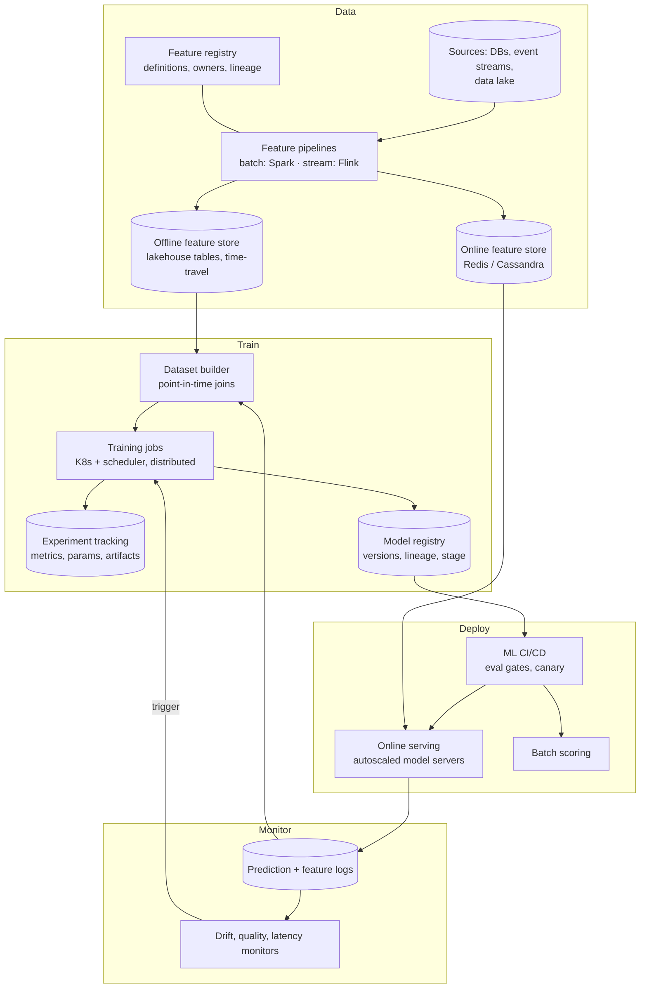

# AI 9. Design an ML Training & Feature Platform (MLOps)

## Interview question

> Design an internal ML platform used by 50 teams to build, train, deploy, and monitor models (ranking, fraud, forecasting, LLM fine-tunes). Today every team has its own scripts and models frequently break in production due to data issues. Fix that.

## Clarifying questions

| Question | Assumed answer |
|----------|----------------|
| Model types? | Tabular (GBDT), deep learning (PyTorch), LLM fine-tuning (LoRA/full) |
| Compute? | Shared GPU cluster (~2,000 GPUs) + CPU for batch |
| Serving? | Online (low latency), batch scoring, streaming |
| Pain points? | Training–serving skew, non-reproducible models, slow deployments, silent model decay |
| Users? | ~300 data scientists / ML engineers |

## Requirements

**Functional:** feature definition & serving; dataset/version management; experiment tracking; distributed training; model registry; deployment (online/batch); monitoring & retraining; governance.
**Non-functional:** reproducibility; self-serve; efficient GPU utilization; reliability of production models; security & access control on data.

## High-level design

## Deep dive 1: feature store (fixing training–serving skew)

Skew happens when features are computed differently in training (SQL on the warehouse) and serving (Java code in a service).
- **Define once, compute for both:** a feature is declared in the registry (`card_txn_count_1h`, entity = card, source, transformation, TTL). The platform generates both the batch backfill and the streaming/online computation from the same definition.
- **Point-in-time correct joins:** training datasets join each label with feature values *as of the label's timestamp* (time-travel tables). Prevents label leakage from future data.
- **Online store** serves the latest values with low latency; **offline store** keeps full history.
- **Feature logging:** log features at serving time and use them for future training — the strongest guarantee against skew.
- Registry provides discovery, ownership, lineage, and freshness SLAs so teams reuse features rather than re-inventing them.

## Deep dive 2: training infrastructure

- **Job specs** (container image + code commit + dataset version + config + hyperparameters) → reproducible runs; every artifact is lineage-tracked.
- **Scheduler:** Kubernetes with a batch scheduler (Kueue/Volcano/Slurm-on-K8s) handling **gang scheduling** (all workers of a distributed job start together), quotas per team, priorities and preemption (production retraining > research experiments), bin-packing for GPU utilization.
- **Distributed training:** data parallel (DDP) for most; FSDP/ZeRO or tensor/pipeline parallel for large models; fault tolerance via frequent async checkpoints to object storage (large jobs will hit GPU failures).
- **Data loading:** stream from columnar formats (Parquet) / sharded datasets; cache on local NVMe; avoid GPUs idling on I/O.
- **HPO:** built-in hyperparameter search (Bayesian / ASHA early stopping).

## Deep dive 3: model registry & CI/CD

- Registry stores: artifact, signature (input/output schema), training data version, metrics, owner, stage (`staging → production → archived`).
- **Promotion pipeline (CI/CD for ML):**
  1. Unit tests on feature code and model code.
  2. Data validation on the training set (schema, nulls, distribution vs previous).
  3. Offline evaluation vs current production model on a fixed holdout + critical slices; must not regress beyond thresholds.
  4. Shadow deployment: score live traffic without acting; compare predictions and latency.
  5. Canary / A/B test with automatic rollback on guardrail metrics.
- Same container used in evaluation and serving.

## Deep dive 4: serving

- Online: model servers (Triton, TorchServe, KServe, or custom) with autoscaling on latency/QPS; GPU for deep models, CPU for GBDT; request batching.
- Batch: scheduled Spark/Ray jobs writing predictions to tables or KV stores (e.g., nightly churn scores).
- LLMs: delegate to the [LLM inference platform](02-llm-inference-serving.md), with fine-tuned adapters registered in the same model registry.

## Deep dive 5: monitoring

| Signal | Detects | Method |
|--------|---------|--------|
| Data quality | Broken pipelines, nulls, schema change | Expectations on feature logs (Great Expectations-style) |
| Feature drift | Input distribution shift | PSI / KL / KS tests vs training distribution |
| Prediction drift | Model behavior change | Score distribution monitoring |
| Performance | Actual quality decay | Join delayed labels → AUC, precision over time |
| Operational | Latency, errors, cost | Standard SRE metrics |

Alerts route to the owning team; drift + performance decay can trigger automated retraining (with the same CI/CD gates — never auto-promote without evaluation).

## Governance

- Access control on datasets (PII), audit logs of who trained on what.
- Model cards: intended use, limitations, fairness evaluation.
- Reproducibility: any production model can be rebuilt from its lineage.

## Trade-offs

| Choice | Pro | Con |
|--------|-----|-----|
| Opinionated "golden path" platform | Consistency, fast for common cases | Constrains advanced teams → allow escape hatches |
| Build vs buy (SageMaker/Vertex/Databricks) | Buy is faster to start | Lock-in, cost, less customization |
| Centralized GPU pool | High utilization | Contention → quotas, preemption, fair-share |
| Auto-retraining | Fresh models | Risk of silently learning from bad data → gates |

## Follow-up interview questions

**Q: A model's performance dropped but no drift alert fired. Why?**
A: Concept drift (P(y|x) changed while P(x) is stable — e.g., fraudsters change tactics using similar-looking transactions), drift in a feature not monitored, or label definition changes. Performance monitoring with delayed labels and slice-level metrics catch this.

**Q: How do you improve GPU utilization from 35% to 70%?**
A: Measure first (idle allocated GPUs vs inefficient jobs). Fix: queue-based scheduling with preemption and backfill, fractional GPU / MIG for small jobs and notebooks, idle notebook reclamation, data-loader optimizations, mixed precision, larger batches.

**Q: How do you handle feature freshness for real-time models?**
A: Streaming feature pipelines with per-feature freshness SLAs; the online store records update timestamps; serving checks staleness and uses fallbacks; monitor end-to-end lag.

**Q: What's the minimum viable version of this platform?**
A: Experiment tracking + model registry + a standardized training container + one deployment path with offline eval gates and basic monitoring. Add the feature store once multiple teams need shared online features.
