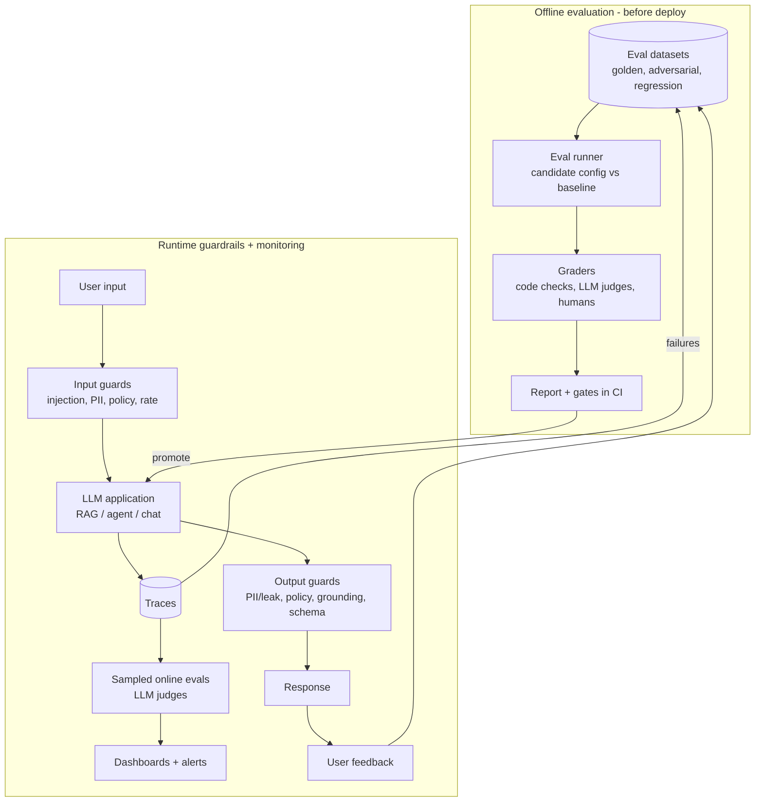

# AI 10. Design an LLM Evaluation & Guardrails System

## Interview question

> Your company ships several LLM features (support chatbot, RAG search, code assistant, agents). Prompt and model changes keep causing regressions nobody notices until customers complain, and there was an incident where the chatbot leaked another customer's data via prompt injection. Design the evaluation and guardrails system.

## Clarifying questions

| Question | Assumed answer |
|----------|----------------|
| What changes? | Prompts, models/versions, retrieval configs, tools — weekly or more often |
| Scale? | ~5M LLM requests/day across products |
| Latency budget for guardrails? | < 150 ms added on the request path |
| Data sensitivity? | Customer PII; multi-tenant |
| Human labelers? | Small expert team + vendor labelers |

## Requirements

**Functional:** offline evaluation before deploy; online monitoring of quality and safety in production; runtime guardrails (input/output checks, PII, injection defense, policy); feedback collection; regression dashboards.
**Non-functional:** low added latency; evals trusted (correlate with human judgment); reproducible; cheap enough to run on every change.

## Two halves

## Deep dive 1: eval datasets

- **Golden set:** a few hundred to a few thousand representative inputs per feature, with reference answers or rubrics, curated by domain experts. Stratified by intent/difficulty/language.
- **Regression set:** every production incident or bad-feedback example becomes a test case.
- **Adversarial/red-team set:** jailbreaks, prompt injections (direct and indirect via documents/tool outputs), PII extraction attempts, cross-tenant probes.
- **Synthetic generation:** LLMs generate variations and edge cases, filtered by humans.
- Version datasets; avoid leakage into fine-tuning data.

## Deep dive 2: graders

| Grader type | Use for | Notes |
|-------------|---------|-------|
| Deterministic code | JSON validity, exact match, unit tests for code assistant, tool-call correctness, latency/cost | Cheap, reliable — use whenever possible |
| Reference similarity | Short factual answers | Embedding similarity / F1; weak for long answers |
| **LLM-as-judge** | Faithfulness, relevance, helpfulness, tone, policy compliance | Rubric-based, pairwise comparison (A vs B) is more reliable than absolute scores |
| Human review | Calibrating judges, high-stakes decisions | Expensive; sample-based |

**Making LLM judges trustworthy:**
- Specific rubrics with examples per score; ask for reasoning before the verdict.
- **Calibrate** against human labels (measure agreement, e.g., Cohen's κ); re-check when the judge model changes.
- Mitigate biases: position bias (swap A/B order and average), verbosity bias, self-preference (judge with a different model family).
- For RAG: decompose into claims and check each against retrieved context (faithfulness), plus retrieval metrics (recall@k).

## Deep dive 3: CI gates

- Every change (prompt, model, retrieval parameter) runs the eval suite against the baseline.
- Gate on: no regression beyond threshold on key metrics; zero failures on critical safety tests; cost/latency within budget.
- Report statistical significance (bootstrap confidence intervals) — LLM outputs are noisy; run multiple samples for non-zero temperature.
- Results tracked over time per feature.

## Deep dive 4: runtime guardrails

**Input side**
- **Prompt-injection detection:** classifier for direct injections; but assume detection is imperfect.
- **PII detection/redaction** (NER + regex) where data shouldn't reach the model or logs.
- Topic/policy classifier (e.g., off-topic for a support bot), rate limits/abuse detection.

**Architecture-level defenses (more important than classifiers):**
- **Tenant isolation:** retrieval and tools filter by the authenticated tenant/user *in code*, never by instructions in the prompt. The data-leak incident is fundamentally an authorization bug — the LLM should never have had access to the other customer's data.
- Least-privilege tools; human confirmation for side-effecting actions; treat all retrieved/tool content as untrusted.
- Separate system instructions from untrusted data with clear delimiters; don't let untrusted content trigger privileged tools ("dual LLM" / quarantined-LLM pattern for processing untrusted text).

**Output side**
- PII / secret leak detection (other tenants' identifiers, API keys, system prompt leakage).
- Policy/toxicity classifier.
- Grounding check for RAG (claims supported by sources) on high-stakes answers.
- Schema validation for structured output; retry or fallback on failure.

**Latency:** run guards in parallel with the main call where possible (input guards concurrently with retrieval), use small fast classifiers (~10–30 ms), and stream output while checking in windows.

## Deep dive 5: online monitoring

- Trace every request: inputs, retrieved docs, prompt version, model version, outputs, tool calls, latency, tokens, cost.
- Sample ~1–5% of traffic for LLM-judge scoring (faithfulness, helpfulness, policy) → dashboards per feature/prompt version; alert on drops.
- Implicit signals: thumbs, regenerate rate, user rephrasing, escalation to human, conversation abandonment.
- Clustering of failures (embedding clusters of low-scored traces) to find new failure modes → feed into regression sets.
- Privacy: PII-redact traces, retention limits, access controls.

## Trade-offs

| Tension | Discussion |
|---------|------------|
| Guardrail strictness vs helpfulness | Over-refusal frustrates users; measure false positive rate of guards too |
| LLM judge cost vs coverage | Judge sampled traffic, not all; use small judge models where calibrated |
| Classifier defenses vs architecture | Classifiers reduce risk; only authorization and isolation eliminate classes of attacks |
| Offline vs online evals | Offline is controlled and pre-deploy; online catches real-world distribution — need both |

## Follow-up interview questions

**Q: How do you evaluate an agent that takes 20 steps?**
A: Evaluate end state (task completed correctly, verified by checking the environment), plus trajectory metrics (steps, cost, policy violations, unnecessary tool calls). Use sandboxed simulated environments for repeatability; run each task multiple times and report pass rates (pass@k / pass^k for reliability).

**Q: The LLM judge says the new prompt is better but users disagree. What happened?**
A: The judge isn't aligned with users: maybe verbosity bias (longer answers score higher), the eval set doesn't represent real traffic, or the rubric misses what users value. Recalibrate against human preferences from real traffic and refresh the dataset from production samples.

**Q: How do you prevent the system prompt from being leaked?**
A: Assume it can be leaked — don't put secrets in it. Detect verbatim system prompt fragments in outputs (n-gram match) and block/refuse, but security must not depend on prompt secrecy.

**Q: How do you choose which model to use for a feature?**
A: Run the same eval suite across candidate models; plot quality vs cost vs latency; pick the cheapest model meeting the quality bar, possibly with routing (small model by default, escalate hard queries to a bigger one).
