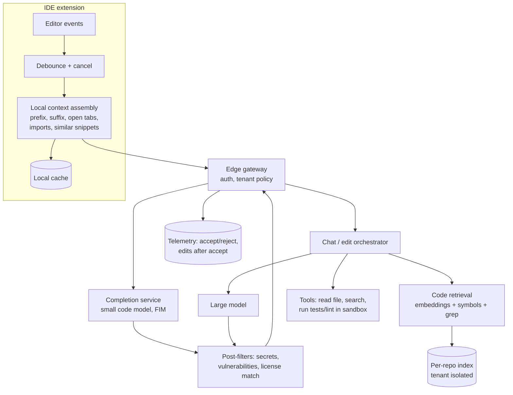

# AI 11. Design an AI Code Assistant (GitHub Copilot / Cursor)

## Interview question

> Design an AI coding assistant integrated into IDEs. It provides inline autocomplete as developers type, a chat panel that answers questions about the codebase, and can make multi-file edits on request. 5M developers, enterprise customers with private repositories.

## Clarifying questions

| Question | Assumed answer |
|----------|----------------|
| Features? | (1) Inline completions (2) Codebase-aware chat (3) Multi-file edits / agent mode |
| Latency? | Inline completion p50 < 300 ms, p95 < 600 ms — otherwise devs keep typing past it |
| Context? | Current file, open tabs, repository (up to millions of LOC) |
| Privacy? | Enterprise code must not be retained or used for training; tenant isolation |
| Success metric? | Acceptance rate, retained characters, chat helpfulness, productivity |

## Requirements

**Functional:** low-latency inline suggestions; chat grounded in repo context; apply edits as diffs for review; multi-language.
**Non-functional:** extreme latency sensitivity for completion; cost control (requests on almost every keystroke pause); security (no secret leakage, no cross-tenant data); safety (don't suggest vulnerable code or verbatim licensed code).

## Estimation

- 5M devs, ~2M active daily; a completion request every ~2–3 s of active typing (after debounce) → ~**100k–200k completion requests/s** at peak.
- Completion prompt ~2k tokens, output ~50 tokens → prefill-dominated; a small fast model is required.
- Chat: ~10 requests/dev/day → 20M/day ≈ 230/s with ~20k-token prompts → large model.

## High-level design

## Deep dive 1: inline completion

- **Fill-in-the-middle (FIM):** model trained with `<prefix> ... <suffix> ... <middle>` so it completes code using text both before and after the cursor.
- **Context assembly (on the client, fast):** current file around the cursor, signatures of imported symbols, snippets from recently opened files ranked by similarity (Jaccard over tokens) to the cursor area. Fit into a ~2–8k token budget with priority ordering.
- **Latency tactics:**
  - Small specialized model (1–15B params), quantized, with speculative decoding.
  - Debounce (~75–150 ms) and **cancel** in-flight requests when the user keeps typing; stream tokens.
  - Stop generation early at logical boundaries (end of line/block) — most accepted completions are short.
  - Prefix caching on the server: consecutive requests share most of the prompt; route a user's requests to the same replica (session affinity).
  - Regional edge deployment to minimize network RTT.
  - Client-side cache: if the user types characters that match the current suggestion, keep showing it without a new request.
- **Ranking/filtering:** generate a few candidates, filter syntactically invalid ones, rank by model likelihood + heuristics; suppress low-confidence suggestions (showing bad ones costs user attention).

## Deep dive 2: codebase-aware chat (code RAG)

- **Indexing:** parse repos with tree-sitter into semantic chunks (functions, classes), embed with a code embedding model; also build a symbol graph (definitions, references, call graph) and keep a lexical index for exact identifiers.
- **Incremental updates:** re-index changed files on commit/save; local index in the IDE for uncommitted changes.
- **Retrieval:** hybrid — embeddings for "where do we handle auth retries?", symbol lookup for named entities, grep for exact strings; expand via the symbol graph (definition of called functions). Rerank.
- **Agentic retrieval:** for complex questions, let the model call `search`, `read_file`, `list_dir` tools iteratively rather than relying on one-shot retrieval.

## Deep dive 3: multi-file edits / agent mode

- Model proposes edits as structured diffs (search/replace blocks or unified diffs); a fast "apply" model or deterministic merger applies them to files robustly.
- Validate: run linters, type-checkers, and tests in a sandbox; feed errors back to the model to iterate.
- Always present changes for human review; never push or run destructive commands without confirmation.

## Deep dive 4: privacy, security & safety

- Tenant isolation for indexes and caches; encryption; zero data retention options; prompts/code excluded from training for enterprise.
- Filters: detect secrets (API keys) in suggestions; static analysis for common vulnerability patterns (SQL injection, hardcoded credentials); **duplicate detection** against public code to block long verbatim matches of licensed code.
- Content exclusion: admins can exclude paths/repos from context.
- Prompt injection: repo files or READMEs can contain malicious instructions — treat retrieved code as data and gate tool use.

## Deep dive 5: evaluation

| Offline | Online |
|---------|--------|
| HumanEval/MBPP-style functional correctness (pass@k with unit tests); repo-level benchmarks (e.g., SWE-bench-like tasks); FIM exact match / edit similarity on held-out repos | Acceptance rate, characters retained after N minutes, completion latency, chat thumbs, task success in agent mode, A/B tests on productivity proxies |

"Retained code" (how much of an accepted suggestion survives later edits) is better than raw acceptance rate, which rewards short trivial suggestions.

## Trade-offs

| Choice | Pro | Con |
|--------|-----|-----|
| Small model for completion | Latency, cost | Lower quality on complex logic |
| More context | Better suggestions | Higher latency and cost |
| Client-side context assembly | Fast, private | Limited by IDE resources |
| Server-side repo index | Whole-repo awareness | Indexing cost; data residency concerns |

## Follow-up interview questions

**Q: Completion latency regressed from 300 ms to 500 ms. How do you investigate?**
A: Break down the latency: client debounce/assembly, network RTT, queue wait, prefill (prompt length grew?), decode (more tokens?), post-filters. Check prefix-cache hit rate (routing change?), GPU saturation, and model/engine version changes.

**Q: How would you personalize completions to a company's codebase?**
A: First retrieval (cheap, always fresh). Then optionally fine-tune LoRA adapters per enterprise on their code (with consent), served via multi-LoRA serving; evaluate on held-out repos from that tenant.

**Q: How do you decide when NOT to show a suggestion?**
A: A lightweight model predicts acceptance probability from context (cursor position, language, recent rejections, model confidence); show only above a threshold tuned for acceptance vs. coverage.
