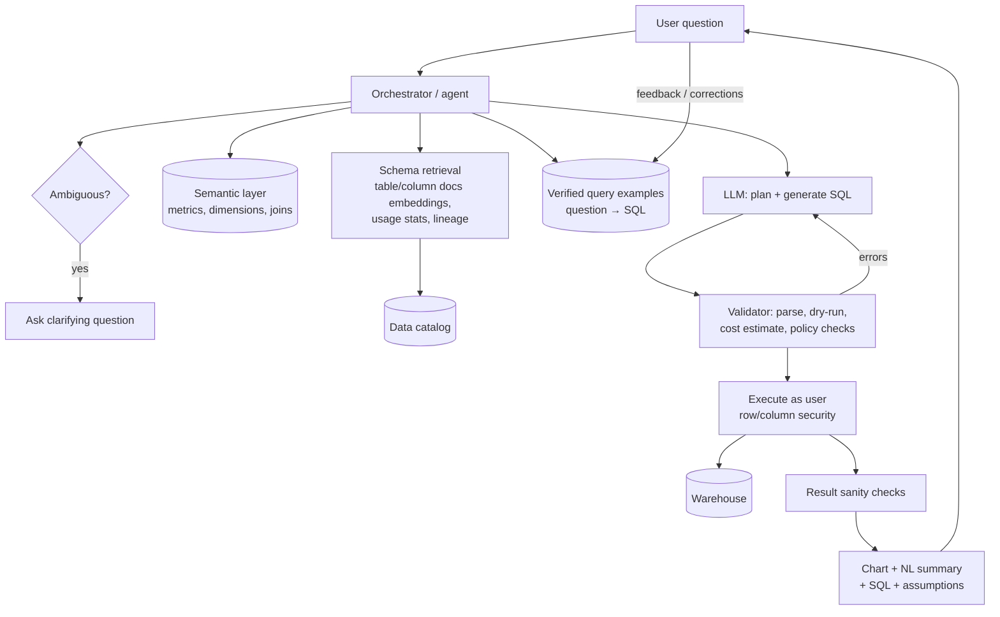

# AI 12. Design a Text-to-SQL Analytics Assistant

## Interview question

> Design an assistant that lets business users ask questions in plain English ("What was revenue by region last quarter vs. the year before?") against the company's data warehouse (thousands of tables), returning correct numbers, a chart, and the SQL used.

## Clarifying questions

| Question | Assumed answer |
|----------|----------------|
| Warehouse? | Snowflake/BigQuery, ~5,000 tables, many poorly documented |
| Users? | 5,000 non-technical employees + analysts |
| Correctness bar? | Wrong numbers are worse than no answer — must expose SQL and assumptions |
| Permissions? | Users may only query data they're entitled to (row/column-level security) |
| Follow-ups? | Conversational ("now break it down by product") |
| Cost? | Must prevent runaway warehouse queries |

## Requirements

**Functional:** NL question → SQL → execute → table/chart + explanation; follow-up questions; show and allow editing of SQL; save/share answers.
**Non-functional:** correctness and trust; governance (permissions, PII); query cost limits; latency < ~15 s typical; observability and evaluation.

## Why this is hard

- Schema linking: finding the right 5 tables among 5,000 (`rev`, `revenue_v2`, `fct_orders_final`...).
- Business semantics: "revenue" = gross or net? Fiscal vs calendar quarter? Exclude test accounts?
- SQL dialect details, joins with fan-out (double counting), time zones.

## High-level design

## Deep dive 1: grounding in business semantics

- **Semantic layer first:** curated metric definitions (`net_revenue = sum(amount) - refunds`, filters, valid dimensions, join paths) maintained by the data team (dbt metrics / LookML-style). The LLM generates a query against the semantic layer (metric + dimensions + filters) when possible, which compiles to SQL deterministically — far more reliable than raw SQL.
- Fall back to raw SQL generation for questions outside the semantic layer, with clear "unverified" labeling.
- **Verified query library:** analyst-approved question→SQL pairs, retrieved as few-shot examples. Every corrected answer can become a new example.

## Deep dive 2: schema retrieval (schema linking)

- Index tables and columns with: names, descriptions (LLM-generated drafts reviewed by owners), sample values, popularity (query logs), freshness, certified flag, lineage.
- Retrieve candidate tables via hybrid search on the question; boost certified, popular tables; include join keys and relationships.
- Provide the LLM a compact schema: relevant tables, key columns, types, a few sample values (critical for filters like `region = 'EMEA'` vs `'Europe'`).

## Deep dive 3: generation & validation loop

1. LLM writes a short plan (tables, joins, filters, aggregation, time range) then SQL.
2. **Static validation:** parse with a SQL parser (dialect-aware); check referenced tables/columns exist and are allowed; block DDL/DML (read-only).
3. **Dry run / EXPLAIN:** catch errors and estimate bytes scanned; enforce cost limits, require partition filters on huge tables, add `LIMIT` for exploratory queries.
4. Errors fed back to the LLM for self-correction (bounded retries).
5. **Result sanity checks:** empty results, suspiciously large numbers (join fan-out), nulls; compare against known metric values (e.g., total revenue last quarter from a certified dashboard).
6. **Self-consistency:** for high-stakes questions, generate multiple SQL candidates and compare results; disagreement → show uncertainty or ask for clarification.

## Deep dive 4: security & governance

- Execute queries **with the user's identity** (OAuth to the warehouse) so native row/column-level security applies — the assistant never has more access than the user.
- PII columns masked by policy; audit log of every question, SQL, and result metadata.
- Don't send sensitive result rows to the LLM unnecessarily: summarization can work on aggregated results only.

## Deep dive 5: evaluation

- **Execution accuracy:** run generated SQL and gold SQL on the same data; compare result sets (order-insensitive, tolerance for floats). Better than SQL string match.
- Eval set built from real user questions with analyst-verified gold queries, stratified by difficulty (single table, joins, time comparisons, ambiguous).
- Online: thumbs, "edited SQL" rate, clarifying-question rate, analyst audit sampling.

## Trade-offs

| Choice | Pro | Con |
|--------|-----|-----|
| Semantic layer | Consistent, correct metrics | Requires curation; limited coverage |
| Raw text-to-SQL | Flexible | Error-prone on messy schemas |
| Ask clarifying questions | Fewer wrong answers | More friction |
| Executing as user | Correct permissions | Needs per-user auth integration |

## Follow-up interview questions

**Q: Two users get different numbers for the "same" question. How do you fix it?**
A: Route common metrics through the semantic layer so definitions are fixed; show definitions and filters in every answer; add the question to the verified library; cache certified answers.

**Q: How do you stop a query that would scan 500 TB?**
A: Dry-run cost estimation before execution, per-user and per-query byte limits, mandatory partition filters, and asking the user to narrow the time range.

**Q: How would you handle "why did revenue drop last week?"**
A: That's an analysis task, not a single query: an agent runs a sequence of queries (decompose by region, product, channel), compares against baselines, and summarizes contributing factors with the supporting queries shown.
