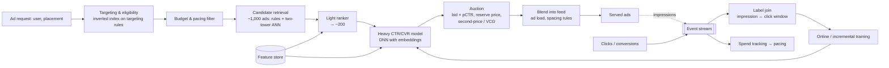

# AI 13. Design an Ad Click Prediction (CTR) & Ad Ranking System

## Interview question

> Design the system that decides which ads to show on a social feed and predicts click-through rate (CTR) for each candidate ad. 2B ad requests per day, millions of active ads, and a real-time auction. Revenue, advertiser ROI, and user experience all matter.

## Clarifying questions

| Question | Assumed answer |
|----------|----------------|
| Pricing model? | Advertisers bid per click (CPC) or per conversion; we rank by expected value |
| Latency? | Whole ad selection < 100 ms |
| Objectives? | P(click), P(conversion); penalize bad user experience (hides, reports) |
| Targeting? | Advertisers specify audiences (age, location, interests), budgets, schedules |
| Data? | Impressions, clicks, conversions (some delayed via advertiser pixels/APIs) |

## ML framing

- Binary classification: P(click | user, ad, context). Also P(conversion | click).
- **Calibration matters more than ranking alone:** predictions are multiplied by bids in the auction, so a CTR of 2% must really mean 2%. Metric: log loss + calibration (predicted/observed ratio), plus AUC.
- Auction score (eCPM-like): `score = bid × pCTR (× pCVR for conversion bids) + quality/UX term`.

## Estimation

- 2B requests/day ≈ 23k QPS, peak ~60k QPS.
- Each request scores ~500–1,000 candidates → **~50M model predictions/s** at peak → batched GPU or highly optimized CPU inference.
- Training data: ~10B impressions/day — downsample negatives (and correct for it in calibration).

## High-level design

## Deep dive 1: features & model

- **Features:** user (demographics, interest embeddings, recent engagement), ad (creative embedding, advertiser, category, historical CTR), context (placement, time, device), cross features (user × ad category affinity).
- High-cardinality IDs (user, ad, advertiser) → **embedding tables** (hundreds of GB; sharded parameter servers / embedding caches).
- **Architectures:** Wide & Deep, DeepFM, DCN-v2 (explicit feature crosses), DLRM; multi-task heads for CTR, CVR, hide rate. Historically logistic regression with hashed crosses + GBDT features (Facebook 2014) — mention as baseline.
- **Freshness:** ad inventory and user interest shift fast → incremental/online training every few minutes to hours; ads with no history rely on content embeddings and advertiser-level priors.

## Deep dive 2: training data pipeline

- Join impressions with clicks within an attribution window (e.g., 30 min for clicks; days for conversions).
- **Delayed feedback:** a conversion may arrive days later — training too early labels it negative. Use delayed-feedback models, importance weighting, or train conversion models on matured windows plus correction.
- **Negative downsampling** (keep 10% of non-clicks) speeds training; recalibrate: `p = q / (q + (1 − q)/w)` where w is the sampling rate.
- **Position/presentation bias:** include position features during training, set to a fixed value at serving.
- Log features at serving time to avoid training–serving skew.

## Deep dive 3: auction, budget & pacing

- **Generalized second price / VCG:** winner pays the minimum needed to keep their rank; incentivizes truthful bidding.
- **Reserve prices** and quality thresholds to protect UX.
- **Pacing:** spread an advertiser's daily budget over the day — a feedback controller (PID-like) adjusts the probability of participating in auctions or a bid multiplier based on spend vs plan. Spend counters updated in near real time.
- Ad load: limit ads per N organic posts, spacing rules, frequency caps per user per campaign.

## Deep dive 4: serving at low latency

- Targeting via an inverted index on targeting attributes (like a search engine) → eligible ads in milliseconds.
- Cascade of models with increasing cost; batch candidates in one inference call; quantized embeddings; cache user embeddings per session.
- Fallbacks: if the heavy model times out, use light ranker scores.

## Evaluation

| Offline | Online |
|---------|--------|
| Normalized log loss, calibration, AUC on next-day data | A/B tests: revenue, CTR, advertiser conversions/ROI, user engagement and hide rate (guardrails), latency |

Small log-loss improvements (0.1%) can be significant at this scale. Run budget-split experiments to avoid advertiser budget interference between test arms.

## Trade-offs

| Tension | Discussion |
|---------|------------|
| Revenue vs UX | More ads/higher-paying ads now can reduce long-term engagement; include UX penalties in score and ad load limits |
| Freshness vs stability | Online learning adapts fast but can drift; monitor calibration continuously |
| Model size vs latency | Cascades and distillation |
| Privacy | Fewer third-party signals (ATT, cookie deprecation) → rely on first-party, aggregated, and on-device signals |

## Follow-up interview questions

**Q: Why is calibration so important here?**
A: The auction multiplies pCTR by bid. Overpredicting CTR for one advertiser makes them win too often and pay for poor results; systematic miscalibration shifts revenue and hurts advertiser trust. Monitor calibration per segment and apply isotonic/Platt correction.

**Q: How do you handle a brand-new ad?**
A: Content-based embeddings of the creative and text, advertiser/campaign priors, and an exploration budget (e.g., Thompson sampling with uncertainty-aware scores) to collect initial clicks quickly.

**Q: CTR went up but revenue went down after a launch. Why?**
A: The model may favor cheap ads with high CTR, lowering bid × pCTR totals; or calibration changed, affecting pricing; or ad load/position changes. Check auction-level metrics (average CPC, fill rate) per segment.
