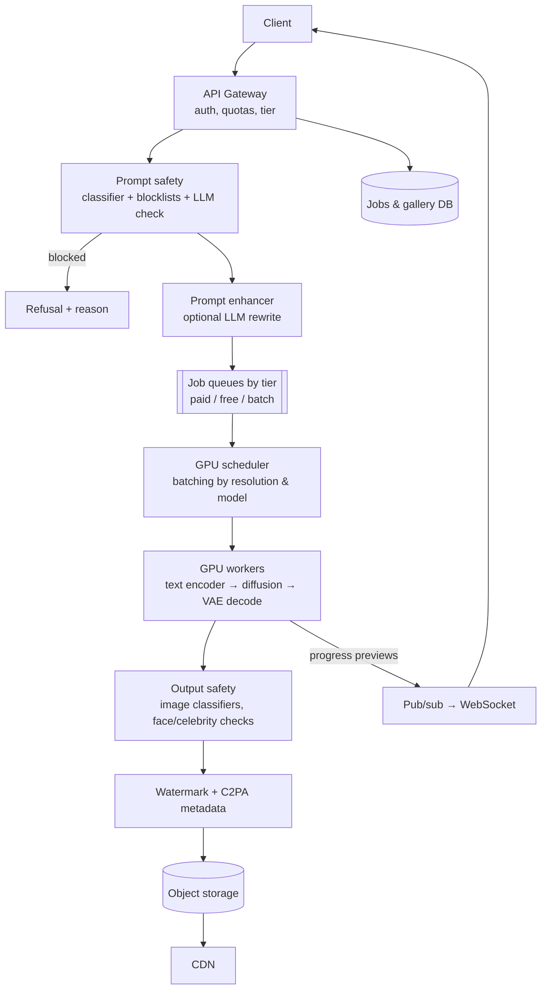

# AI 14. Design a Text-to-Image Generation Service (Midjourney / DALL·E)

## Interview question

> Design a service where users type a prompt and get 4 generated images within ~10 seconds. 10M DAU, free and paid tiers, image editing (inpainting, variations, upscaling), and strict safety requirements.

## Clarifying questions

| Question | Assumed answer |
|----------|----------------|
| Model? | Latent diffusion / diffusion transformer we host on GPUs |
| Output? | 4 images at 1024×1024 per request; upscale to 2048 on demand |
| Latency? | Paid: < 10 s; free: best effort, may queue |
| Volume? | 10M DAU × 5 requests = 50M requests/day → 200M images/day |
| Safety? | Block sexual content involving minors (absolute), non-consensual imagery of real people, violent/graphic content per policy; provenance watermarking |

## Requirements

**Functional:** prompt → images; parameters (aspect ratio, style, seed); edits (inpaint, variations, upscale); gallery/history; sharing.
**Non-functional:** GPU cost efficiency (dominant cost); predictable latency by tier; safety at input and output; durable image storage + CDN delivery.

## Estimation

- 50M requests/day ≈ 580/s avg, ~1.5k/s peak.
- Generating 4 images with ~25–30 denoising steps on an H100 ≈ ~3–5 s (batched). → ~1.5k/s × 4 s ≈ **6,000 GPUs busy at peak**, before optimizations. Step reduction and distillation directly cut this.
- Storage: 200M images/day × ~1.5 MB (PNG/WebP) ≈ **300 TB/day** → lifecycle policies (free-tier images expire, thumbnails kept).

## High-level design

## Deep dive 1: generation pipeline

1. **Text encoding** (CLIP/T5-style encoders) of the prompt → embeddings.
2. **Denoising loop** in latent space (e.g., 64×64×c latents for a 1024² image): N steps of the diffusion model (U-Net or DiT) with classifier-free guidance (conditional + unconditional pass, often batched together).
3. **VAE decode** latents → pixels. Optional upscaler / refiner model.
- Edits: inpainting conditions on a mask + original latents; variations start from noised latents of an existing image (img2img) with a strength parameter.

## Deep dive 2: GPU efficiency

- **Fewer steps:** better samplers (DPM-Solver++), distilled models (consistency/LCM, adversarial distillation) reduce 30–50 steps to 4–8 → 4–8× fewer GPU-seconds. Offer "fast" vs "quality" modes.
- **Batching:** group requests with the same resolution/model into a batch; diffusion is compute-bound so batching gains are moderate but real. 4 images per request already form a batch.
- **Precision & kernels:** FP16/FP8, fused attention, compiled graphs (TensorRT / torch.compile), CUDA graphs.
- **Caching:** cache text embeddings for popular prompts; dedupe identical (prompt, seed, params) requests.
- **Model residency:** keep each GPU pinned to one model to avoid swapping multi-GB weights; route requests by model.
- **Tiered scheduling:** paid queue has priority; free tier fills idle capacity and is throttled at peaks; preemptible/spot GPUs for batch and free work.
- **Autoscaling:** on queue wait time per tier; warm pools since model loading takes tens of seconds.

## Deep dive 3: user experience

- Async job model: `POST /v1/generations → job_id`; progress via WebSocket with **low-res previews** decoded from intermediate latents every few steps (makes waits feel shorter).
- Show queue position for free tier.
- Store seed and params so users can reproduce or iterate.

## Deep dive 4: safety

Layered, because each layer misses things:
- **Prompt filtering:** keyword/blocklists (fast), text classifier, LLM-based policy check for obfuscated prompts; detect named real people for sensitive contexts.
- **Model-level:** training data filtering, safety fine-tuning, concept removal for disallowed content.
- **Output filtering:** image classifiers (nudity, violence, gore, minors detection), face matching against public-figure policy; blur or block.
- **Provenance:** invisible watermarking + C2PA content credentials for AI-generated media.
- Abuse monitoring: account-level patterns of repeated blocked attempts → enforcement; human review for appeals and policy tuning.

## Evaluation

| Offline | Online |
|---------|--------|
| FID / CLIP score (rough), human preference evals (side-by-side), prompt-adherence benchmarks (counting, text rendering, composition), safety red-team sets (block rate, over-blocking rate) | Image download/upscale/share rate, re-roll rate, user ratings, latency per tier, cost per image, safety incident rate |

## Trade-offs

| Choice | Pro | Con |
|--------|-----|-----|
| Fewer steps / distilled models | Much cheaper and faster | Some quality/diversity loss |
| Prompt enhancement by LLM | Better results for short prompts | Users lose some control; extra latency |
| Strict output filters | Safety | False positives frustrate users |
| Keep all images forever | User value | Large storage cost → tiered retention |

## Follow-up interview questions

**Q: How would you add text-to-video?**
A: Same architecture with far higher cost (video diffusion over spatio-temporal latents): longer jobs (minutes), checkpointed jobs so preemption doesn't lose work, multi-GPU per request (sequence/context parallelism), stricter queueing and pricing, frame-sampled output safety.

**Q: How do you let users fine-tune on their own photos (personalization)?**
A: LoRA/DreamBooth-style fine-tuning jobs on a training queue (minutes of GPU), stored as small adapters per user, loaded at inference; strict consent/verification for real-person likeness and extra safety checks.

**Q: GPU capacity drops 30% during a launch spike. What do you do?**
A: Shed free-tier load (queue or temporarily disable), switch free tier to the fast distilled model, reduce default image count/resolution, keep paid SLOs, and burst to other regions/clouds if available.
