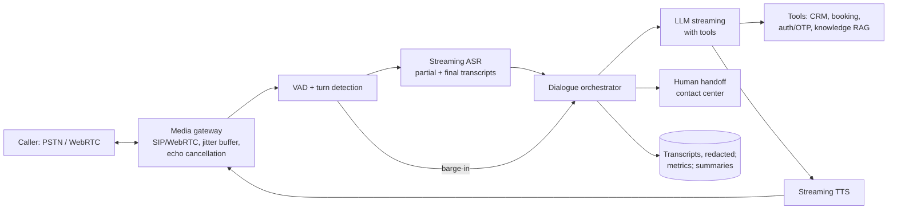

# AI 15. Design a Real-time Voice AI Assistant

## Interview question

> Design a voice assistant (for a phone support line or a smart speaker) that holds natural spoken conversations with users: it listens, understands, answers or takes actions, and speaks back. Responses must feel conversational — under ~800 ms from when the user stops talking to when the assistant starts speaking — and users can interrupt it.

## Clarifying questions

| Question | Assumed answer |
|----------|----------------|
| Channel? | Phone calls (8 kHz telephony) and app/web (16–48 kHz) |
| Concurrency? | 50k concurrent calls at peak |
| Tasks? | FAQs, account lookups, booking/changing appointments, handoff to a human |
| Languages? | English + Spanish initially |
| Latency target? | Voice-to-voice < 800 ms p50, < 1.5 s p95 |
| Compliance? | Call recording consent, PII redaction, authentication before account actions |

## Requirements

**Functional:** streaming speech recognition; dialogue with tools (account APIs); speech synthesis; barge-in (user interrupts); human handoff with context; call summaries.
**Non-functional:** very low latency; natural turn-taking; robustness to noise/accents; secure handling of PII; high availability (a dropped call is a failed customer interaction).

## Two architectures

| Cascaded (chosen for support use case) | End-to-end speech-to-speech model |
|---------------------------------------|-----------------------------------|
| ASR → LLM → TTS, each streaming | Single multimodal model takes audio in, produces audio out |
| Swap components, use text-based tools, guardrails, logging easy | Lowest latency, preserves tone/emotion, more natural |
| Latency adds up across stages | Harder to control, audit, and attach tools/guardrails; costlier |

Mention both; choose cascaded for controllability, with an end-to-end model as a future option.

## High-level design

## Deep dive 1: latency budget (voice-to-voice)

| Stage | Budget | Technique |
|-------|--------|-----------|
| End-of-turn detection | 200–300 ms | VAD + semantic end-of-utterance model (don't wait for fixed 1 s silence) |
| ASR finalization | ~100 ms | Streaming ASR already has partials; finalize fast |
| LLM time-to-first-token | 200–350 ms | Small/fast model, prompt caching, colocated GPUs, short system prompt |
| TTS time-to-first-audio | 100–150 ms | Streaming TTS that starts on the first phrase |
| Network/media | 50–100 ms | Regional media servers, WebRTC/UDP |

Key tricks:
- **Stream everything:** LLM tokens are chunked at phrase/sentence boundaries and sent to TTS immediately; audio playback starts while the LLM is still generating.
- **Speculative processing:** start LLM inference on a stable partial transcript before the end-of-turn is confirmed; discard if the user keeps talking.
- **Fillers for slow tools:** "Let me check that for you…" spoken while a CRM lookup runs.

## Deep dive 2: turn-taking & barge-in

- Echo cancellation so the assistant doesn't hear itself.
- When VAD detects user speech during playback: stop TTS within ~100–200 ms, cancel in-flight LLM generation, and record **what was actually spoken** (truncate the assistant message in history to the played portion).
- Distinguish backchannels ("uh-huh", "okay") from real interruptions with a small classifier, so the assistant doesn't stop for every "mm-hmm".

## Deep dive 3: ASR & TTS

- **ASR:** streaming model (conformer/transducer or streaming Whisper-style) with telephony fine-tuning; **contextual biasing** with domain vocab (product names, customer names from CRM); confidence scores trigger confirmation ("Did you say March 13th?") for critical slots.
- Spoken-form handling: numbers, dates, emails, spelled-out codes; DTMF keypad fallback for account numbers.
- **TTS:** low-latency neural TTS with a consistent brand voice; SSML/prosody control; text normalization (pronounce "$1,250.50" correctly). Avoid unauthorized voice cloning of real people.

## Deep dive 4: dialogue & tools

- LLM with a concise system prompt tuned for spoken style (short sentences, one question at a time, no markdown/lists).
- Tools: knowledge base RAG, account lookup, booking APIs — with **authentication gates** (verify via OTP or knowledge-based checks before revealing account data or taking actions), idempotent actions, and confirmation before irreversible operations.
- State machine guardrails for regulated flows (identity verification, disclosures must be read verbatim).
- **Escalation:** on user request, repeated misunderstanding, negative sentiment, or policy triggers → warm transfer to a human agent with a summary and transcript.

## Deep dive 5: scaling & reliability

- 50k concurrent calls; each call holds a media session + ASR stream + TTS stream. ASR/TTS GPUs handle many concurrent streams each (batched streaming inference).
- Calls pinned to a region; session state checkpointed so a crashed orchestrator can resume a call on another instance.
- Graceful degradation: if the LLM is down, fall back to a scripted IVR flow or direct transfer to humans.

## Evaluation & monitoring

- ASR word error rate (WER) per accent/channel; entity accuracy for critical slots.
- Voice-to-voice latency percentiles, barge-in responsiveness, interruption rates.
- Task completion / containment rate (resolved without human), escalation rate, CSAT, average handle time.
- Simulated-caller evals: LLM-driven synthetic callers with TTS voices and noise, run through the full pipeline before releases.

## Trade-offs

| Choice | Pro | Con |
|--------|-----|-----|
| Cascaded pipeline | Control, tools, auditability | Latency stacking, loses vocal emotion |
| Speculative LLM on partials | Lower latency | Wasted compute when users keep talking |
| Aggressive end-of-turn | Snappy | Cuts users off mid-thought |
| Small fast LLM | Latency, cost | Weaker reasoning → route hard cases to bigger model with a filler phrase |

## Follow-up interview questions

**Q: Users complain the assistant interrupts them. Fix?**
A: Tune end-of-turn detection: add a semantic model that predicts whether the utterance is complete (e.g., "my account number is…" is incomplete), adapt silence thresholds per user speaking rate, and evaluate on labeled turn-taking data.

**Q: How do you protect PII in recordings and logs?**
A: Explicit consent, redact PII entities in transcripts (and mute corresponding audio spans), encrypt storage, short retention, role-based access, and pause recording during payment card capture (PCI) with DTMF masking.

**Q: How would you support a new language quickly?**
A: Multilingual ASR/TTS models, language identification at call start, translated and localized prompts, locale-specific eval sets, and native-speaker review of TTS pronunciation and tone.
