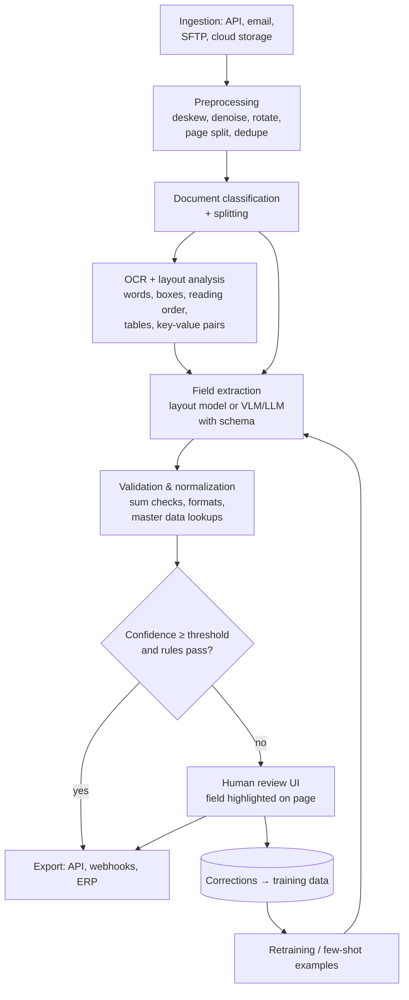

# AI 16. Design a Document Intelligence & Data Extraction System

## Interview question

> Design a system that ingests business documents — invoices, receipts, contracts, insurance claims, ID cards — as PDFs, scans, and phone photos, and extracts structured data (vendor, line items, totals, dates, clauses) into downstream systems. 5M pages/day across many customers, with high accuracy requirements for financial fields.

## Clarifying questions

| Question | Assumed answer |
|----------|----------------|
| Document types? | Known types (invoice, receipt, ID) with schemas + custom customer-defined schemas |
| Input quality? | Mix of digital PDFs, scans, skewed phone photos, handwriting |
| Accuracy bar? | > 99% on amounts/dates after review; errors in payments are costly |
| Latency? | Most async (minutes); some interactive (ID verification < 5 s) |
| Human review? | Yes, for low-confidence fields |
| Multi-tenant? | Yes, strict isolation; some customers require in-region processing |

## Requirements

**Functional:** upload/ingest (API, email, S3); classify document type; split multi-document PDFs; extract fields & tables to schema; validation; human-in-the-loop review; export via API/webhooks.
**Non-functional:** field-level accuracy with calibrated confidence; throughput & cost per page; auditability (which pixel did a value come from?); privacy & data residency.

## Estimation

- 5M pages/day ≈ 60 pages/s avg, ~200/s peak (month-end spikes for invoices).
- OCR/layout ~100–300 ms GPU per page; VLM extraction ~1–3 s per page → GPU fleet sized for peak with queue buffering.
- Human review: if 5% of documents need review at ~1 min each → ~4k review hours/day → **confidence calibration directly drives labor cost**.

## High-level design

## Deep dive 1: OCR & layout understanding

- Digital PDFs: extract text directly with positions (no OCR) — faster and exact; fall back to OCR for image-only pages.
- OCR outputs words + bounding boxes + confidence; **layout analysis** detects blocks, reading order, tables (row/column structure), key-value pairs.
- Handwriting and low-quality photos need specialized models; image quality checks can ask the user to retake a photo (interactive flows).

## Deep dive 2: extraction approaches

| Approach | When | Notes |
|----------|------|-------|
| Templates / rules (regex + positions) | Fixed forms from one source | Brittle with layout changes |
| Layout-aware models (LayoutLM-style: text + position + image) | High-volume known types | Fine-tuned per type; fast, cheap per page, needs labeled data |
| **Vision-language models / LLMs with a JSON schema** | Long-tail types, custom schemas, few-shot | Flexible, zero/few-shot; costlier, can hallucinate values not on the page |

**Chosen:** hybrid — fine-tuned layout models for the top document types (most volume, lowest cost), VLM/LLM extraction with constrained JSON output for custom schemas and the long tail. Route by document class and customer schema.

**Grounding to prevent hallucinations:** require each extracted value to cite its source token span/bounding box; verify the value actually appears in the OCR text (fuzzy match for normalization). Values not found on the page are flagged.

## Deep dive 3: validation & business rules

- Arithmetic checks: line items sum to subtotal; subtotal + tax = total.
- Format checks: dates, currencies, IBAN/VAT checksums, PO number patterns.
- Cross-reference master data: vendor exists in the customer's ERP; PO number matches an open order (3-way match: PO, receipt, invoice).
- Duplicate detection: same vendor + invoice number + amount already processed.
- Rule failures route to review even when model confidence is high.

## Deep dive 4: confidence & human-in-the-loop

- Field-level confidence from model probabilities, **calibrated** per field type (isotonic regression on review outcomes) so a 0.95 means 95% correct.
- Thresholds per field and per customer, set to hit a target accuracy (e.g., 99.5% on totals) while minimizing review volume.
- Review UI shows the page with the source region highlighted, keyboard-first correction, and only the uncertain fields (not the whole document).
- Corrections feed training (active learning), few-shot example stores for VLM prompts per customer, and accuracy dashboards.

## Deep dive 5: platform concerns

- Async pipeline with per-stage queues (each stage scales independently on GPUs/CPUs); idempotent stages keyed by `(doc_id, stage, version)` so reprocessing is safe.
- Tenant isolation: separate storage prefixes/keys per tenant, per-tenant few-shot stores; never use one customer's documents as examples for another.
- Data residency: regional processing stacks; PII redaction options; retention policies (delete source images after N days).
- Versioning: store which model/prompt version produced each value for audits and reprocessing.

## Evaluation

- Field-level precision/recall/exact match per document type and per field; table extraction accuracy (cell-level F1); end-to-end "straight-through processing" rate (documents with zero human touches and no downstream errors).
- Calibration curves; review-time per document; downstream error reports from customers.

## Trade-offs

| Choice | Pro | Con |
|--------|-----|-----|
| Fine-tuned layout models | Cheap, fast, accurate on known types | Labeling effort per type |
| VLM/LLM extraction | Handles anything, quick onboarding | Cost, latency, hallucination risk → grounding checks |
| Lower review thresholds | Less labor | More errors reach customers |
| Full-page VLM vs OCR+LLM | VLM sees layout/visuals | OCR+text LLM is cheaper and easier to ground |

## Follow-up interview questions

**Q: A customer onboards a brand-new form type tomorrow. How do you support it?**
A: They define a schema (field names, types, descriptions) and upload ~5–10 labeled examples; we use VLM/LLM extraction with those as few-shot examples immediately, route everything through review initially, and once enough corrections accumulate, fine-tune a layout model or lower review thresholds.

**Q: How do you handle a 300-page contract?**
A: Classify and segment by section, extract clause-level data with retrieval over chunks (find the "termination" clause, then extract fields), keep page references for citations, and run long-document jobs in a separate queue.

**Q: How do you prevent the LLM from making up an invoice total?**
A: Constrained output schema, require source spans, verify the value exists in OCR text, run arithmetic consistency checks, and route any ungrounded or inconsistent value to human review.
