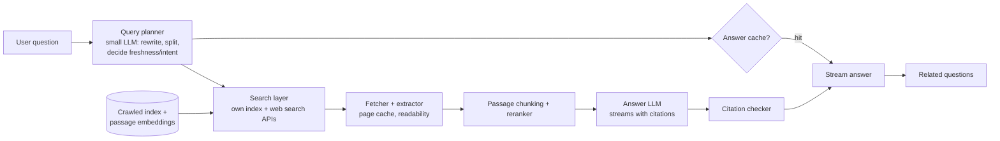

# AI 18. Design an AI Answer Engine (Perplexity / AI Search)

## Interview question

> Design a search product that answers questions directly with a cited, up-to-date summary of the web instead of 10 blue links. Users can ask follow-ups. 20M queries/day, answers should start streaming within ~1.5 s, and every claim should link to a source.

## Clarifying questions

| Question | Assumed answer |
|----------|----------------|
| Data source | Live web search + our own index of crawled pages; news freshness matters |
| Modes | Quick answer (default) and "deep" mode with more sources (see [Deep Research](19-deep-research-agent.md)) |
| Latency | TTFT ≤ 1.5 s quick mode; full answer ≤ 8 s |
| Citations | Mandatory, inline `[1]`, clickable |
| Follow-ups | Yes, conversational context |
| Cost target | A few cents per query at most |

## Requirements

**Functional:** question → retrieve fresh sources → synthesize a cited answer; follow-up questions; source cards; related questions.
**Non-functional:** fast first token, factual grounding, freshness, cost control, safety, resistance to SEO spam and prompt injection in web pages.

## Estimation

- 20M queries/day ≈ 230 QPS avg, ~700 peak.
- Per query: search (1–3 queries) + fetch/parse ~10 pages + LLM with ~8k input tokens and ~500 output tokens → 160B input tokens/day → the LLM is the dominant cost; caching and small-model routing are essential.

## High-level design



## Deep dive 1: query planning

- A small fast model rewrites the question (using conversation history for follow-ups), splits multi-part questions, and tags intent: news (needs freshness), local, shopping, math (route to a calculator/code tool), or simple factual (may be answerable from a knowledge graph).
- Generates 1–3 search queries; skips search entirely for chit-chat.

## Deep dive 2: retrieval from the web

- **Hybrid sources:** our own crawl index (fast, controllable, with precomputed passage embeddings) + external search APIs for breadth and freshness.
- **Fetch & extract:** parallel page fetches with tight timeouts (~800 ms); a page cache keyed by URL with freshness TTLs (news short, reference pages long); boilerplate removal; respect robots.txt and paywalls.
- **Passage selection:** chunk pages, rerank passages with a cross-encoder against the question, keep the top ~10–20 passages from diverse domains (avoid one site dominating).
- **Source quality:** domain reputation, spam/SEO-farm detection, recency boosts for news.

## Deep dive 3: generation with citations

Prompt: numbered passages with URLs and dates, instructions to answer only from sources, cite each sentence `[n]`, say when sources disagree or are insufficient.

```
[1] (nytimes.com, 2026-10-17) "...passage..."
[2] (wikipedia.org, updated 2026-10-01) "..."
Question: ...
Answer concisely with citations after each claim.
```

- **Citation verification:** post-check that each cited sentence is supported by its passage (an NLI model or small LLM judge); drop or flag unsupported claims.
- **Prompt injection from web pages** ("ignore previous instructions…"): delimit sources as data, strip hidden text, no privileged tools in the answer step, and filter outputs.

## Deep dive 4: latency engineering

| Step | Budget | Trick |
|------|--------|-------|
| Query planning | 150 ms | Small model, cached for repeated queries |
| Search | 300 ms | Parallel sources, own index first |
| Fetch + extract | 600 ms | Page cache; start reranking pages as they arrive |
| Rerank | 100 ms | Batched cross-encoder |
| LLM TTFT | 300–400 ms | Prefix caching of the system prompt, colocated inference |

Stream source cards to the UI immediately while the answer generates — perceived latency drops even more.

## Deep dive 5: cost & caching

- **Answer cache** for popular, non-personal queries (with TTLs by freshness class); **semantic cache** for near-duplicate questions.
- Route simple questions to a smaller model; use the large model for complex synthesis or deep mode.
- Limit passages and output length by query type.

## Evaluation

- Offline: answer correctness on dated question sets with references, citation precision (claim supported by cited source) and recall, freshness tests on recent events, latency/cost per query.
- Online: thumbs, follow-up rate (a clarifying follow-up can signal a bad answer), source click-through, copy events, A/B tests.

## Trade-offs

| Choice | Pro | Con |
|--------|-----|-----|
| Own index + external APIs | Control + breadth | Two systems to maintain/pay for |
| Fetch live pages | Freshness | Latency and cost; must handle failures |
| Citation verification | Trust | Extra latency/cost |
| Aggressive caching | Cheap, fast | Stale answers for fast-moving topics |

## Follow-up interview questions

**Q: Two sources contradict each other. What does the system do?**
A: The prompt instructs the model to surface disagreement with both citations; ranking prefers authoritative/recent sources; the verifier flags conflicting claims.

**Q: How do you keep answers about breaking news correct?**
A: Classify freshness intent, bypass long-lived caches, restrict to recent sources, include publication dates in the prompt, and show timestamps in the UI.

**Q: How is this different from the enterprise RAG assistant?**
A: Open web vs private corpus: no per-user ACLs, but much more spam, injection risk, freshness pressure, and a need for live fetching. See [RAG Enterprise Assistant](01-rag-enterprise-assistant.md) for the permissioned version.
