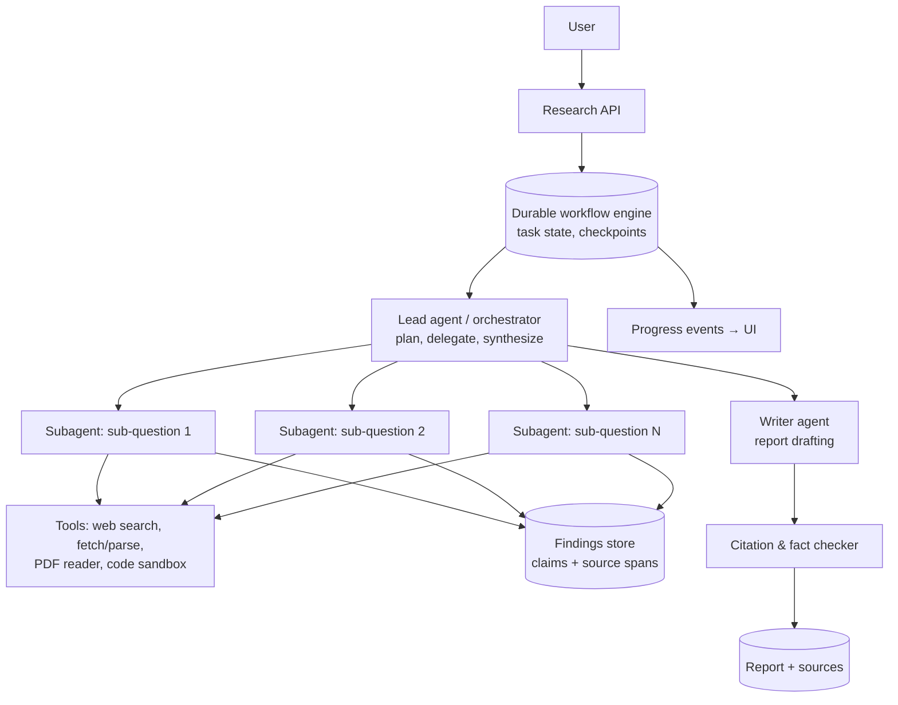

# AI 19. Design a Multi-Agent Deep Research System

## Interview question

> Design a "deep research" feature: a user asks a complex question ("Compare the economics of sodium-ion vs lithium-ion batteries for grid storage through 2030"), and the system spends 5–30 minutes searching, reading hundreds of sources, and produces a long, well-structured, cited report.

## Clarifying questions

| Question | Assumed answer |
|----------|----------------|
| Duration | Minutes to ~30 min; user gets progress updates and can leave |
| Sources | Web, PDFs, plus optional user-uploaded files or connected drives |
| Output | 2–10 page report with citations, tables, and an executive summary |
| Scale | 200k research tasks/day |
| Budget | Bounded cost per task (e.g., a few dollars max) |

## Requirements

**Functional:** clarify the question; plan research; search and read many sources in parallel; synthesize a cited report; show progress; allow follow-up edits.
**Non-functional:** durable long-running execution, bounded cost and time, factual grounding, parallelism, observability.

## Estimation

- 200k tasks/day; each ~50–200 LLM calls and ~100 page reads → ~20M LLM calls/day, mostly by small/medium models.
- Tokens per task: subagents read ~500k tokens of sources in total but return compressed findings (~5–10k tokens each) → the orchestrator sees ~50–100k tokens.

## Why multi-agent?

A single agent's context window fills up after reading a few long sources, and sequential reading is slow. An **orchestrator–worker** pattern:
- **Parallelism:** many subagents research different sub-questions at once.
- **Context isolation:** each subagent reads raw pages in its own context and returns only condensed findings with citations.
- **Specialization:** different prompts/tools per role (searcher, reader, data analyst, writer, fact-checker).

Cost: more total tokens than a single agent — worth it for broad, open-ended questions, not for simple lookups.

## High-level design

## Deep dive 1: planning and delegation

1. **Clarify** (optional): ask 1–3 questions if the request is ambiguous (scope, region, time horizon).
2. **Plan:** the lead agent writes a research plan — sub-questions, what evidence would answer each, expected sources — and stores it in the workflow state (so it survives context limits and restarts).
3. **Delegate** with explicit instructions per subagent: objective, output format (claims with source URLs and quotes), tool hints, and a budget (max searches/pages/tokens).
4. **Iterate:** after results return, the lead checks coverage and gaps, spawns follow-up subagents, and stops when the plan is satisfied or budgets run out.

Scale effort to complexity: simple questions → 1–3 subagents; broad comparisons → 10+.

## Deep dive 2: subagents and findings

- Subagent loop: search → pick promising results → read → extract relevant claims with exact quotes and URLs → refine search → return a compact summary.
- Findings are stored as structured records `{claim, quote, url, date, confidence}` in a findings store, not just free text — the writer and checker work from these.
- Deduplicate sources across subagents; prefer primary sources (papers, filings, official data) over blogs.

## Deep dive 3: durable, long-running execution

- Run on a **durable workflow engine** (Temporal-style): each LLM call and tool call is a checkpointed step; worker crashes resume from the last step rather than restarting (and re-spending).
- User can close the tab; progress events stream when they return; notify on completion.
- Timeouts per step, retries with backoff, and a global time/cost budget enforced by the orchestrator.

## Deep dive 4: writing and verification

- Writer agent drafts section by section from findings (keeps each call's context small), with inline citations.
- **Citation checker** verifies every cited sentence against the stored quote; unsupported claims are removed or rewritten; numeric claims cross-checked when possible (a code tool can recompute figures from data).
- Final report includes a source list, a confidence note, and a "what we couldn't find" section.

## Deep dive 5: cost control & observability

- Model tiering: small models for search-result triage and extraction; strongest model for planning and final synthesis.
- Budgets: max subagents, pages, tokens, and dollars per task; early stopping when marginal findings drop.
- Full tracing of the agent tree (which subagent did what, tokens, cost) for debugging and evals.

## Evaluation

- Rubric-based grading of reports (accuracy, completeness, citation quality, source quality, structure) by LLM judges calibrated with expert reviewers.
- Factual accuracy spot checks; citation precision; cost and time per task; user ratings and follow-up edits.
- Because runs are non-deterministic, evaluate on many tasks and compare distributions, not single runs.

## Trade-offs

| Choice | Pro | Con |
|--------|-----|-----|
| Multi-agent | Parallel, more coverage, isolated contexts | 3–15× more tokens, coordination complexity |
| Structured findings store | Verifiable citations, reusable evidence | More schema/plumbing |
| Durable workflows | Survives failures, resumable | Infrastructure complexity |
| Strict budgets | Predictable cost | Might stop before full coverage |

## Follow-up interview questions

**Q: Subagents keep searching the same thing. How do you fix it?**
A: Give each subagent a distinct, explicit objective and boundaries; share a "sources already read" set via the findings store; have the lead review overlaps; tune prompts with eval traces.

**Q: How do you let users research over their private documents too?**
A: Add connectors (drive, email, wiki) as tools that enforce the user's permissions (see [MCP Platform](22-mcp-tool-platform.md) and [RAG](01-rag-enterprise-assistant.md)), and keep private findings out of shared caches.

**Q: When would you NOT use multi-agent?**
A: For simple factual questions, tightly sequential tasks (each step depends on the previous), or when cost/latency budgets are small — a single agent or a fixed RAG pipeline is cheaper and more predictable.
