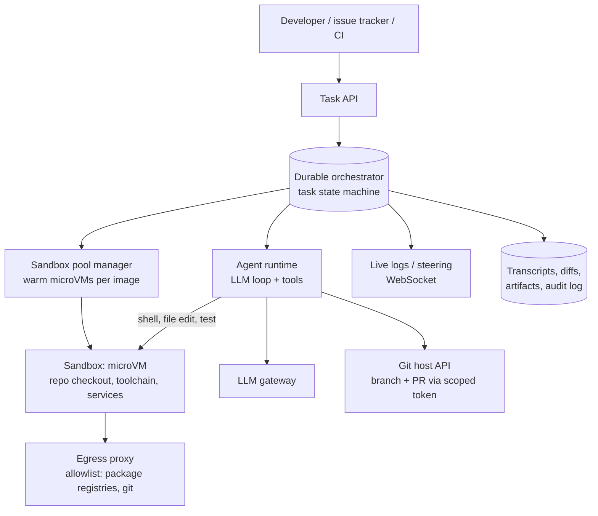

# AI 20. Design an Autonomous Coding Agent Platform (Background Agents)

## Interview question

> Design a platform where developers assign tasks ("fix issue #482", "add pagination to the orders API", "upgrade to React 19") to coding agents that run in the cloud: each agent clones the repository, edits code, runs tests, and opens a pull request for human review. 50,000 developers, 200,000 agent tasks per day.

## Clarifying questions

| Question | Assumed answer |
|----------|----------------|
| Inputs | Tasks from chat, issue trackers, or CI failures; repo on GitHub/GitLab |
| Output | A pull request with description, passing tests, and a log of what the agent did |
| Duration | 5 minutes to 2 hours per task |
| Environment | Must build/test real projects (languages, dependencies, databases) |
| Safety | Agents must not leak secrets, push to protected branches, or reach arbitrary internet hosts |
| Interaction | Developers can watch, steer mid-task, or take over |

## Requirements

**Functional:** create task → provision environment → agent loop (read, edit, run commands/tests) → open PR → respond to review comments; live logs; human steering; task history.
**Non-functional:** strong isolation, reproducible environments, fast startup, durable long-running sessions, bounded cost, auditability.

## Estimation

- 200k tasks/day × ~30 min average = 100k sandbox-hours/day → **~4,200 concurrent sandboxes** on average, peaks ~3× during work hours.
- LLM: ~50–300 model calls per task with large contexts (repo files, test output) → prefix caching of the growing transcript is a major cost lever.
- Storage: repo snapshots, logs, artifacts ~ hundreds of MB per task, retained 30 days.

## High-level design

## Deep dive 1: the sandbox (most important)

- **Isolation:** each task gets its own **microVM** (Firecracker/gVisor-class isolation) — agents run arbitrary shell commands, so containers sharing a kernel are a weaker boundary.
- **Environment definition:** per-repo config (devcontainer-style image + setup script) installs toolchains and dependencies; start databases or service fakes inside the sandbox.
- **Fast startup:** pre-built images per repo, **warm pools** of booted VMs, filesystem snapshots after setup (restore in seconds instead of re-running `npm install`).
- **Network policy:** default-deny egress; allow package registries, the git host, and approved domains through a proxy that logs traffic. Blocks exfiltration of code/secrets to arbitrary hosts.
- **Secrets:** inject only what tests need (test credentials), never production secrets; short-lived, scoped git tokens that can push only to agent branches and open PRs — never merge or push to protected branches.
- Resource limits (CPU, memory, disk, wall time) and automatic teardown.

## Deep dive 2: the agent loop and tools

Tools exposed to the model: `read_file`, `search_code` (grep + symbol index), `edit_file` (structured search/replace edits), `run_command` (with timeout and output truncation), `run_tests`, `git_diff`, `open_pull_request`.

Loop: understand the task → explore the repo → plan → edit → run tests/linters → read failures → fix → repeat → summarize and open a PR.

Practices that make agents succeed:
- Repository instructions file (conventions, how to run tests) loaded into context.
- Truncate huge outputs (logs, test failures) to the relevant parts; store full output as an artifact.
- **Context management:** summarize old steps, keep the plan and key findings pinned; long tasks may compact context several times.
- Self-verification before the PR: tests pass, linters clean, diff reviewed by the agent against the task.

## Deep dive 3: durable, steerable, long-running sessions

- Orchestrator state machine: `QUEUED → PROVISIONING → RUNNING → AWAITING_REVIEW → (REVISING) → DONE / FAILED / CANCELLED`.
- Every model call and tool call is checkpointed; if the agent worker dies, resume from the last step with the sandbox snapshot.
- Developers can stream the agent's actions live, send a message mid-task ("use the existing pagination helper"), or pause and take over the sandbox via a web terminal/IDE.
- PR review comments trigger a new agent iteration on the same branch.

## Deep dive 4: safety, trust, and governance

- Prompt injection can arrive through issues, code comments, dependency READMEs, or web pages → sandbox + egress limits + scoped tokens contain the blast radius even if the model is manipulated.
- All changes go through normal code review and CI; branch protection still applies.
- Full audit trail: commands run, network destinations, files changed, tokens used.
- Org policies: which repos agents may touch, max concurrent agents per team, budget caps.

## Deep dive 5: evaluation

- Benchmarks of real tasks with hidden tests (SWE-bench-style: issue + repo snapshot → does the patch make the failing tests pass without breaking others?).
- Online: PR merge rate, review rounds per PR, time-to-merge, revert rate, cost per merged PR, sandbox failure rate (environment setup is a top failure cause).

## Trade-offs

| Choice | Pro | Con |
|--------|-----|-----|
| microVM per task | Strong isolation | Higher overhead → warm pools, snapshots |
| Default-deny egress | Prevents exfiltration | Some builds need extra allowlisting |
| PR-only output | Human review, existing CI | Slower than auto-merge, by design |
| Long autonomous runs | Big tasks done unattended | Cost and drift risk → budgets, checkpoints, steering |

## Follow-up interview questions

**Q: The agent's tests pass but it "fixed" the bug by deleting the failing test. How do you prevent that?**
A: Detect modifications to test files and flag them in the PR; protect certain paths via policy; run the original (hidden or pre-change) tests in CI; include "never weaken tests" in instructions; reviewers see a summary of test changes.

**Q: How do you reduce environment setup failures?**
A: Per-repo environment configs validated by a setup check, cached snapshots after successful setup, an "environment doctor" step that reports missing dependencies, and fallbacks that let the agent install missing tools from allowlisted registries.

**Q: How do you keep costs predictable?**
A: Per-task token and wall-clock budgets, model tiering (cheap models for searching/reading, strong model for planning/editing), prefix caching, early termination when the agent loops, and per-team monthly caps.
