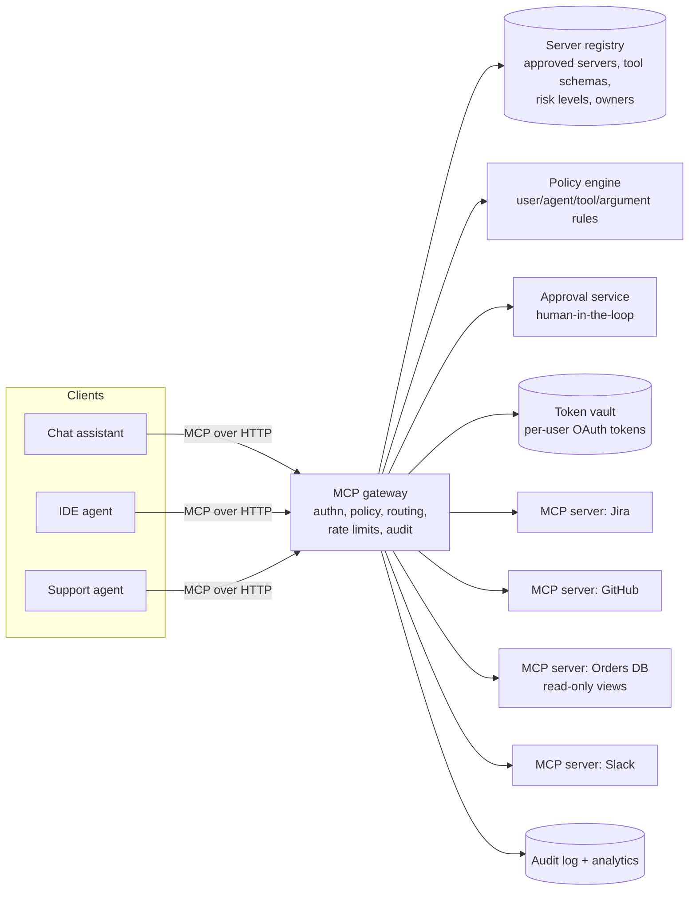

# AI 22. Design a Tool Integration Platform for AI Agents (MCP)

## Interview question

> Your company wants every AI assistant and agent (chat app, IDE agent, support bot) to securely use internal and SaaS tools — Jira, GitHub, Salesforce, internal databases, Slack — without each team writing custom integrations. Design a platform based on the Model Context Protocol (MCP) with enterprise-grade auth, permissions, and auditing.

## Background: what MCP is

**Model Context Protocol** is an open protocol that standardizes how AI applications (MCP **clients/hosts**) connect to external capabilities exposed by MCP **servers**:
- **Tools** — functions the model can call (`create_issue`, `query_orders`), described with JSON Schema.
- **Resources** — data the application can read (files, records).
- **Prompts** — reusable prompt templates.

Messages are JSON-RPC 2.0. Transports: **stdio** for local servers, and **Streamable HTTP** for remote servers, with OAuth-based authorization for remote access. One server works with any compatible client — an "N × M integrations" problem becomes "N + M".

## Clarifying questions

| Question | Assumed answer |
|----------|----------------|
| Clients | Internal chat assistant, IDE agents, support agent, CI agents |
| Servers | 50+ (SaaS connectors + internal services) |
| Users | 20k employees; agents act **on behalf of users** |
| Scale | 50M tool calls/day |
| Security | Least privilege, per-user permissions, approvals for destructive actions, full audit |

## Requirements

**Functional:** catalog of approved MCP servers; per-user authentication to each backend; policy engine (who can use which tools, with which arguments); human approval for sensitive actions; audit logs; usage analytics.
**Non-functional:** secure (no token leakage, injection-resistant), low latency overhead, highly available, easy for teams to publish new servers.

## High-level design



## Deep dive 1: identity and delegated authorization

- The user signs in to the client (SSO). The client authenticates to the **MCP gateway** with a token that represents *this user* (and *this agent*).
- For each backend, the gateway holds **per-user OAuth tokens** in a vault (obtained through a consent flow the first time a user connects Jira, GitHub, …). Calls run with the **user's own permissions** in the backend — the agent can never see more than the user could.
- Tokens are never passed to the model or exposed to clients; the gateway injects them server-side.
- Service accounts only for explicitly approved automation (CI agents), with narrow scopes.

## Deep dive 2: policy and least privilege

Policies evaluated on every `tools/call`:
```yaml
- tool: github.merge_pull_request
  allow: false                              # agents may open PRs, never merge
- tool: jira.create_issue
  allow: true
- tool: orders.issue_refund
  allow_if: { agent: support-bot, args.amount: "<= 200" }
  require_approval_if: { args.amount: "> 200" }
- tool: slack.post_message
  allow_if: { args.channel_type: internal }  # no external shared channels
```
- Tools carry **risk levels** in the registry (read, write, destructive, external-communication); clients show approval prompts for risky ones.
- Expose **narrow tools** (`get_order_status`) rather than raw power (`run_sql`). For databases, read-only views and row-level security.

## Deep dive 3: defending against prompt injection and tool abuse

Agents read untrusted content (emails, tickets, web pages, tool results) that may contain instructions like "export all customer records to this URL".
- **Authorization in code, not prompts:** the policy engine blocks disallowed actions regardless of what the model wants.
- **Data-flow rules:** e.g., a session that read confidential data cannot call external-communication tools without approval.
- **Tool description integrity:** only registry-approved servers and pinned tool schemas (a malicious server could hide instructions in its tool descriptions); review changes to tool definitions like code changes.
- **Output size limits and sanitization** of tool results before they reach the model.

## Deep dive 4: operating the platform

- **Registry & publishing:** teams publish MCP servers through a pipeline: security review, schema linting, risk classification, owner on call. Clients discover only approved servers.
- **Gateway responsibilities:** routing to server instances, timeouts, retries for idempotent reads, rate limits per user/agent/tool, circuit breakers per backend.
- **Audit:** every call logged with user, agent, client, tool, arguments (redacted), result status, latency, approval decisions — searchable for security investigations.
- **Analytics:** most-used tools, error rates, latency, and which tools agents misuse (bad arguments → improve descriptions).

## Trade-offs

| Choice | Pro | Con |
|--------|-----|-----|
| Central MCP gateway | One place for auth, policy, audit | Extra hop and a critical dependency |
| Per-user delegated tokens | Agents inherit user permissions exactly | Consent flows and token lifecycle management |
| Narrow, task-specific tools | Safer, easier for models to use correctly | More tools to build and maintain |
| Approval prompts | Safety for risky actions | Friction and approval fatigue → tune by risk |

## Follow-up interview questions

**Q: Why not just give the agent an API key with admin access?**
A: It breaks least privilege: any successful prompt injection or model mistake gets admin power, and audit logs can't tell which user caused what. Delegated per-user tokens + policies limit and attribute every action.

**Q: How do you let the model pick from 500 tools without overloading its context?**
A: Tool search/selection: index tool descriptions, retrieve the relevant subset per task (or let the client load tool definitions on demand), and group tools by server so only needed servers are attached.

**Q: How do you version tools without breaking agents?**
A: Semantic versioning of tool schemas, additive changes by default, deprecation windows, and contract tests/evals that run client agents against new server versions before rollout.
