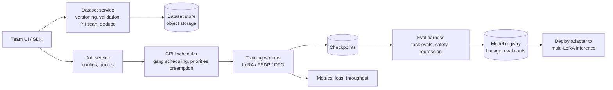

# AI 23. Design an LLM Fine-Tuning & Alignment Platform

## Interview question

> Design a self-serve platform where product teams customize open-weight LLMs (1B–70B parameters) with their own data: supervised fine-tuning, preference optimization (DPO/RLHF-style), and evaluation, then deploy the result to the inference platform. 30 teams, ~500 fine-tuning jobs/month on a shared GPU cluster.

## Clarifying questions

| Question | Assumed answer |
|----------|----------------|
| Methods | LoRA/QLoRA (most jobs), full fine-tuning (rare, large teams), preference tuning (DPO), RL with verifiable rewards as an advanced option |
| Data | Team-provided examples (chat transcripts, labeled outputs), synthetic data, human preference pairs |
| Compute | Shared cluster of 512 H100-class GPUs |
| Output | Adapter or full model registered and deployable (see [LLM Inference Serving](02-llm-inference-serving.md)) |
| Governance | PII controls, data lineage, eval gates before production |

## When to fine-tune (say this first)

| Need | Best tool |
|------|-----------|
| Model lacks *knowledge* of your documents | **RAG**, not fine-tuning |
| Consistent format/style/tone, domain jargon, specific task behavior | **Fine-tuning (SFT)** |
| Prefer some answers over others (helpfulness, safety, brand voice) | **Preference tuning (DPO / RLHF)** |
| Reduce cost/latency by matching a big model's quality with a small one | **Distillation** (fine-tune small model on big model outputs) |
| Tasks with checkable answers (math, code, extraction) | **RL with verifiable rewards** |

Try prompting + RAG first; fine-tune when evals show a gap that prompts can't close or when cost/latency demands a smaller model.

## Requirements

**Functional:** dataset upload/versioning and validation; job configuration (base model, method, hyperparameters); training with monitoring; automatic evaluation; model registry; one-click deployment (adapters).
**Non-functional:** efficient GPU sharing, reproducibility, data security, fault tolerance, cost visibility per team.

## Estimation

- LoRA on an 8B model with 50k examples × 1k tokens = 50M tokens/epoch → ~1–2 hours on a single 8-GPU node.
- 70B LoRA (QLoRA 4-bit base): ~1 node for hours to a day; full fine-tuning of 70B needs multi-node sharding (FSDP/ZeRO-3) and is far costlier.
- 500 jobs/month × ~10 GPU-hours average ≈ 5,000 GPU-hours/month → small slice of a 512-GPU cluster (~370k GPU-hours/month); the rest serves evals, research, and inference.

## High-level design

## Deep dive 1: data is the product

- **Formats:** chat-style examples (`messages` with system/user/assistant turns), preference pairs (`prompt, chosen, rejected`), or prompts + reward functions for RL.
- **Validation:** schema checks, token length limits, chat template correctness, deduplication, train/eval split (no leakage), PII detection and redaction, toxic content filters.
- **Quality over quantity:** 1–10k high-quality examples often beat 100k noisy ones. Tools to review samples, spot label inconsistencies, and generate **synthetic data** with a stronger model (then filter with graders).
- **Lineage:** every model records exactly which dataset versions trained it (needed for audits and "right to be forgotten" requests).

## Deep dive 2: training methods

| Method | What changes | Memory/cost | Notes |
|--------|--------------|-------------|-------|
| **LoRA** | Small low-rank adapter matrices; base frozen | Low; one GPU/node | Adapters are MBs; many served on one base model |
| **QLoRA** | LoRA on a 4-bit quantized base | Lowest | Slight quality cost; fits 70B on one node |
| **Full fine-tuning** | All weights | Highest; multi-node FSDP/ZeRO | Max quality headroom; separate model to serve |
| **DPO** | Learns from preference pairs directly | Like SFT (+ reference model) | Simpler and more stable than PPO-based RLHF |
| **RLHF (PPO)** | Reward model + RL loop | High; several models in memory | Powerful but complex |
| **RL with verifiable rewards** | Reward from tests/checkers | High; rollouts at scale | Great for code/math/extraction tasks |

Use proven libraries (e.g., PyTorch FSDP, DeepSpeed, PEFT, TRL-style trainers) inside versioned containers; record seeds and configs for reproducibility.

## Deep dive 3: GPU scheduling & reliability

- Shared cluster with **quotas per team**, priorities (production retrains > experiments), and **preemption** of low-priority jobs (which resume from checkpoints).
- **Gang scheduling** for multi-GPU jobs (all-or-nothing placement), topology-aware placement (GPUs on the same NVLink/InfiniBand fabric).
- Frequent checkpoints to object storage; automatic retry on node failure; detect hung jobs via throughput monitoring.
- Small jobs bin-packed; MIG/fractional GPUs for tiny models and notebooks.

## Deep dive 4: evaluation gates

- Every job auto-runs: the team's task evals (held-out set + LLM-judge rubrics), **regression evals** on general capabilities (did fine-tuning break instruction following?), and **safety evals** (fine-tuning can erode safety behavior — must re-check).
- Compare against the base model and the current production model; promotion requires passing thresholds.
- Eval cards stored in the registry; human review for high-impact launches.

## Deep dive 5: deployment

- LoRA adapters deploy onto **multi-LoRA serving** (hundreds of adapters on one base model, loaded on demand) — near-zero marginal infrastructure per team.
- Full fine-tunes get their own deployment; canary + A/B through the [LLM gateway](17-llm-gateway.md) with aliasing for easy rollback.

## Trade-offs

| Choice | Pro | Con |
|--------|-----|-----|
| LoRA by default | Cheap, fast, easy to serve | Lower ceiling than full fine-tuning for big behavior shifts |
| Self-serve platform | Teams move fast | Need strong guardrails, quotas, eval gates |
| Synthetic data | Scales data creation | Can amplify the teacher's errors → filter and evaluate |
| Mandatory safety re-eval | Catches safety regressions | Adds time to every job |

## Follow-up interview questions

**Q: A team fine-tuned on 5,000 support transcripts and the model now hallucinates order numbers. Why?**
A: The training data contained specific order numbers and facts, so the model learned to produce plausible-looking ones. Fine-tuning teaches patterns, not a reliable database — use RAG/tools for facts, scrub identifiers from training data, and add evals for fabricated entities.

**Q: How do you prevent catastrophic forgetting?**
A: Prefer LoRA, use lower learning rates and fewer epochs, mix in general-purpose instruction data, and gate on regression evals for general capabilities.

**Q: How do you handle a GDPR deletion request for data used in training?**
A: Lineage identifies affected models; remove the data from datasets, retrain/re-fine-tune affected adapters (cheap with LoRA), and retire old versions per policy.
