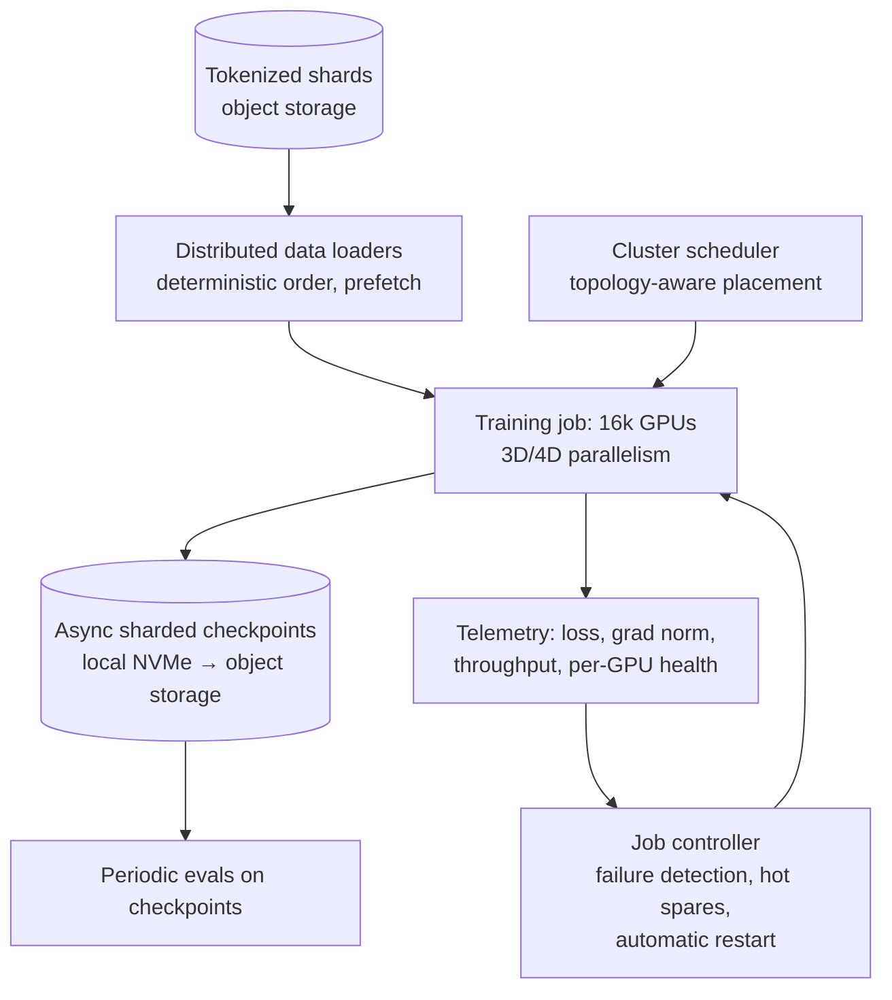

# AI 24. Design Distributed LLM Training Infrastructure

## Interview question

> Design the infrastructure to pre-train a 70-billion-parameter language model on 15 trillion tokens using a cluster of 16,000 GPUs. The run takes weeks; hardware failures happen daily. Maximize useful GPU utilization and make the run reliable and reproducible.

## Clarifying questions

| Question | Assumed answer |
|----------|----------------|
| Hardware | 16k H100-class GPUs (8 per node, NVLink within node), InfiniBand/RoCE between nodes |
| Model | Dense transformer, 70B params, 8k context (later extended) |
| Data | 15T tokens, already cleaned (see [Pretraining Data Pipeline](25-llm-pretraining-data-pipeline.md)) |
| Precision | BF16 with FP8 matmuls where stable |
| Goal | Finish in ~1–2 months with high MFU (model FLOPs utilization) |

## Estimation (the numbers interviewers love)

- Training compute ≈ **6 × parameters × tokens** = 6 × 70e9 × 15e12 ≈ **6.3 × 10²⁴ FLOPs**.
- H100 dense BF16 ≈ ~1 PFLOP/s peak; at **40% MFU** → 0.4e15 FLOP/s per GPU × 16k GPUs ≈ 6.4e18 FLOP/s.
- Time ≈ 6.3e24 / 6.4e18 ≈ **1e6 s ≈ 11–12 days** of pure compute; with failures, restarts, and evaluation overhead, plan for ~3–4 weeks.
- Memory per parameter for mixed-precision Adam training ≈ 16–18 bytes (weights, gradients, FP32 master weights, two optimizer moments) → 70B × 16 B ≈ **1.1 TB** of state → must be sharded across GPUs (each has 80 GB), plus activations.

## High-level design

## Deep dive 1: parallelism strategies

No single GPU can hold the model, and data must be spread across thousands of GPUs. Combine:

| Parallelism | What is split | Communication | Typical placement |
|-------------|---------------|---------------|-------------------|
| **Data parallel (DP)** | Batches across replicas; gradients averaged | All-reduce of gradients each step | Across nodes |
| **Sharded data parallel (FSDP / ZeRO)** | Optimizer state, gradients, and weights sharded across DP ranks | All-gather weights, reduce-scatter gradients | Across nodes |
| **Tensor parallel (TP)** | Individual matrix multiplications across GPUs | Very frequent, high bandwidth | **Within a node** (NVLink), e.g., TP=8 |
| **Pipeline parallel (PP)** | Layers into stages on different GPU groups | Activations between stages; "bubbles" | Across nodes |
| **Context/sequence parallel (CP)** | Long sequences split across GPUs | Attention communication | For long context |
| **Expert parallel (EP)** | MoE experts across GPUs | All-to-all token routing | For mixture-of-experts models |

Example layout for 70B on 16k GPUs: TP=8 (one node), PP=4, DP≈512 (with sharded optimizer). Choose to keep high-bandwidth traffic on NVLink and overlap communication with computation.

## Deep dive 2: networking and topology

- All-reduce/all-gather volumes are enormous → non-blocking fat-tree or rail-optimized InfiniBand/RoCE fabrics; 400 Gbps+ per GPU.
- Topology-aware scheduling: place TP groups inside nodes, PP neighbors close together, DP groups across racks.
- Collective libraries (NCCL) tuned per topology; monitor for slow links (one bad cable slows the whole synchronous job).

## Deep dive 3: failures are normal

At this scale GPU errors (ECC, Xid), NVLink/network flaps, node crashes, and silent slowdowns occur **daily or more often**.
- **Fast detection:** heartbeats and per-step timing for every rank; health checks before (re)joining (burn-in tests, NCCL tests).
- **Checkpointing:** asynchronous, sharded checkpoints (each rank writes its shard) first to local NVMe, then drained to object storage; frequency chosen by the failure rate (e.g., every 15–30 min) — the goal is to minimize lost work + checkpoint overhead.
- **Fast restart:** hot spare nodes swap in for failed ones; the job controller restarts from the latest checkpoint automatically within minutes.
- **Goodput** (useful training time / wall time) is the key metric, alongside MFU.

## Deep dive 4: training stability

- Watch loss and gradient norm for **spikes**; mitigations: gradient clipping, learning-rate warmup and schedules, skipping bad batches, rolling back to an earlier checkpoint with data reordering.
- Numerical precision: BF16 for most ops; FP8 matmuls with careful scaling; keep sensitive ops (norms, softmax, optimizer) in higher precision.
- **Silent data corruption** (a GPU computing wrong results without errors): periodic redundant computation checks, comparing replicas.

## Deep dive 5: data loading and reproducibility

- Pre-tokenized shards in object storage, streamed with prefetching; deterministic sampling order keyed by step so restarts resume exactly where they left off.
- Data mixture schedules (e.g., more code/math later in training) controlled by config.
- Everything versioned: code commit, container, config, data manifest, random seeds.

## Deep dive 6: evaluation during training

- Periodically evaluate checkpoints on held-out loss and downstream benchmarks (on separate eval capacity) to catch regressions early and to choose the final checkpoint.

## Trade-offs

| Choice | Pro | Con |
|--------|-----|-----|
| More tensor parallelism | Fits bigger models | Communication-heavy; must stay within NVLink domains |
| Pipeline parallelism | Spans nodes with modest bandwidth | Pipeline bubbles reduce utilization |
| Frequent checkpoints | Less lost work on failure | I/O overhead (mitigated by async writes) |
| FP8 | ~Faster matmuls, less memory | Stability risk; needs careful scaling |

## Follow-up interview questions

**Q: One GPU in 16,000 runs 10% slower. What happens to the job?**
A: Synchronous training waits for the slowest rank every step, so the entire job slows ~10%. Per-rank step timing detects stragglers; the controller drains the slow node and swaps in a spare.

**Q: How do you pick the checkpoint interval?**
A: Balance checkpoint cost against expected lost work: with mean time between failures M and checkpoint write time C, the optimal interval is roughly √(2·C·M) (Young's approximation). Async checkpointing makes C small, allowing frequent saves.

**Q: How does mixture-of-experts change the design?**
A: Fewer FLOPs per token for the same parameter count, but adds expert parallelism with all-to-all communication, load-balancing losses, and more complex memory planning.
