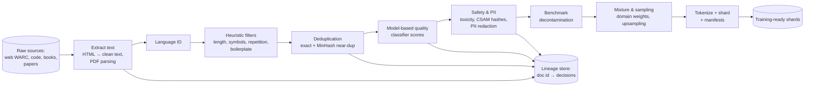

# AI 25. Design an LLM Pretraining Data Pipeline

## Interview question

> Design the pipeline that turns raw web crawls, code repositories, books, and papers into a clean, deduplicated, tokenized training dataset of ~15 trillion tokens for a large language model — with quality filtering, safety filtering, PII handling, data mixture control, and full lineage.

## Clarifying questions

| Question | Assumed answer |
|----------|----------------|
| Raw sources | ~100 PB of web crawl snapshots (WARC), public code, licensed books/papers, multilingual data |
| Output | Tokenized shards + manifests, ready for distributed training |
| Freshness | New crawl snapshots added every few months |
| Constraints | Respect robots.txt/opt-outs and licenses; remove PII; exclude benchmark test sets |
| Compute | Large CPU cluster (Spark/Ray-style) plus some GPUs for model-based classifiers |

## Requirements

**Functional:** ingest, extract text, language identification, quality and safety filtering, deduplication, PII redaction, decontamination, mixture/sampling, tokenization, sharding, lineage.
**Non-functional:** petabyte-scale throughput, reproducibility (re-run any version), auditability (why was a document included or removed?), cost efficiency.

## Estimation

- Raw crawl: billions of pages per snapshot; after extraction maybe ~10% of bytes are useful text.
- Typical yields: of raw web documents, often only a small fraction survives filtering + dedup (aggressive filtering is normal — quality beats quantity).
- 15T tokens × ~4 bytes/token ≈ **60 TB of clean text**; tokenized shards similar size in compact integer form.

## High-level design

Implemented as batch jobs on Spark/Ray over columnar files (Parquet) in object storage; each stage writes versioned outputs so stages can be re-run independently.

## Deep dive 1: extraction and heuristic filters

- HTML → main text with boilerplate removal (nav, ads, cookie banners); keep structure like headings, lists, code blocks.
- Language identification (fastText-style classifiers) → route to language-specific filters.
- Heuristics (cheap, run first): min/max length, fraction of alphabetic characters, repeated lines/n-grams (spam, templates), "lorem ipsum", excessive symbols, bad-word lists for specific domains, URL blocklists.

## Deep dive 2: deduplication

Duplicate and near-duplicate content wastes compute and causes memorization.
- **Exact dedup:** hash of normalized document (or of each line/paragraph to strip repeated boilerplate).
- **Near-dup:** **MinHash + LSH** — compute shingles (n-grams), MinHash signatures, and bucket with locality-sensitive hashing; documents with Jaccard similarity above ~0.8 are clustered and one is kept.
- Scale: distributed LSH over billions of documents → shuffle-heavy; process per snapshot then globally across snapshots.
- Also dedupe at sub-document level (repeated paragraphs across sites).

## Deep dive 3: model-based quality filtering

- Train lightweight classifiers (fastText or small transformers) to score "educational/high-quality" text — labels from a stronger LLM grading samples, or from reference corpora (e.g., Wikipedia-like or textbook-like text as positives).
- Keep documents above a threshold, or sample with probability proportional to quality.
- Validate filtering choices with **small proxy training runs**: train small models on different filtered variants and compare downstream benchmark scores — data decisions are made empirically.

## Deep dive 4: safety, PII, legal

- Remove CSAM via hash matching and classifiers (zero tolerance), filter extreme toxicity (balanced to avoid removing dialects or legitimate discussions).
- **PII:** detect and redact emails, phone numbers, IDs, addresses (regex + NER), with special care for code (keys/secrets in repos).
- Respect robots.txt/opt-out signals and source licenses; maintain domain-level exclusion lists; keep provenance for every document.

## Deep dive 5: decontamination

- Remove training documents that overlap with evaluation benchmarks (n-gram overlap, e.g., 13-gram matches) so reported scores are honest.
- Maintain a registry of protected eval sets; re-run decontamination when new benchmarks are adopted.

## Deep dive 6: mixture, tokenization, and sharding

- **Mixture:** weights per domain (web, code, math, books, multilingual, papers), upsampling scarce high-quality sources (a few epochs) and downsampling low-quality web; mixture schedules can change during training (e.g., more high-quality data in the final "annealing" phase).
- **Tokenization:** run the chosen tokenizer (BPE/SentencePiece) in parallel; pack documents into fixed-length sequences with separator tokens.
- **Sharding:** many equal-sized shards with manifests (counts, source mix, checksums), globally shuffled; deterministic ordering so training can resume exactly.

## Lineage & reproducibility

- Every dataset version = code commit + configs + input snapshot IDs + per-stage outputs.
- Per-document decision log (kept/removed and why) supports audits, takedown requests, and debugging ("why did the model learn this?").

## Trade-offs

| Choice | Pro | Con |
|--------|-----|-----|
| Aggressive filtering | Higher quality per token | Less diversity; risk of filtering out minority dialects/topics |
| MinHash near-dup | Scales to billions | Approximate; parameter tuning |
| Model-based quality scores | Big quality gains | Classifier bias becomes model bias |
| Upsampling good data | Better results | Repetition can cause memorization if overdone |

## Follow-up interview questions

**Q: How do you decide if a new filter helps?**
A: Ablation: train small proxy models (e.g., 1B params on tens of billions of tokens) on data with and without the filter, then compare benchmark and held-out loss results.

**Q: A website owner requests removal of their content. What happens?**
A: Add the domain to exclusion lists, use lineage to find affected documents and dataset versions, rebuild future datasets without them, and follow the policy for models already trained.

**Q: How would you add synthetic data?**
A: Generate with strong models (e.g., textbook-style explanations, math with verified solutions, code with passing tests), filter by verifiers and quality classifiers, dedupe against real data, and cap its share of the mixture to avoid model collapse.
