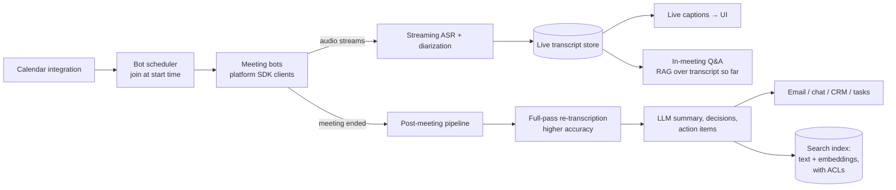

# AI 26. Design an AI Meeting Assistant (Live Transcription, Summaries, Action Items)

## Interview question

> Design an AI meeting assistant that joins video calls (Zoom, Google Meet, Teams), produces live captions with speaker names, answers questions during the meeting ("what did Priya say about the budget?"), and sends a summary with decisions and action items right after. 2M meetings/day.

## Clarifying questions

| Question | Assumed answer |
|----------|----------------|
| How it joins | A bot participant via platform SDKs/APIs, or a desktop app capturing local audio |
| Languages | 30+, including mixed-language meetings |
| Live features | Captions (< 1 s delay), in-meeting Q&A |
| Post-meeting | Summary, decisions, action items with owners, searchable transcript |
| Privacy | Consent notice to all participants, enterprise data controls, retention policies |
| Integrations | Calendar, CRM, task trackers (create tasks from action items) |

## Requirements

**Functional:** join/record (with consent); streaming transcription with speaker diarization; live Q&A over the transcript so far; post-meeting summary & action items; search across past meetings; integrations.
**Non-functional:** low caption latency, accuracy (names, jargon), privacy and access control, scale for peak hours (meetings cluster at :00 and :30), cost efficiency.

## Estimation

- 2M meetings/day × 40 min avg = 80M audio-minutes/day; peak concurrency maybe ~150k meetings at the top of the hour.
- Streaming ASR: GPU-batched streaming models handle many concurrent streams per GPU → hundreds to a few thousand GPUs at peak.
- Transcript: ~150 words/min → 6k words (~8k tokens) per meeting; summarization ≈ 2M × 8k = **16B input tokens/day**.

## High-level design

## Deep dive 1: joining meetings and capturing audio

- The scheduler reads calendars (with user consent), spins up a bot instance per meeting slightly before start (pre-warm capacity for :00/:30 peaks), and joins via the platform's SDK.
- Prefer **separate audio streams per participant** when the platform provides them → speaker attribution is trivial and accurate. Otherwise, run diarization on the mixed audio.
- A visible bot participant + announcement provides consent notice; respect hosts who remove the bot.

## Deep dive 2: streaming transcription

- Streaming ASR emits partial hypotheses quickly (captions) and finalizes segments after a short delay.
- **Contextual biasing:** feed participant names, company/product vocabulary, and meeting title into the recognizer to fix proper nouns.
- **Diarization:** speaker embeddings cluster voices; map clusters to participant names using platform active-speaker signals.
- After the meeting, a **second, slower, more accurate pass** over the full recording improves the final transcript (common pattern: fast streaming model for live, big offline model for the record).

## Deep dive 3: summarization and action items

- Long meetings exceed comfortable context sizes or dilute attention → **hierarchical summarization**: chunk by topic/time segments, summarize each, then synthesize the final summary.
- Structured output (JSON schema): `topics[]`, `decisions[]`, `action_items[{owner, task, due_date, quote_timestamp}]`, `open_questions[]`.
- **Grounding:** each decision/action item links to a transcript timestamp so users can verify; owners must be actual participants.
- Meeting-type templates (sales call → next steps, objections; standup → blockers; interview → candidate assessment rubric).

## Deep dive 4: live Q&A and cross-meeting search

- During the meeting: questions answered by RAG over the transcript so far (recent context + retrieval over earlier segments).
- Across meetings: index transcripts and summaries (keyword + vector) **with access control** — only participants (or people the meeting is shared with) can retrieve it. Permission filters are applied before the LLM sees anything.

## Deep dive 5: privacy & governance

- Admin controls: which meetings may be recorded, external-participant rules, data residency, retention (e.g., delete audio after 30 days, keep transcripts per policy).
- Encryption at rest/in transit; per-tenant isolation; no training on customer data without explicit agreement.
- Sensitive meetings (HR, legal) can be excluded by calendar labels.

## Evaluation

- ASR word error rate per language/accent, name accuracy, diarization error rate.
- Summary quality: LLM-judge rubrics (coverage of decisions, faithfulness, no fabricated action items) calibrated with human ratings; user edits to summaries as implicit feedback.
- Operational: caption latency, join success rate, cost per meeting-hour.

## Trade-offs

| Choice | Pro | Con |
|--------|-----|-----|
| Bot participant | Works without installing software | Platform API limits; visible bot |
| Two-pass ASR | Low-latency captions + accurate record | Double ASR compute |
| Hierarchical summarization | Handles long meetings well | More LLM calls; may lose cross-segment links |
| Per-participant audio streams | Accurate speakers | Not available on every platform |

## Follow-up interview questions

**Q: The summary assigned an action item to someone who wasn't in the meeting. How do you prevent this?**
A: Constrain owners to the participant list in the structured output schema, require a supporting transcript timestamp, and validate post-generation; low-confidence items are marked "unassigned".

**Q: How do you handle the 9:00 am spike when 100k meetings start at once?**
A: Calendar-driven pre-scaling (we know start times in advance), warm bot and ASR pools spun up minutes earlier, and staggered joins within the first seconds.

**Q: How would you support on-device/private mode?**
A: Run a smaller ASR model locally (desktop app), send only text (or nothing) to the cloud, and use a local or tenant-dedicated LLM for summaries — trading some accuracy for privacy.
