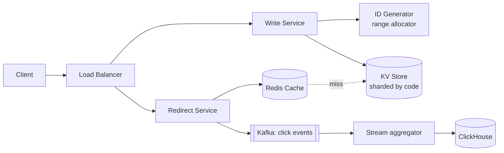

# 1. Design a URL Shortener (TinyURL / bit.ly)

## Interview question

> Design a service that takes a long URL and returns a short alias like `https://sho.rt/aZ3kP9q`. Visiting the short URL redirects to the original. Support custom aliases, expiration, and basic click analytics.

## Clarifying questions

| Question | Assumed answer |
|----------|----------------|
| Scale? | 100M new URLs/day, 10:1 read:write |
| Short code length? | As short as possible; 7 chars OK |
| Custom aliases? | Yes, optional |
| Expiration? | Optional, default never |
| Can a short link be edited/deleted? | Deleted yes, edited no |
| Analytics? | Click counts, referrer, country — eventually consistent is fine |
| Same long URL twice → same code? | Not required (simpler, and different users want separate stats) |

## Requirements

**Functional**
- `shorten(long_url, custom_alias?, expires_at?) → short_url`
- `GET /{code}` → HTTP redirect to the long URL
- Click analytics per link

**Non-functional**
- Redirect p99 < 50 ms; very high availability (a broken link is a visible failure)
- Short codes must be unique and non-guessable enough to prevent enumeration
- Durable: links live for years

## Estimation

- Writes: 100M/day ≈ **1,200 /s** (peak ~3k/s)
- Reads: 1B/day ≈ **12k /s** (peak ~30k/s)
- Storage per record ≈ 500 B → 100M × 500 B = 50 GB/day → **~18 TB/year**, ~90 TB over 5 years
- Code space: base62 with 7 chars = 62⁷ ≈ **3.5 trillion** codes; 5 years × 36.5B/yr = 182B → plenty
- Cache: 20% of links get 80% of traffic. Cache a day's hot set: 0.2 × 1B × 500 B ≈ 100 GB → a small Redis cluster

## API

```http
POST /api/v1/urls
{ "long_url": "https://example.com/a/very/long/path", "custom_alias": "promo", "expires_at": "2027-01-01T00:00:00Z" }
→ 201 { "short_url": "https://sho.rt/promo", "code": "promo" }

GET /{code}
→ 302 Location: https://example.com/a/very/long/path   (or 404 / 410 Gone if expired)

DELETE /api/v1/urls/{code}
GET /api/v1/urls/{code}/stats
```

**301 vs 302:** 301 (permanent) is cached by browsers, which cuts load but makes analytics undercount. Use **302** when analytics matter; 301 for pure cost savings.

## Data model

```sql
-- Key-value access pattern: lookup by code. Use DynamoDB/Cassandra, or sharded MySQL.
urls(
  code        VARCHAR(16) PRIMARY KEY,
  long_url    TEXT NOT NULL,
  user_id     BIGINT,
  created_at  TIMESTAMP,
  expires_at  TIMESTAMP NULL
)

-- Analytics go to a separate store (ClickHouse / BigQuery)
clicks(code, ts, country, referrer, user_agent)
```

A NoSQL key-value store fits: single-key lookups, no joins, horizontal scaling, easy sharding by `code`.

## High-level design



**Write path:** validate URL → get unique ID → base62-encode → store → return.
**Read path:** check Redis → on miss read DB, populate cache → publish click event async → 302.

## Deep dive 1: generating short codes

| Approach | How | Pros | Cons |
|----------|-----|------|------|
| Hash (MD5/SHA) + truncate | `base62(md5(url))[:7]` | Stateless | Collisions → need check-and-retry against DB |
| Random 7 chars | `random_base62(7)` | Unpredictable | Collision check needed; rate rises as space fills |
| Global counter + base62 | `base62(counter++)` | No collisions | Counter is a bottleneck/SPOF; sequential codes are guessable |
| **Range allocation (chosen)** | Each app server leases a block of 1M IDs from ZooKeeper/etcd/DB, increments locally | No collisions, no per-request coordination | Unused IDs lost on crash (fine); need to obfuscate |
| Snowflake-style IDs | timestamp + machine + seq | Decentralized | 64-bit → 11 base62 chars, longer codes |

**Chosen:** range allocation. To avoid guessable sequences, pass the ID through a reversible permutation (e.g., a Feistel cipher or multiply by a large prime mod 62⁷) before base62 encoding. Codes look random but remain collision-free.

```python
ALPHABET = "0123456789abcdefghijklmnopqrstuvwxyzABCDEFGHIJKLMNOPQRSTUVWXYZ"

def base62(n: int) -> str:
    s = []
    while n:
        n, r = divmod(n, 62)
        s.append(ALPHABET[r])
    return "".join(reversed(s)) or "0"
```

**Custom aliases:** write with a conditional insert (`INSERT ... IF NOT EXISTS` / DynamoDB `attribute_not_exists`). Reserve a namespace (e.g., custom aliases must contain a character that generated codes never produce, or use a separate check) so they can't collide with future generated codes.

## Deep dive 2: scaling the read path

- **Cache:** Redis with LRU, cache-aside. Hit rate is typically >90% because traffic is heavily skewed.
- **CDN / edge:** For viral links, serve the redirect at the edge (e.g., edge worker with KV store) to absorb spikes.
- **Negative caching:** Cache "not found" briefly to stop scanners from hammering the DB.
- **Replication:** Read replicas per region; links are immutable so replication lag is harmless (a newly created link might 404 for ~100 ms in a remote region — mitigate by reading from primary on cache+replica miss).

## Deep dive 3: analytics

Never write analytics synchronously in the redirect path. Publish click events to Kafka; a Flink job aggregates per (code, minute, country) and writes to ClickHouse. The redirect latency stays independent of analytics load.

## Expiration & cleanup

- Check `expires_at` at read time (return 410).
- Set Redis TTL ≤ expiry.
- A lazy background sweeper deletes expired rows; or use DB-native TTL (DynamoDB/Cassandra).

## Trade-offs & failure modes

| Concern | Mitigation |
|---------|------------|
| ID allocator down | Servers hold leased ranges, so writes continue for a while; allocator itself is replicated (etcd quorum) |
| Cache stampede on a viral link | Request coalescing / single-flight on miss |
| Abuse (phishing, spam) | Rate limit by user/IP, scan URLs against Safe Browsing, allow takedown |
| Hot shard | Code is pseudo-random → uniform distribution across shards |

## Follow-up interview questions

**Q: How would you guarantee the same long URL returns the same short code?**
A: Add a secondary index `long_url_hash → code`. On shorten, look up the hash first. This doubles write cost and must be scoped per user, otherwise users share analytics.

**Q: How do you prevent people from enumerating all links?**
A: Don't expose sequential IDs — permute them before encoding; rate-limit 404s per IP; optionally use longer codes for private links.

**Q: How would you make this multi-region?**
A: Partition the ID space per region (region prefix bits or separate ranges), so each region generates codes without cross-region coordination. Replicate data asynchronously to all regions; reads are local.

**Q: Why not just use a relational DB with auto-increment?**
A: It works at small scale. At 1k+ writes/s with 90 TB of data you need sharding, and auto-increment doesn't shard cleanly. Range allocation gives you the same property across shards.

**Q: What's the bottleneck at 10× scale?**
A: Read QPS (300k/s). Handled by more cache nodes and edge caching. Storage grows linearly and is solved by adding shards.
