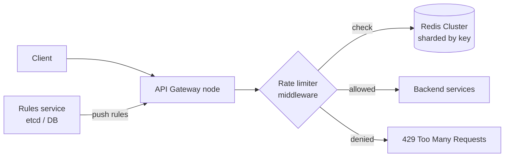

# 2. Design a Distributed Rate Limiter

## Interview question

> Design a rate limiter that protects an API gateway serving many services. Limits can be per user, per API key, per IP, and per endpoint (e.g., 100 requests/min per user on `/search`). It must work across a fleet of gateway servers.

## Clarifying questions

| Question | Assumed answer |
|----------|----------------|
| Where does it run? | In the API gateway (server-side), not client-side |
| Scale? | 1M RPS across 500 gateway nodes |
| How strict? | Small overshoot (a few %) is OK; no huge overshoot |
| Behavior when limited? | HTTP 429 with `Retry-After` and rate-limit headers |
| Rule changes? | Configurable at runtime without deploys |
| If the limiter fails? | Fail open (allow traffic) — availability over strictness |

## Requirements

**Functional:** evaluate rules keyed by (identity, endpoint); return allow/deny; expose remaining quota.
**Non-functional:** adds < 2 ms p99 latency; highly available; accurate across nodes; memory efficient.

## Estimation

- 1M RPS → 1M limiter checks/s.
- Redis at ~100k ops/s per shard (each check ≈ 1 Lua script call) → **~10–20 Redis shards** with headroom.
- Memory: 10M active keys × ~100 B = **1 GB** — trivial.

## Algorithms

| Algorithm | How it works | Pros | Cons |
|-----------|--------------|------|------|
| Fixed window counter | `INCR key:{minute}` | Simple, tiny memory | 2× burst at window edges |
| Sliding window log | Store every request timestamp in a sorted set | Exact | Memory O(requests) |
| **Sliding window counter** | Weighted sum of current + previous window | Smooth, O(1) memory | Approximate (assumes uniform distribution in the previous window) |
| **Token bucket** | Bucket of capacity B refilled at rate R; each request takes a token | Allows controlled bursts, O(1) | Two parameters to tune |
| Leaky bucket | Queue drained at constant rate | Smooth output | Adds latency; bursts queue |

**Chosen:** token bucket for most APIs (bursty client behavior is normal), sliding window counter where a hard "N per minute" contract is promised.

Sliding window counter estimate:
```
count = curr_window_count + prev_window_count × (1 − elapsed_in_curr / window_size)
```

## High-level design



- **Rules** stored in a config service and pushed/cached in each gateway (e.g., every 10 s or via watch).
- **Counters** live in Redis, sharded by the rate-limit key so a single key always hits one shard.

### Rule format

```yaml
- id: search-per-user
  match: { endpoint: "/search", key: "user_id" }
  algorithm: token_bucket
  capacity: 20
  refill_per_sec: 1.67   # 100/min
- id: global-per-ip
  match: { key: "ip" }
  algorithm: sliding_window
  limit: 1000
  window: 60s
```

## Deep dive 1: atomicity across nodes

Two gateways checking the same key concurrently will race with GET-then-SET. Use a **Redis Lua script** so read-modify-write is atomic on the shard:

```lua
-- KEYS[1] = bucket key; ARGV = capacity, refill_rate, now_ms, cost
local cap  = tonumber(ARGV[1])
local rate = tonumber(ARGV[2])
local now  = tonumber(ARGV[3])
local cost = tonumber(ARGV[4])
local b = redis.call('HMGET', KEYS[1], 'tokens', 'ts')
local tokens = tonumber(b[1]) or cap
local ts     = tonumber(b[2]) or now
tokens = math.min(cap, tokens + (now - ts) / 1000 * rate)
local allowed = tokens >= cost
if allowed then tokens = tokens - cost end
redis.call('HMSET', KEYS[1], 'tokens', tokens, 'ts', now)
redis.call('PEXPIRE', KEYS[1], math.ceil(cap / rate * 1000) + 1000)
return { allowed and 1 or 0, tokens }
```

Use Redis server time (`redis.call('TIME')`) instead of client time if gateway clocks may drift.

## Deep dive 2: latency and hot keys

- **Local pre-check:** Each gateway keeps a local in-memory token bucket at `limit / N_nodes` and only syncs with Redis periodically (e.g., every 100 ms batch). This trades accuracy for latency and Redis load. Good for very high-volume keys.
- **Hot key** (one huge customer): split the key into K sub-buckets `key:{0..K-1}`, each with limit/K, chosen randomly per request.
- **Pipelining:** If a request matches multiple rules, evaluate them in one Lua call.

## Deep dive 3: failure handling

- Redis timeout (e.g., > 5 ms) → **fail open** and emit a metric; optionally fall back to the local in-memory limiter.
- Redis replication is async, so a failover can reset some counters — acceptable for rate limiting.
- Circuit-break the Redis client to avoid piling up latency during an outage.

## Response headers

```
HTTP/1.1 429 Too Many Requests
Retry-After: 12
X-RateLimit-Limit: 100
X-RateLimit-Remaining: 0
X-RateLimit-Reset: 1760000000
```

## Trade-offs

| Choice | Gain | Cost |
|--------|------|------|
| Centralized Redis | Accurate global limits | Extra network hop (~0.5–1 ms) |
| Local-only limiters | Zero latency | Limit is per node; inaccurate when load is uneven |
| Hybrid (local + periodic sync) | Low latency, near-accurate | More complex; brief overshoot |
| Fail open | Availability | Abuse can slip through during outages |

## Follow-up interview questions

**Q: How would you rate limit across multiple regions?**
A: Usually limit per region with a regional Redis (each region gets a share of the global limit). Truly global limits require async cross-region counter sync (CRDT-style G-counters), accepting temporary overshoot.

**Q: How do you handle a client that retries immediately after a 429?**
A: Return `Retry-After`; for abusive clients escalate to a longer block (penalty box) stored as a separate key; at the extreme, block at the edge/WAF.

**Q: How is this different from load shedding?**
A: Rate limiting enforces per-client fairness contracts. Load shedding protects the server based on its own health (CPU, queue depth) regardless of client. You want both: limiter at the gateway, adaptive concurrency limits in services.

**Q: How would you implement cost-based limits (e.g., an expensive query costs 10 units)?**
A: Token bucket naturally supports it — pass `cost` to the script. Cost can be estimated before the request or charged after (deduct actual cost; allow the bucket to go negative).

**Q: Sliding window log is exact — why not always use it?**
A: Memory is O(limit) per key. With limit = 10k/hour and millions of keys, that's gigabytes of sorted-set entries and O(log n) operations. The counter approximation is within a few percent and O(1).
