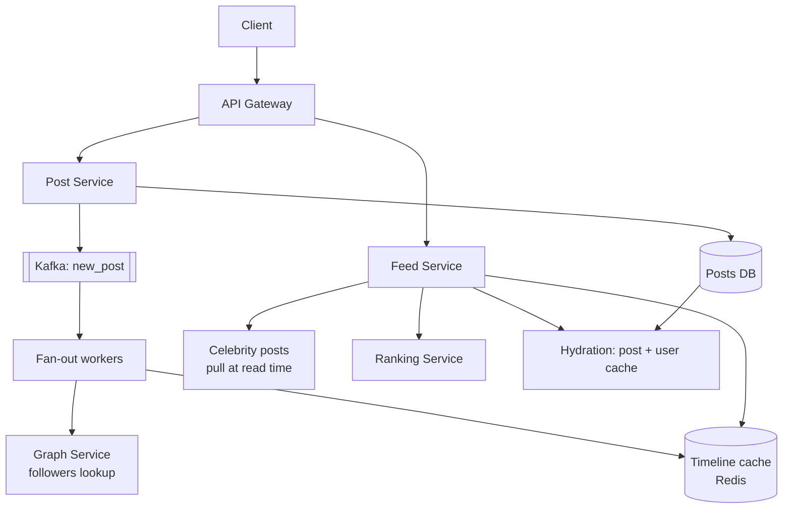

# 3. Design a News Feed (Twitter / Instagram)

## Interview question

> Design the home timeline for a social network. Users post content and follow other users. The home feed shows recent posts from people they follow, ranked. Support 500M DAU.

## Clarifying questions

| Question | Assumed answer |
|----------|----------------|
| Feed order? | Ranked (relevance), with recency as a strong signal |
| Post types? | Text + media (media stored separately in blob storage/CDN) |
| Follow graph shape? | Avg 200 followees; some accounts have 100M+ followers |
| Feed freshness? | New posts visible within a few seconds for most users |
| Scale? | 500M DAU, each opens feed ~10×/day; 100M posts/day |

## Requirements

**Functional:** create post; follow/unfollow; get home feed (paginated); like/comment counts.
**Non-functional:** feed load p99 < 300 ms; high availability over strict consistency; scales to celebrity accounts.

## Estimation

- Feed reads: 500M × 10 = 5B/day ≈ **58k QPS** (peak ~150k)
- Post writes: 100M/day ≈ **1.2k QPS**
- Fan-out: 1.2k posts/s × 200 avg followers = **240k timeline inserts/s** (excluding celebrities)
- Timeline cache: store 800 post IDs per user × 8 B = 6.4 KB; 500M users → **3.2 TB** of Redis (only cache active users)

## API

```http
POST /v1/posts           { "text": "...", "media_ids": ["m1"] }
POST /v1/users/{id}/follow
GET  /v1/feed?cursor=<opaque>&limit=20
→ { "items": [ {post...} ], "next_cursor": "..." }
```

Use cursor-based pagination (not offset) because the feed changes between page loads.

## Data model

```
users(user_id PK, name, follower_count, ...)
posts(post_id PK [snowflake, time-sortable], author_id, text, media_urls, created_at)  -- sharded by post_id
follows(follower_id, followee_id, created_at)  -- two tables/indexes: by follower and by followee
timeline cache (Redis): feed:{user_id} → sorted set of (post_id, score)
```

## High-level design



## Deep dive 1: fan-out on write vs fan-out on read

| Model | Write cost | Read cost | Good for |
|-------|-----------|-----------|----------|
| **Push (fan-out on write)** | O(followers) inserts | O(1) read of precomputed list | Normal users |
| **Pull (fan-out on read)** | O(1) | O(followees) queries + merge | Celebrities, inactive users |
| **Hybrid (chosen)** | Push for users with < ~10k followers | Merge precomputed list + pull from followed celebrities | Production systems (Twitter used this) |

**Hybrid flow:**
1. On post: if author follower count < threshold → fan-out workers push `post_id` into each follower's `feed:{id}` sorted set (trim to 800).
2. Skip fan-out for celebrities. Also skip users inactive for 30+ days (rebuild their feed on next login).
3. On read: fetch `feed:{user}` + recent posts from each followed celebrity (cached per celebrity, so it's one cache read per celebrity) → merge → rank → hydrate.

## Deep dive 2: ranking

Two stages:
1. **Candidate generation:** ~500–1000 post IDs from timeline + celebrity posts (+ optionally recommended out-of-network posts).
2. **Ranking:** a model (e.g., gradient-boosted trees or a neural net) scores P(like), P(comment), P(share), P(hide) from features: author affinity, post age, engagement velocity, media type. Final score = weighted sum of predictions.

Then apply business rules: diversity (don't show 5 posts from one author in a row), dedupe already-seen posts, inject ads.

See [AI: Recommendation System](../ai-system-design/03-recommendation-system.md) for ranking model depth.

## Deep dive 3: hydration and counts

- The feed holds only IDs. Hydrate via batch `MGET` from a post cache and a user cache.
- Like counts: high write volume. Use sharded counters in Redis, flushed to DB periodically. Show approximate counts.
- Deleted posts: filter at hydration time (tombstone check) rather than removing from millions of timelines.

## Trade-offs & failure modes

| Problem | Solution |
|---------|----------|
| Celebrity posts → 100M inserts | Pull model for celebrities |
| Fan-out lag during spikes | Kafka buffers; feed still shows older content; prioritize active users' queues |
| Redis loss | Timeline is a cache — rebuild from follow graph + posts DB on demand |
| Unfollow | Lazy: filter at read time; async cleanup |
| New follow | Backfill the last N posts of the new followee into the timeline |

## Follow-up interview questions

**Q: How do you pick the celebrity threshold?**
A: It's an economic trade-off: write amplification vs read-time merge cost. Pick it so that read-time merges stay bounded (e.g., users follow at most ~a few dozen "celebrities"). It can be dynamic based on follower count and posting rate.

**Q: How do you show "new posts available" in real time?**
A: Clients hold a long-poll/SSE/WebSocket connection; fan-out workers publish a lightweight notification to online users' connection servers. Clients fetch the actual feed on tap.

**Q: How would you shard posts?**
A: By `post_id` (snowflake, includes timestamp) for uniform distribution. A secondary index `author_id → post_ids` (sharded by author) supports profile pages and celebrity pulls.

**Q: How do you avoid showing the same post twice across pages?**
A: The cursor encodes the score/post_id boundary of the last item; also keep a short-lived "seen" set per session.

**Q: What if the ranking service is down?**
A: Degrade gracefully to reverse-chronological order from the timeline cache.
