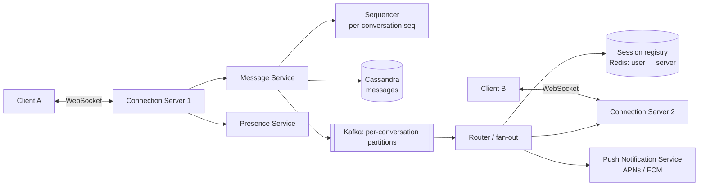

# 4. Design a Chat System (WhatsApp / Slack)

## Interview question

> Design a chat application supporting 1:1 and group chats (up to 500 members), online presence, delivery/read receipts, and message history across multiple devices. 200M DAU.

## Clarifying questions

| Question | Assumed answer |
|----------|----------------|
| 1:1 and group? | Both; groups ≤ 500 members |
| Message types? | Text; media via upload to blob storage, message carries a URL |
| Multi-device? | Yes — phone + web/desktop, history synced |
| Retention? | Stored on server indefinitely (Slack-style). (WhatsApp-style would delete after delivery.) |
| E2E encryption? | Mention as follow-up |
| Ordering? | Messages in a conversation must appear in the same order for all members |

## Requirements

**Functional:** send/receive messages in real time; offline delivery; history; presence; receipts (sent/delivered/read).
**Non-functional:** delivery latency < 200 ms for online users; no message loss; ordering per conversation; high availability.

## Estimation

- 200M DAU × 40 messages/day = 8B msgs/day ≈ **93k msgs/s** (peak ~250k)
- Avg message 200 B → 1.6 TB/day → **~600 TB/year** (plus replication)
- Concurrent connections: ~50M at peak; ~50k–100k WebSocket connections per server → **~500–1000 connection servers**

## API

Real-time via a persistent **WebSocket** connection (bidirectional, low overhead). REST for history & management.

```
WS → { "type": "send", "client_msg_id": "uuid", "conv_id": "c1", "body": "hi" }
WS ← { "type": "ack",  "client_msg_id": "uuid", "msg_id": 9001, "seq": 42 }
WS ← { "type": "message", "conv_id": "c1", "seq": 43, "from": "u2", "body": "hey" }
WS → { "type": "receipt", "conv_id": "c1", "seq": 43, "status": "read" }

GET /v1/conversations/{id}/messages?before_seq=43&limit=50
GET /v1/sync?since=<device_cursor>
```

## Data model

```
messages            -- Cassandra/ScyllaDB, partition by conv_id, cluster by seq
  (conv_id, seq) PK, msg_id, sender_id, body, created_at

conversations(conv_id, type, name, created_at)
conversation_members(conv_id, user_id, last_read_seq, joined_at)
user_conversations(user_id, conv_id, last_activity)   -- inbox list
```

Cassandra fits: write-heavy, time-ordered reads within a partition, horizontal scale. For very active groups, bucket partitions by time: `(conv_id, month)`.

## High-level design



## Message flow (A → B)

1. A sends over WebSocket with a `client_msg_id` (idempotency key).
2. Message Service assigns a **per-conversation sequence number**, writes to Cassandra, then ACKs to A ("sent" ✓).
3. Publishes to Kafka (partitioned by `conv_id` → ordering preserved).
4. Router looks up B's devices in the session registry. Online → push to B's connection server. Offline → send push notification.
5. B's client ACKs → "delivered" ✓✓ is propagated back to A. Read → `last_read_seq` updated, "read" receipt sent.

## Deep dive 1: ordering & exactly-once display

- Wall-clock timestamps from clients are unreliable. Use a **server-assigned monotonically increasing seq per conversation**. Options: Redis `INCR conv:{id}:seq`, or a single owner (the Kafka partition consumer or a conversation actor) that assigns sequences.
- Retries can duplicate sends → dedupe by `(conv_id, client_msg_id)`.
- Clients detect gaps in `seq` and fetch missing messages via `/sync`. This makes delivery effectively **at-least-once with idempotent display**.

## Deep dive 2: multi-device sync

Each device keeps a cursor (last seen seq per conversation, or a per-user inbox stream offset). On reconnect, the device calls `/sync?since=cursor` to pull everything missed. Real-time pushes are an optimization on top of pull-based sync — this is what makes the system robust to dropped connections.

## Deep dive 3: group fan-out

- Group of 500: router fetches member list (cached), groups members by connection server, and sends one batched RPC per server.
- Storage: write the message **once** per conversation (not per recipient). Each member's read position is just `last_read_seq`.
- Large channels (Slack with 100k members): don't push full messages to everyone; push "channel has new activity" and let clients pull.

## Deep dive 4: presence

- Clients send heartbeats every ~30 s over the WebSocket. Presence service stores `user → last_seen` in Redis with TTL.
- Status change publishes to subscribers — but only to users who currently have the person's chat open or in their contact list *and are online*. Fanning out presence to everyone is the classic scalability trap.
- Debounce flapping (mobile network switches) with a grace period.

## Connection servers

- Stateful; use a consistent L4 load balancer. Session registry maps `user_id/device_id → server_id`.
- On server crash, clients reconnect (with jittered backoff) to another server and resync via cursor. No messages lost because persistence happens before delivery.

## Trade-offs

| Choice | Why | Cost |
|--------|-----|------|
| WebSocket vs long polling | Lower latency/overhead | Stateful servers, harder LB |
| Persist before deliver | No loss | Adds a DB write (~5 ms) on the hot path |
| Per-conversation seq | Simple, consistent ordering | Sequencer is a hot spot for huge groups (shard by conv) |
| Store once per conv | Storage efficient | Per-user "inbox" queries need a separate index |

## Follow-up interview questions

**Q: How would end-to-end encryption change the design?**
A: Server only stores/forwards ciphertext. Use the Signal protocol (X3DH + Double Ratchet); for groups, sender keys. Server can't search messages or generate previews; multi-device requires each device to have its own keys and messages encrypted per device.

**Q: How do you handle a user who's offline for a month?**
A: On reconnect, they sync per-conversation using cursors, starting with the inbox list (most recent conversations first) and lazily loading history.

**Q: What if Kafka is down?**
A: Messages are already persisted in Cassandra; online delivery degrades, and clients fall back to polling `/sync`. Once Kafka recovers, delivery resumes.

**Q: How do you implement "typing…" indicators?**
A: Ephemeral events sent through the same WebSocket and router path but never persisted, throttled to once every few seconds, dropped if the recipient is offline.

**Q: How do you search message history?**
A: Async index messages into Elasticsearch partitioned by workspace/user, with ACL filters on conversation membership. (Not possible with E2EE except client-side.)
