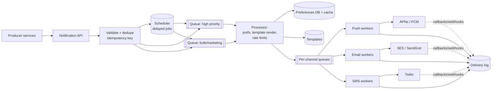

# 5. Design a Notification System

## Interview question

> Design a service that lets internal teams send notifications to users via push (iOS/Android), email, and SMS. Support user preferences, templates, scheduling, and rate limits. Volume: 1B notifications/day.

## Clarifying questions

| Question | Assumed answer |
|----------|----------------|
| Channels? | Push (APNs/FCM), email, SMS, in-app |
| Types? | Transactional (OTP, receipts) and marketing (campaigns) |
| Latency? | Transactional < few seconds; marketing can be minutes |
| Delivery guarantee? | At-least-once; avoid duplicates where possible |
| Preferences? | Users can opt out per channel and per category; quiet hours |

## Requirements

**Functional:** send API; templates with localization; user preferences; scheduling; delivery tracking; bulk campaigns.
**Non-functional:** reliable (no silent drops); scalable to spikes (campaigns to 100M users); priority isolation (OTP never stuck behind marketing).

## Estimation

- 1B/day ≈ **12k/s** average; campaigns can spike to **~500k/s** for minutes.
- Notification log: 1B × 500 B = 500 GB/day (keep 30–90 days hot).

## API

```http
POST /v1/notifications
{
  "idempotency_key": "order-123-shipped",
  "user_ids": ["u1"],
  "template_id": "order_shipped",
  "params": { "order_id": "123" },
  "category": "transactional",
  "channels": ["push", "email"],
  "send_at": null
}
→ 202 { "notification_id": "n-789" }

GET /v1/notifications/{id}/status
```

## High-level design



## Deep dive 1: reliability

- **Accept fast, process async:** API writes the request to a durable queue (Kafka/SQS) and returns 202.
- **Idempotency:** store `idempotency_key` in Redis/DB with TTL (e.g., 24 h). Duplicate request → return original ID.
- **Retries:** exponential backoff with jitter for 5xx/timeouts from providers; no retry on permanent errors (invalid token, unsubscribed). After N attempts → dead-letter queue + alert.
- **Per-attempt dedupe:** workers record `(notification_id, channel, user)` as sent before ACKing the queue message, so redelivery doesn't double-send. Exactly-once to the end device is impossible; aim for at-least-once + dedupe.
- **Invalid device tokens:** APNs/FCM feedback → remove tokens from device registry.

## Deep dive 2: priority isolation & spikes

- Separate queues and worker pools per priority (OTP vs marketing) — a 100M-user campaign must not delay a password reset.
- **Campaign expansion:** a campaign targets a segment (e.g., "all users in US"). A segment expander streams user IDs in batches into the bulk queue, throttled to a configured send rate.
- **Provider rate limits:** token bucket per provider/account (e.g., SMS provider allows 1k/s). Workers acquire tokens before sending.
- **Per-user frequency caps:** "max 3 marketing pushes/day" via a per-user counter in Redis.

## Deep dive 3: preferences & compliance

```
user_preferences(user_id, category, channel, enabled, quiet_hours_start, quiet_hours_end, timezone)
device_tokens(user_id, device_id, platform, token, last_seen)
```

- Cached in Redis; processor checks before rendering.
- Quiet hours: requeue to scheduler at the user's local quiet-hours end (except transactional/critical).
- Legal: unsubscribe links in emails (CAN-SPAM/GDPR), SMS STOP handling, audit logs.

## Scheduling

- Small scale: DB table indexed by `send_at`, polled by workers using `SELECT ... FOR UPDATE SKIP LOCKED`.
- Large scale: time-bucketed scheduler (e.g., Redis sorted set by timestamp, sharded), or a timer wheel; move due jobs to the main queue.

## Tracking

Status machine: `accepted → queued → sent → delivered → opened/clicked` or `failed / suppressed`. Provider webhooks (email delivered/bounced, SMS DLRs) update the log. Analytics to a warehouse.

## Trade-offs

| Choice | Pro | Con |
|--------|-----|-----|
| Kafka vs SQS | Kafka: replay, high throughput; SQS: per-message visibility timeouts, easier retries | Kafka retries need retry topics |
| Render at send time | Latest template/user data | More work in hot path |
| Multiple providers per channel | Failover if one is down | Cost & integration complexity |

## Follow-up interview questions

**Q: How do you avoid sending the same push to a user twice when a worker crashes after sending but before ACK?**
A: Write a sent-marker keyed by `(notification_id, device)` before the send call completes (or atomically with a status update), and check it on redelivery. A tiny window remains; truly exactly-once isn't possible with external providers.

**Q: How do you support in-app notifications?**
A: Write to a per-user inbox table (Cassandra, partitioned by user) and push a real-time event via the WebSocket gateway if online. Unread counts in Redis.

**Q: How would you A/B test notification copy?**
A: Template variants with assignment by hash(user_id, experiment) in the processor; log variant with each send; measure open/click/conversion downstream.

**Q: A provider is down — what happens?**
A: Circuit breaker opens, messages stay in the channel queue (or fail over to a secondary provider). Transactional SMS might fall back to email/push.
