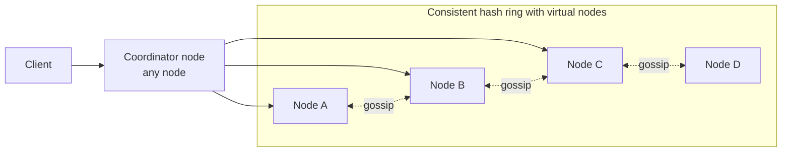

# 6. Design a Distributed Key-Value Store (Dynamo / Cassandra-style)

## Interview question

> Design a distributed key-value store supporting `put(key, value)` and `get(key)`. It should scale horizontally to petabytes, be highly available, and let clients tune consistency.

## Clarifying questions

| Question | Assumed answer |
|----------|----------------|
| Value size? | Small (< 10 KB typical, < 1 MB max) |
| CP or AP? | AP by default with tunable consistency |
| Scale? | Hundreds of nodes, 10s of PB, millions of ops/s |
| Range queries? | Not required (hash partitioning) |
| Multi-datacenter? | Yes |

## Requirements

**Functional:** get, put, delete; optional TTL.
**Non-functional:** single-digit ms latency; always writable; automatic scaling and failure recovery; tunable consistency.

## CAP framing

During a network partition you must choose:
- **CP:** refuse some requests to stay consistent (e.g., etcd, ZooKeeper, HBase).
- **AP:** stay available, accept temporary divergence, reconcile later (Dynamo, Cassandra).

We choose **AP with tunable quorums**: clients pick per request.

## Architecture



Every node is identical (no master). Any node can coordinate a request.

## Deep dive 1: partitioning — consistent hashing

- Hash keys onto a ring (e.g., 0…2¹²⁸). Each node owns ranges; a key is stored on the first node clockwise plus the next N−1 distinct nodes (replication factor N = 3).
- **Virtual nodes:** each physical node owns ~256 tokens on the ring → even distribution and, when a node joins/leaves, load spreads across many nodes instead of one neighbor.
- Adding a node moves only ~1/N_nodes of the data.

## Deep dive 2: replication & quorum

With N replicas, write quorum W, read quorum R:
- **R + W > N** → reads see the latest write (strong-ish consistency, modulo sloppy quorum).
- Common: N=3, W=2, R=2 (balanced); W=1,R=1 (fast, eventual); W=3,R=1 (read-optimized).

Multi-DC: `LOCAL_QUORUM` to avoid cross-region latency on the hot path; async replication to other DCs.

## Deep dive 3: conflict resolution

Concurrent writes to different replicas cause divergence.
- **Last-write-wins (LWW)** with timestamps: simple (Cassandra); can drop writes under clock skew.
- **Vector clocks** (Dynamo): detect concurrent versions; return siblings to the client to merge (e.g., union of shopping carts).
- **CRDTs:** data types that merge automatically (counters, sets).

## Deep dive 4: write path (LSM tree storage engine)

1. Append to **commit log** (WAL) on disk → durability.
2. Insert into **memtable** (in-memory sorted structure).
3. When full, flush to an immutable **SSTable** on disk.
4. Background **compaction** merges SSTables, drops overwritten/deleted (tombstoned) entries.

Read path: memtable → SSTables (newest first), using per-SSTable **Bloom filters** to skip files that don't contain the key, plus a row/key cache.

LSM trees favor writes (sequential I/O). B-trees favor reads; LSM is the usual choice for write-heavy KV stores.

## Deep dive 5: failure handling

| Mechanism | Purpose |
|-----------|---------|
| **Gossip protocol** | Each node periodically exchanges membership/heartbeat state with random peers; failure detected via phi-accrual detector |
| **Sloppy quorum + hinted handoff** | If a replica is down, write to the next healthy node with a "hint"; deliver when the replica returns. Keeps writes available |
| **Read repair** | On read, if replicas disagree, coordinator writes the latest version back to stale replicas |
| **Anti-entropy with Merkle trees** | Replicas compare Merkle tree hashes of key ranges and sync only differing ranges — efficient background repair |

## Put/Get example (N=3, W=2, R=2)

```
put(k, v):
  coordinator hashes k → replicas [A, B, C]
  send write to A, B, C; return success after 2 ACKs

get(k):
  send read to A, B, C (or 2 + digest from the 3rd)
  wait for 2 responses; return newest version; repair stale replica async
```

## Trade-offs

| Choice | Benefit | Cost |
|--------|---------|------|
| Leaderless | No failover, high availability | Conflicts, complex repair |
| LWW | Simple | Lost updates under skew |
| Virtual nodes | Balanced load | More metadata, repair overhead |
| LSM storage | Fast writes | Read amplification, compaction I/O |

## Follow-up interview questions

**Q: How would you make it strongly consistent?**
A: Use leader-based replication per partition with Raft/Paxos (like Spanner, CockroachDB, TiKV). Writes go to the leader and commit on majority. Costs availability during leader election and a cross-replica round-trip per write.

**Q: How do you handle a hot key?**
A: Client-side/proxy cache for reads; for writes, split the key (`key#0..k`) and aggregate on read; or increase replication for that key range.

**Q: How do tombstones cause problems?**
A: Deleted keys become tombstones that must persist until all replicas have seen them (gc_grace). Many tombstones slow reads (scanning them) and resurrect data if a replica missed the delete and the tombstone was purged before repair.

**Q: How would you turn this into a distributed cache instead (like Memcached/Redis Cluster)?**
A: Drop the WAL/SSTables (memory only), use LRU eviction, consistent hashing on the client or proxy, and replication only for availability. Accept data loss on node failure; the source of truth is the DB.

**Q: How do you add range queries?**
A: Range partitioning (by key ranges, like Bigtable/HBase) instead of hashing, with dynamic split/merge of ranges. Prone to hot spots for sequential keys.
