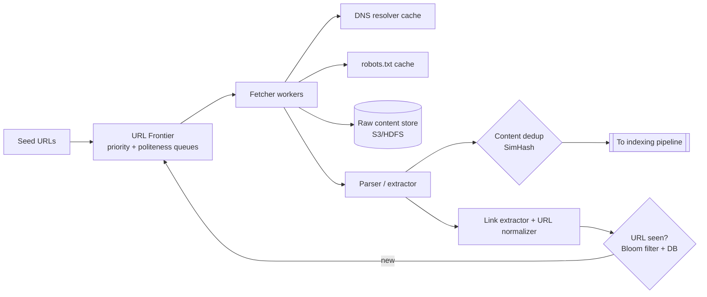

# 7. Design a Web Crawler

## Interview question

> Design a web crawler that downloads 1 billion pages per month for a search engine index. It must be polite to websites, avoid duplicate work, and keep content fresh.

## Clarifying questions

| Question | Assumed answer |
|----------|----------------|
| Purpose? | Search indexing (HTML only; skip images/video) |
| Scale? | 1B pages/month; store content for 5 years |
| Freshness? | Popular pages recrawled daily; long tail monthly |
| Robots.txt? | Must respect |
| Dynamic JS pages? | Small fraction rendered via headless browser |

## Requirements

**Functional:** start from seed URLs; fetch, parse, extract links; store content; schedule recrawls.
**Non-functional:** scalable; polite (per-host rate limits); robust to traps and malformed pages; extensible (new content types).

## Estimation

- 1B pages / month ≈ **400 pages/s** (peak ~800/s)
- Avg page 500 KB raw → compress to ~100 KB → 100 TB/month → **6 PB over 5 years**
- Bandwidth: 400 × 500 KB = **200 MB/s ≈ 1.6 Gbps**

## High-level design

## Deep dive 1: the URL frontier

Two-level design (from the Mercator crawler):

1. **Front queues (priority):** URLs assigned to F queues by priority (PageRank, domain importance, change frequency). A biased selector picks higher-priority queues more often.
2. **Back queues (politeness):** B queues, each holding URLs for **a single host**. A heap tracks the earliest time each host may be contacted next. A fetcher thread pops the host whose time has arrived, fetches one URL, then sets `next_time = now + delay` (e.g., delay = 10 × last fetch duration, or the robots.txt `Crawl-delay`).

This guarantees one connection per host at a time and prioritizes important pages.

Frontier storage: billions of URLs don't fit in memory → keep queues on disk (e.g., RocksDB/Kafka) with in-memory buffers at the head and tail.

**Distribution:** partition hosts across crawler nodes by `hash(host)`, so each host's politeness is enforced by one node — no cross-node coordination.

## Deep dive 2: deduplication

- **URL dedup:** normalize (lowercase host, strip fragments, sort query params, remove tracking params), then check a **Bloom filter** (10B URLs at 1% FPR ≈ 12 GB). False positives mean we skip a few new URLs — acceptable. Confirm with a KV store of URL → last crawl metadata.
- **Content dedup:** ~30% of the web is duplicate or near-duplicate. Exact: hash of content. Near-dup: **SimHash** (64-bit fingerprint; documents within Hamming distance ≤ 3 are near-duplicates).

## Deep dive 3: robustness

- **Crawler traps** (infinite calendars, session IDs in URLs): max URL length, max depth per host, max pages per host per crawl cycle, detect repeating path segments.
- **Timeouts** and max download size.
- **DNS** is a hidden bottleneck — run a local caching resolver.
- **Robots.txt:** cache per host (refresh daily); obey `Disallow` and `Crawl-delay`.
- **Checkpointing:** frontier state persisted so a crash doesn't lose progress.

## Deep dive 4: freshness / recrawl

- Track per-URL change history (`last_modified`, content hash). Estimate change rate (e.g., Poisson model); schedule next crawl ∝ estimated change frequency × importance.
- Use conditional GETs (`If-Modified-Since`, `ETag`) to save bandwidth.
- Sitemaps and RSS feeds give hints of new/changed URLs.

## Storage

- Raw pages: compressed WARC files in object storage, keyed by URL hash + crawl timestamp.
- Metadata: `url_hash → {url, last_crawl, status, content_hash, next_crawl}` in Bigtable/Cassandra.

## Trade-offs

| Choice | Pro | Con |
|--------|-----|-----|
| BFS vs priority | Priority crawls important pages first | Needs a scoring signal |
| Bloom filter | Memory efficient | False positives skip URLs |
| Partition by host | Simple politeness | Uneven load for huge hosts (split by sub-path if necessary) |
| Headless rendering | Captures JS content | 10–100× more expensive; only for pages that need it |

## Follow-up interview questions

**Q: How do you detect a page needs JS rendering?**
A: Heuristics: tiny HTML body with large JS bundles, known SPA frameworks, or comparing the text extracted from raw HTML vs a sample rendered version. Route those to a separate rendering queue.

**Q: How do you avoid overloading a small site that's linked from everywhere?**
A: Per-host back queue + minimum delay between requests + respect for `Crawl-delay`; adaptive slowdown on 429/503 or rising latency.

**Q: How would you crawl 10× faster?**
A: Add fetcher nodes (stateless apart from their host partition) and rebalance host partitions with consistent hashing; async I/O fetchers (thousands of concurrent connections per node); more bandwidth. The politeness constraint doesn't change — speedup comes from crawling more hosts in parallel.

**Q: How do you handle the same content at different URLs (canonicalization)?**
A: Respect `<link rel="canonical">`, 301 redirects, and SimHash clustering; index only the canonical URL.
