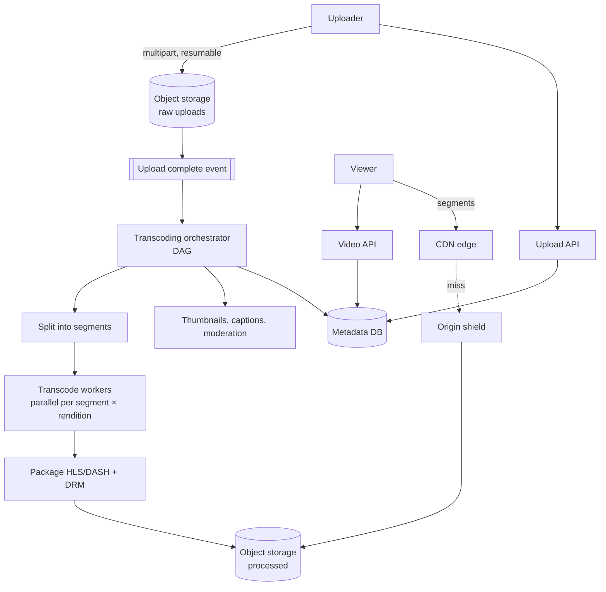

# 8. Design a Video Streaming Platform (YouTube / Netflix)

## Interview question

> Design a platform where users upload videos and others stream them on any device with smooth playback. 1B DAU watching; 500 hours of video uploaded per minute.

## Clarifying questions

| Question | Assumed answer |
|----------|----------------|
| Upload + watch? | Both (YouTube-style). Netflix is watch-only with a curated catalog |
| Devices? | Web, mobile, TV — adaptive quality |
| Max video size? | 256 GB / 12 h |
| Features in scope? | Upload, transcode, stream, view counts; recommendations out of scope |
| Live streaming? | Out of scope (follow-up) |

## Requirements

**Functional:** upload video; process into multiple formats; stream with adaptive bitrate; metadata (title, thumbnail, views).
**Non-functional:** playback starts < 2 s; minimal rebuffering; highly available; uploads reliable for large files; cost-efficient (bandwidth dominates).

## Estimation

- Uploads: 500 h/min → 720k hours/day.
- Storage: 1 hour of source ≈ 3 GB; after transcoding to ~6 renditions × 2 codecs ≈ +3 GB → ~6 GB/hour → **~4.3 PB/day** of new storage.
- Streaming egress: 1B DAU × 30 min × ~3 Mbps ≈ 1B × 675 MB ≈ **675 PB/day** → must be served from CDN/edge caches.

## API

```http
POST /v1/uploads                       → { upload_id, presigned_part_urls[] }   # resumable multipart
PUT  <presigned S3 URL per chunk>
POST /v1/uploads/{id}/complete         { title, description }
GET  /v1/videos/{id}                   → metadata + manifest URL
GET  https://cdn.../{id}/master.m3u8   → HLS master playlist
```

## High-level design



## Deep dive 1: upload

- Client asks for a **resumable multipart upload** (e.g., 8–16 MB chunks, presigned URLs straight to object storage — bypasses app servers).
- Failed chunks retry independently; the client can resume after network loss.
- On completion, an event triggers processing; the video is in `PROCESSING` state.

## Deep dive 2: transcoding pipeline

- **Why:** source formats vary; devices need different codecs (H.264 universal, VP9/AV1/HEVC for efficiency) and resolutions (240p → 4K).
- **Split → parallelize → merge:** split the source at keyframes into ~10 s GOP-aligned segments; transcode each segment × rendition in parallel on a worker fleet (CPU or hardware encoders). A 1-hour video finishes in minutes rather than hours.
- **DAG orchestrator** (e.g., a workflow engine like Temporal or a custom DAG): tasks = validate → split → transcode (fan-out) → package → thumbnails → content moderation → publish. Each task is idempotent and retried on failure.
- **Prioritize:** publish low resolutions first so the video goes live quickly; generate 4K / AV1 later, and only for videos that get views (save compute on long-tail videos nobody watches).
- **Per-title encoding:** choose bitrate ladders per video complexity (cartoons need less bitrate than sports).

## Deep dive 3: adaptive bitrate streaming (ABR)

- Output **HLS or DASH**: video cut into 2–6 s segments per rendition, plus a manifest listing renditions and segment URLs.
- The player measures throughput and buffer level and picks the rendition for each next segment (buffer-based algorithms like BOLA). This avoids rebuffering when bandwidth drops.
- Start with a low rendition for fast startup, then ramp up.

## Deep dive 4: CDN strategy

- Bandwidth is the dominant cost. Popular content served from edge caches (cache hit ratio > 95%).
- **Tiered caching:** edge → regional "origin shield" → object storage, to protect the origin.
- **Proactive placement** (Netflix Open Connect): push popular titles to ISP-embedded caches overnight during off-peak hours.
- **Long tail** stays in fewer locations; served from regional caches/origin.

## Metadata & views

- Metadata DB: MySQL (sharded, e.g., via Vitess) — `videos(video_id, owner_id, title, status, duration, renditions, created_at)`.
- View counts: write-heavy → client sends events to Kafka; stream aggregation (Flink) updates counters periodically; dedupe/anti-fraud before counting.

## Trade-offs

| Choice | Benefit | Cost |
|--------|---------|------|
| Transcode everything upfront | Instant high quality | Wasted compute on unwatched videos |
| Lazy high-quality encodes | Saves compute | First viewers see lower quality |
| AV1 | ~30% smaller than VP9 | Very expensive to encode; device support |
| Shorter segments | Faster quality switching, lower latency | More requests, worse compression |

## Follow-up interview questions

**Q: How do you add live streaming?**
A: Ingest via RTMP/SRT/WebRTC to an ingest server, real-time transcode into an ABR ladder, package into short segments (LL-HLS with partial segments ~1 s), push to CDN. Latency 2–5 s instead of ~30 s.

**Q: How do you protect premium content?**
A: DRM (Widevine, FairPlay, PlayReady) with encrypted segments (CENC); license server issues keys to authenticated players; signed CDN URLs with short expiry.

**Q: How do you handle a video that suddenly goes viral?**
A: CDN absorbs it; origin shield collapses concurrent misses to a single origin fetch; trigger high-quality encodes on popularity spikes.

**Q: How do you resume playback on another device?**
A: Client periodically sends watch-position heartbeats → stored in a per-user KV store (`user_id, video_id → position`), read on play.
