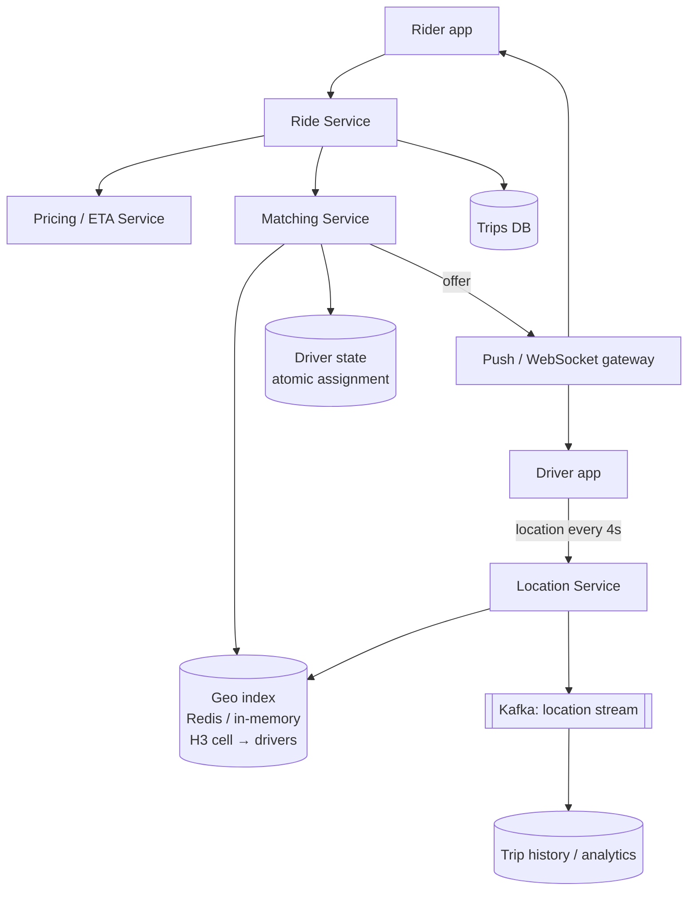

# 9. Design a Ride-Sharing Service (Uber / Lyft)

## Interview question

> Design the backend for a ride-hailing app. Riders request a ride; the system matches them with a nearby driver, both see each other's live location, and the trip is tracked until completion. 10M rides/day globally.

## Clarifying questions

| Question | Assumed answer |
|----------|----------------|
| Scope? | Request, match, live tracking, trip lifecycle. Payments/pricing briefly |
| Drivers online? | ~2M concurrently at peak |
| Location update frequency? | Drivers every 4 s |
| Matching latency? | Find a driver within a few seconds |
| Consistency? | A driver must never be assigned two rides at once |

## Requirements

**Functional:** drivers report location; riders see nearby cars; request ride → ETA & price; match to driver; driver accepts; live trip tracking; trip completion.
**Non-functional:** low-latency matching; high write throughput for locations; strong consistency for assignments; availability per city.

## Estimation

- Location updates: 2M drivers / 4 s = **500k writes/s**. Each update ~100 B → 50 MB/s.
- Ride requests: 10M/day ≈ 115/s average, peak ~1k/s.
- Location data is ephemeral: only the latest position matters for matching (history goes to cold storage for analytics).

## API

```http
# Driver (over WebSocket or HTTP/2 stream)
POST /v1/drivers/location   { lat, lng, heading, speed, ts }
POST /v1/drivers/status     { status: "available" | "offline" }
POST /v1/offers/{id}/accept

# Rider
GET  /v1/nearby?lat=&lng=          → driver positions (approximate)
POST /v1/rides  { pickup, dropoff, product: "standard" } → { ride_id, eta, price }
GET  /v1/rides/{id}                 → status, driver location
```

## High-level design



## Deep dive 1: geospatial indexing

Goal: "find available drivers within ~2 km of a point" with 500k location updates/s.

| Option | Notes |
|--------|-------|
| SQL `WHERE lat BETWEEN ... AND lng BETWEEN ...` | Too slow at this update rate |
| Quadtree | Adapts to density; rebuild/updates are costly with moving points |
| **Geohash** | String prefix = cell; easy in Redis (`GEOADD/GEOSEARCH`); edge effects at cell boundaries |
| **H3 hexagons (Uber)** | Uniform neighbor distances, hierarchical; query = cell + k-ring neighbors |

**Chosen:** H3 at resolution ~8–9 (cells ~0.5 km²). Store `cell_id → set(driver_id)` and `driver_id → (lat, lng, cell, ts)` in memory (Redis or an in-memory service sharded by city/region).

On each update: if the driver changed cell, remove from the old cell set and add to the new one. To query: get the rider's cell + k-ring of neighbors, union driver sets, compute exact distance, filter available drivers.

**Sharding:** by geography (city/region). Nearly all queries are local to a region, so cross-shard queries are rare (handle borders via neighbor shards).

## Deep dive 2: matching

1. Rider requests ride → Matching Service queries nearby available drivers.
2. Rank candidates by **ETA** (road-network routing, not straight-line distance), driver rating, acceptance probability.
3. **Atomically reserve** the top driver: `SET driver:{id}:state ride_123 NX` (or compare-and-set in a strongly consistent store). If it fails, the driver was taken → try next.
4. Send offer with a timeout (~15 s). Accept → trip created. Decline/timeout → release reservation, offer next driver.

**Batch matching:** instead of greedy first-come matching, collect requests for ~1–2 s and solve an assignment problem (bipartite matching minimizing total ETA). Better global efficiency in dense cities.

## Deep dive 3: live tracking

- Driver location stream → the trip's subscribers (rider app) via WebSocket gateway; a pub/sub channel per trip.
- Client-side interpolation/smoothing and map-matching (snap GPS to roads).

## Deep dive 4: trip state machine & consistency

```
REQUESTED → MATCHING → DRIVER_ASSIGNED → DRIVER_ARRIVED → IN_PROGRESS → COMPLETED
                ↘ NO_DRIVERS            ↘ CANCELLED
```

- Trips DB: strongly consistent (PostgreSQL sharded by city, or Spanner/CockroachDB). Transitions use optimistic concurrency (`UPDATE ... WHERE state = expected`).
- Payment is triggered on COMPLETED via an async, idempotent workflow (see [Payment System](12-payment-system.md)).

## Pricing & ETA (brief)

- ETA: routing engine on a road graph (contraction hierarchies) + ML correction from historical traffic.
- Surge: per-H3-cell supply/demand ratio computed in a streaming job every ~1 min.

## Trade-offs & failure modes

| Problem | Approach |
|---------|----------|
| Location writes overwhelm DB | Keep latest location in memory only; stream history to Kafka |
| Region outage | Cell-based architecture; each region independent; trip state replicated so in-progress trips survive |
| Driver loses connectivity | Mark stale after N missed heartbeats; don't offer rides; trip continues with last known location |
| Double assignment | Atomic reservation on driver state |

## Follow-up interview questions

**Q: Why not store driver locations in a relational DB with a spatial index?**
A: 500k updates/s with index maintenance is too expensive, and we only need the latest position. An in-memory index sharded by region handles it with sub-ms updates.

**Q: How do you support ride pooling?**
A: Matching considers in-progress trips with spare seats; the cost function includes detour time for existing riders; constraints limit max detour. It's a vehicle-routing problem solved heuristically in small batches.

**Q: How do you reduce location update cost?**
A: Adaptive frequency (less frequent when stationary or not on a trip), delta encoding, batching over a persistent connection.

**Q: How do you test matching changes safely?**
A: Simulation against replayed historical demand/supply, then city-level A/B tests (switchback experiments by time window, since riders and drivers interact within a market).
