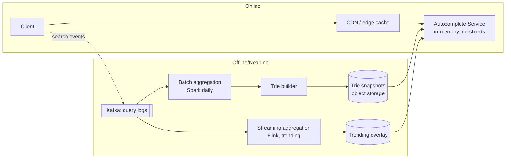

# 10. Design Search Autocomplete (Typeahead)

## Interview question

> As a user types into a search box, show the top 5 suggested queries matching the prefix, ranked by popularity. 500M DAU, results must appear within 100 ms of each keystroke.

## Clarifying questions

| Question | Assumed answer |
|----------|----------------|
| Match type? | Prefix match only (no mid-word / fuzzy at first) |
| Ranking? | Popularity (query frequency), time-decayed toward recent trends |
| Personalization? | Out of scope initially (follow-up) |
| Freshness? | Trending queries should appear within ~15 minutes; base data daily |
| Languages? | Multiple, lowercase ASCII for the core design |
| Filtering? | Remove offensive / unsafe suggestions |

## Requirements

**Functional:** `suggest(prefix) → top 5 queries`; log searches to update popularity.
**Non-functional:** p99 < 100 ms end to end (server < 20 ms); highly available; eventual consistency of rankings is fine.

## Estimation

- 500M DAU × 10 searches × ~6 keystrokes requests (after debouncing) ≈ 30B/day ≈ **350k QPS** (peak ~1M).
- Unique queries to index: ~1B; keep the top ~100M by frequency. Avg 20 chars → raw strings ~2 GB; trie with cached top-k per node ~ tens of GB → fits in memory on a handful of shards.

## API

```http
GET /v1/suggest?q=how%20to%20m&limit=5&locale=en-US
→ { "suggestions": ["how to make pancakes", "how to meditate", ...] }
```

Client-side: debounce (~100–150 ms), cancel in-flight requests, and cache responses per prefix in the browser.

## High-level design



Two separate paths: **serving** (read-only, in-memory, fast) and **data collection** (aggregates logs, rebuilds the index). Never update the serving trie per query.

## Deep dive 1: the trie with cached top-k

A naive trie requires traversing the whole subtree under a prefix to find the top-k — too slow for short prefixes like "a".

**Optimization:** at every node, store the precomputed **top-k completions** (k ≈ 10) for that prefix. Lookup becomes O(length of prefix): walk to the node, return its list.

```
root
 └─ h
    └─ o  top: [how to..., hotels, home depot, ...]
       └─ w  top: [how to make pancakes, how to meditate, ...]
```

Building: aggregate counts per query, insert into trie, compute top-k bottom-up (merge children's top-k lists + node's own count). Memory trade-off: more storage per node for constant-time reads.

**Alternative:** a simple KV map `prefix → top-k list` for all prefixes up to length ~20 (stored in Redis or a static sorted file). Easier to shard and cache; larger storage. Many production systems do exactly this.

## Deep dive 2: scaling & sharding

- Replicate the full index on every server if it fits in memory (simplest; scale reads by adding replicas).
- If not: shard by prefix range (`a–c`, `d–f`, …), with a smarter split based on traffic distribution (shards for "s" or "c" are hotter). A router maps prefix → shard.
- **Caching:** short prefixes (1–3 chars) are extremely hot and identical for everyone → cache at CDN/edge with short TTL (e.g., 5–15 min).

## Deep dive 3: updating rankings

- **Daily batch:** Spark job aggregates the last N days of logs with exponential time decay (score = Σ count × e^(−λ·age)), filters (min frequency, blocklist, PII), builds a new trie snapshot, and servers hot-swap it (load in background, then atomically switch pointers).
- **Trending:** Flink computes counts in sliding windows (e.g., 15 min) and detects queries whose rate exceeds their baseline. A small trending overlay is merged at query time with the base trie results.

## Deep dive 4: filtering & safety

- Blocklist of offensive terms, applied at build time and again at serve time (so a newly-blocked term disappears immediately without a rebuild).
- Remove queries that look like PII (emails, phone numbers) and only include queries searched by at least N distinct users (k-anonymity).

## Trade-offs

| Choice | Pro | Con |
|--------|-----|-----|
| Top-k cached per node | O(prefix) lookup | Large memory; rebuild required |
| Prefix → list KV | Simple, cacheable | Storage blowup for long prefixes (cap length) |
| Batch rebuild | Simple, consistent | Stale for hours → add trending overlay |
| Edge caching | Massive offload | Hard to personalize |

## Follow-up interview questions

**Q: How would you add personalization?**
A: Fetch top-50 global candidates from the trie, then re-rank in a lightweight model using user features (past queries, location, language). Keep a per-user recent-query list in a fast KV for "your recent searches." Personalized results can't be CDN-cached.

**Q: How do you handle typos ("amazn")?**
A: Fuzzy matching via edit-distance-bounded trie traversal, or generate candidate corrections (SymSpell / n-gram models) and query those prefixes. Spend fuzzy effort only when exact matches are sparse.

**Q: How do you support multiple languages?**
A: Separate indexes per locale; Unicode normalization; for CJK, tokenization differs and prefix-of-characters works well.

**Q: How do you avoid suggestion manipulation (people spamming a query)?**
A: Count distinct users, not raw searches; rate-limit counts per user/IP; anomaly detection on sudden spikes from few sources; human review for trending list.
