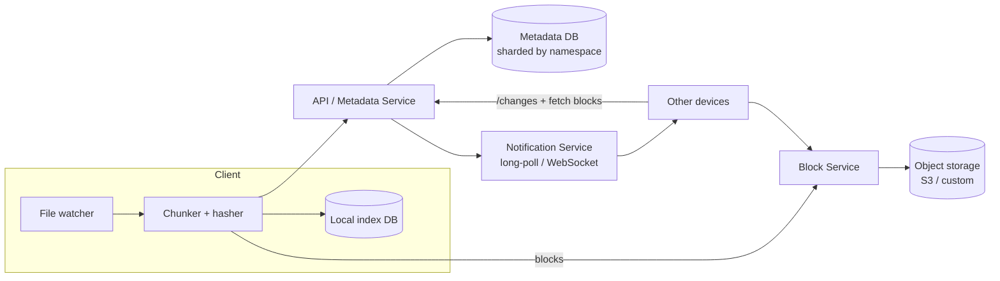

# 11. Design Cloud File Storage & Sync (Dropbox / Google Drive)

## Interview question

> Design a service where users store files in the cloud and keep them synced across devices. Support upload/download, automatic sync, sharing, and version history. 100M DAU.

## Clarifying questions

| Question | Assumed answer |
|----------|----------------|
| Max file size? | 50 GB |
| Sync clients? | Desktop, mobile, web |
| Sharing? | Share with users / via link; read or edit permissions |
| Versioning? | Keep 30 days of history |
| Real-time co-editing? | Out of scope (that's Google Docs, a different problem) |
| Offline edits? | Yes — sync on reconnect with conflict handling |

## Requirements

**Functional:** upload, download, delete, rename/move; sync changes to all devices; share; version history.
**Non-functional:** durability ≥ 11 nines; reliable for large files on flaky networks; bandwidth efficient; changes propagate within seconds.

## Estimation

- 500M total users, 100M DAU; avg 10 GB stored per user → **5 EB logical**; dedup reduces significantly.
- Files changed per day: 100M × 5 = 500M file updates/day ≈ 6k/s.
- Metadata ops (list, sync checks) are far more frequent than data transfer.

## Key idea: split files into blocks

- Split files into **4 MB blocks**, each identified by its SHA-256 hash.
- A file = ordered list of block hashes.
- Benefits:
  - **Delta sync:** only changed blocks are uploaded when a file changes.
  - **Dedup:** identical blocks stored once (across versions and users).
  - **Resumable** large uploads; parallel transfer.

(Advanced: content-defined chunking with rolling hashes (Rabin fingerprints) so inserting a byte at the start doesn't shift all block boundaries.)

## API

```http
POST /v1/blocks/check        { hashes: [...] } → { missing: [...] }
PUT  /v1/blocks/{hash}       <bytes>   (or presigned URL to object storage)
POST /v1/files/commit        { path, parent_rev, block_list: [...], size, mtime }
                              → { file_id, rev } | 409 conflict
GET  /v1/files/{id}?rev=     → metadata + block list
GET  /v1/blocks/{hash}
GET  /v1/changes?cursor=     → long-poll; returns changes since cursor
POST /v1/shares              { file_id, grantee, role }
```

## Data model (metadata — strongly consistent, sharded MySQL by namespace)

```
namespaces(ns_id, owner_id)                         -- a user's root or a shared folder
files(file_id, ns_id, path, latest_rev, is_deleted)
file_versions(file_id, rev, block_list, size, modified_by, created_at)
journal(ns_id, seq, file_id, rev, op)               -- append-only change log per namespace
blocks(hash, size, storage_location, ref_count)
acl(ns_id, principal_id, role)
```

## High-level design



## Sync flow (upload a change)

1. Watcher detects a modified file; client chunks it and hashes blocks.
2. `blocks/check` → server returns hashes it doesn't have.
3. Client uploads only missing blocks (in parallel, resumable).
4. `files/commit` with the new block list and `parent_rev` (the revision the edit was based on).
5. Metadata service in one transaction: verify `parent_rev == latest_rev`, insert new version, append to the namespace **journal**, bump `latest_rev`.
6. Notification service tells other devices subscribed to the namespace "new changes after seq X".
7. Other devices call `/changes?cursor=X`, get the new block list, download missing blocks, reassemble.

## Deep dive 1: conflict resolution

- Commit uses **optimistic concurrency** via `parent_rev`. If another device committed first → 409.
- Resolution: the server keeps the winner; the losing client saves its version as `file (Alice's conflicted copy).docx`. Never silently lose data.
- Offline edits replay the same way on reconnect.

## Deep dive 2: change notification

- Each namespace has an append-only journal with a monotonically increasing `seq`. Each device stores its cursor per namespace.
- Clients hold a long-poll (or WebSocket) to the notification service, which just says "something changed"; the client then pulls changes. Pull-based sync means missed notifications never cause missed changes.

## Deep dive 3: storage & durability

- Blocks in object storage with **erasure coding** (e.g., 6+3 Reed-Solomon) across availability zones — 11 nines durability at ~1.5× overhead (vs 3× for replication).
- Hot vs cold tiers: rarely accessed blocks move to cheaper storage.
- **Garbage collection:** blocks referenced by no live version (after the 30-day history window) are deleted by a mark-and-sweep job; ref counts are a hint, the sweep is authoritative.
- Encryption at rest per block; per-user keys optional.

## Deep dive 4: sharing

- A shared folder is its own **namespace** mounted into multiple users' trees. ACL checked at the namespace level. Changes to the shared namespace's journal notify all members' devices.
- Link sharing: unguessable token → (file_id, role, expiry).

## Trade-offs

| Choice | Pro | Con |
|--------|-----|-----|
| 4 MB fixed blocks | Simple | Insert near file start reuploads everything → content-defined chunking |
| Cross-user dedup | Big storage savings | Side-channel: user can learn whether a file exists on the service; mitigate with per-user dedup or upload throttling |
| Strongly consistent metadata | Correct sync | Metadata DB is the scaling bottleneck → shard by namespace |
| Long-poll notifications | Works through firewalls | Many open connections |

## Follow-up interview questions

**Q: Why separate metadata and block storage?**
A: Different access patterns: metadata is small, transactional, and queried constantly; blocks are large, immutable, and content-addressed — perfect for object storage and CDN caching.

**Q: How do you make downloads fast globally?**
A: Blocks are immutable and content-addressed, so they're perfectly cacheable: serve via CDN with signed URLs; prefer LAN sync between devices on the same network.

**Q: How do you handle a 50 GB upload on a phone?**
A: Block-level resumable uploads, background transfer APIs, Wi-Fi-only policies, and committing the file only after all blocks are uploaded.

**Q: How do you restore a deleted folder with 100k files?**
A: Deletion is a journal entry marking files deleted; restore writes new versions pointing at existing block lists — no data transfer needed as long as blocks are within the retention window.
