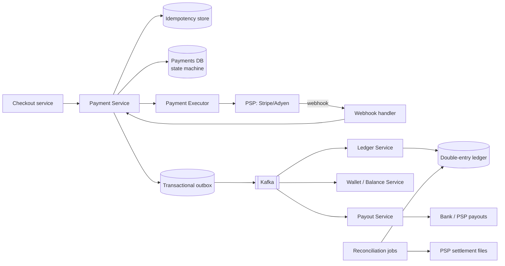

# 12. Design a Payment System

## Interview question

> Design the payment backend for an e-commerce marketplace. Buyers pay with cards; the platform holds funds and pays out sellers. Handle 1M transactions/day. Money must never be lost or double-charged.

## Clarifying questions

| Question | Assumed answer |
|----------|----------------|
| Do we process cards ourselves? | No — integrate a Payment Service Provider (PSP) like Stripe/Adyen; avoid holding raw card data (PCI scope) |
| Flows? | Pay-in (buyer → platform), pay-out (platform → seller), refunds |
| Currencies? | Multiple; store amounts as integer minor units |
| Volume? | 1M payments/day (~12/s, peak ~100/s) — throughput is easy; correctness is the hard part |

## Requirements

**Functional:** create payment, capture, refund, payout; payment status; transaction history.
**Non-functional:** **correctness** above all — exactly-once effect, no double charge, auditable; high availability; strong consistency for balances; full audit trail.

## API

```http
POST /v1/payments
Idempotency-Key: 6f1c...           # required
{ "order_id": "o-1", "amount": 2599, "currency": "USD", "payment_method_token": "pm_abc" }
→ 201 { "payment_id": "p-1", "status": "PROCESSING" }

GET  /v1/payments/{id}
POST /v1/payments/{id}/refunds   Idempotency-Key: ...  { "amount": 500 }
POST /v1/webhooks/psp            # PSP → us, signed
```

## High-level design



Card data never touches our servers: the client tokenizes cards directly with the PSP (hosted fields / SDK); we only store tokens.

## Deep dive 1: idempotency (no double charges)

- Clients send an `Idempotency-Key`. Server stores `(key, request_hash, response, status)` with a unique constraint.
- First request: insert key as `IN_PROGRESS` → process → store response.
- Retry with same key: return the stored response (or 409 if still in progress / request body differs).
- We pass our own idempotency key to the PSP (e.g., `payment_id`) so retries to the PSP don't double-charge either.

## Deep dive 2: payment state machine

```
CREATED → PROCESSING → AUTHORIZED → CAPTURED → SETTLED
                   ↘ FAILED          ↘ REFUNDED (partial/full)
                   ↘ UNKNOWN (timeout) → resolved by status query/webhook
```

- Transitions are guarded: `UPDATE payments SET status='CAPTURED' WHERE id=? AND status='AUTHORIZED'`.
- **Timeouts are the dangerous case:** if a PSP call times out we don't know whether the charge succeeded. Mark `UNKNOWN`, never blindly retry with a new key; query PSP status (same idempotency key) or wait for the webhook.

## Deep dive 3: double-entry ledger

Every money movement is recorded as balanced entries — the sum of debits equals the sum of credits.

```
ledger_entries(entry_id, txn_id, account_id, direction [DEBIT|CREDIT], amount, currency, created_at)
-- immutable, append-only; corrections are new reversing entries
```

Example: buyer pays $25.99, platform fee 10%:

| Account | Debit | Credit |
|---------|-------|--------|
| PSP receivable | 2599 | |
| Seller payable | | 2339 |
| Platform revenue | | 260 |

Balances are derived from entries (and cached/materialized). Use a relational DB with ACID transactions (PostgreSQL), sharded by account if needed.

## Deep dive 4: reliable event propagation

Writing to the DB and publishing to Kafka are two systems → can't be atomic directly. Use the **transactional outbox**: in the same DB transaction that updates the payment, insert an event into an `outbox` table; a relay (or CDC like Debezium) publishes it to Kafka. Consumers are idempotent (dedupe by event ID). This gives at-least-once delivery with exactly-once *effect*.

For multi-step flows (charge → reserve inventory → create shipment), use a **saga**: each step has a compensating action (refund, release inventory), orchestrated by a workflow engine.

## Deep dive 5: reconciliation

Distributed systems drift; reconciliation is the safety net.
- Daily: compare our ledger with PSP settlement reports and bank statements, line by line.
- Mismatches (missing webhook, unknown-status payments, FX rounding) → auto-fix rules or a finance ops queue.
- Continuous: the ledger must always balance; alert on any non-zero sum.

## Payouts

- Seller balances accrue in the ledger; a scheduled job creates payout batches (e.g., daily), holds funds for a risk period, calls the PSP/bank payout API with idempotency keys, and records ledger entries.

## Security & compliance

- PCI DSS scope minimized via tokenization; encryption at rest and in transit; secrets in an HSM/KMS.
- Fraud checks before authorization (see [AI: Fraud Detection](../ai-system-design/08-fraud-detection.md)).
- Audit logs: immutable, who did what and when.

## Trade-offs

| Choice | Pro | Con |
|--------|-----|-----|
| Use PSP | No PCI burden, global methods | Fees, dependency |
| Relational DB | ACID, constraints | Harder to scale writes (fine at this volume) |
| Async ledger via outbox | Decoupled, reliable | Ledger lags payments by seconds |
| Multiple PSPs | Resilience, better rates | Routing & reconciliation complexity |

## Follow-up interview questions

**Q: Why store money as integers?**
A: Floating point can't represent decimals exactly (0.1 + 0.2 ≠ 0.3). Use integer minor units (cents) plus currency code; be careful with currencies that have 0 or 3 decimal places.

**Q: A webhook arrives before our PSP API call returns. What happens?**
A: Both paths call the same idempotent state transition; whichever arrives first moves the state, the second is a no-op because the guarded update finds the state already changed.

**Q: How do you handle a PSP outage?**
A: Circuit breaker; route to a secondary PSP for new payments (card tokens may need network tokens or vaulting to be portable); queue retries for non-urgent operations.

**Q: How do you guarantee exactly-once?**
A: You can't get exactly-once delivery across networks; you get exactly-once *effects* through idempotency keys at every boundary, guarded state transitions, deduplicated consumers, and reconciliation to catch the rest.
