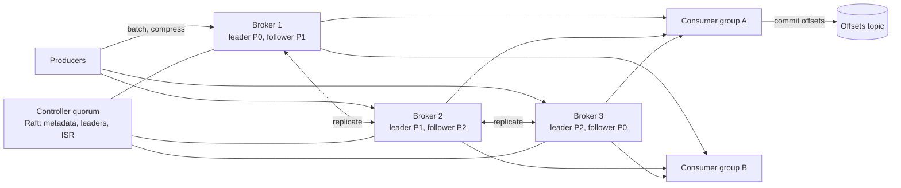

# 13. Design a Distributed Message Queue (Kafka)

## Interview question

> Design a distributed, durable message queue / log like Kafka. Producers publish messages to topics; many independent consumer groups read them at their own pace. Target: 1M messages/s ingest, messages retained for 7 days, no data loss once acknowledged.

## Clarifying questions

| Question | Assumed answer |
|----------|----------------|
| Queue (delete on consume) or log (retain, replay)? | Log — consumers track their own offsets and can replay |
| Ordering? | Per partition (per key), not global |
| Delivery semantics? | At-least-once by default; exactly-once as a follow-up |
| Message size? | Avg 1 KB, max 1 MB |
| Retention? | Time-based (7 days) or size-based; optional log compaction per key |

## Requirements

**Functional:** create topics with N partitions; produce (with optional key); consume via consumer groups; commit offsets; replay from an offset or timestamp.
**Non-functional:** high throughput; durability (replicated, survive broker loss); horizontal scalability; low end-to-end latency (< 10 ms p99 in-DC); ordering within a partition.

## Estimation

- 1M msgs/s × 1 KB = **1 GB/s** ingest; replication factor 3 → 3 GB/s of disk writes cluster-wide.
- 7 days retention: 1 GB/s × 604,800 s ≈ **600 TB** × 3 replicas = **1.8 PB**.
- A broker with ~12 disks sustaining ~300 MB/s writes and 50 TB → **~40–60 brokers**.
- Consumers: if 5 consumer groups each read everything → 5 GB/s egress (mostly served from page cache).

## Core abstraction

```
Topic "orders"
  Partition 0: [m0][m1][m2][m3] ... → offsets 0,1,2,3 (append-only)
  Partition 1: [m0][m1] ...
  Partition 2: ...
Key → partition = hash(key) % num_partitions  → per-key ordering
```

## API

```
produce(topic, key?, value, headers) → (partition, offset)       # acks = 0 | 1 | all
fetch(topic, partition, offset, max_bytes) → [messages]
commit(group, topic, partition, offset)
subscribe(group, topics) → partition assignment (via group rebalance)
```

## High-level design



## Deep dive 1: storage — why a log is fast

- Each partition is a sequence of **segment files** (e.g., 1 GB each) plus a sparse offset index and a time index.
- **Sequential appends** only → disks (even HDDs) do hundreds of MB/s.
- Rely on the OS **page cache** instead of an application cache; recent data is read from memory.
- **Zero-copy** (`sendfile`) moves bytes from page cache to the socket without copying into user space.
- **Batching + compression** (producer batches by partition, compresses with lz4/zstd) amortizes per-message overhead.
- Retention deletes whole old segments — O(1), no per-message deletes.
- **Log compaction** (optional): keep only the latest value per key — turns the log into a changelog/table (used for state stores, offsets).

## Deep dive 2: replication & durability

- Each partition has one **leader** and followers. Producers and consumers talk to the leader.
- Followers fetch from the leader. The **in-sync replica set (ISR)** = replicas caught up within a lag threshold.
- `acks=all`: leader acks once all ISR members have the message. With `min.insync.replicas=2` and RF=3, an acked message survives any single broker failure.
- **High watermark:** consumers only see messages replicated to all ISR members, so a failover never exposes messages that later disappear.
- Leader failure: the controller (Raft-based metadata quorum, replacing ZooKeeper in modern Kafka) elects a new leader from the ISR. Unclean election (from out-of-sync replicas) is disabled by default — availability traded for no data loss.
- Rack/AZ-aware replica placement.

## Deep dive 3: consumer groups

- Partitions of a topic are divided among the consumers in a group; **each partition is consumed by exactly one consumer in the group** → parallelism = number of partitions.
- Group coordinator handles membership and **rebalancing** when consumers join/leave (cooperative incremental rebalancing avoids stop-the-world pauses).
- Consumers commit offsets to an internal compacted topic. Commit *after* processing → at-least-once; commit *before* → at-most-once.
- Consumer lag (latest offset − committed offset) is the key operational metric.

## Deep dive 4: exactly-once semantics

- **Idempotent producer:** broker dedupes retries using (producer ID, sequence number) per partition.
- **Transactions:** a producer atomically writes to multiple partitions *and* commits consumer offsets; consumers with `read_committed` skip aborted data. Enables exactly-once read-process-write pipelines within the system.
- Side effects outside the log (DB writes, emails) still need idempotent consumers.

## Partition count trade-offs

| More partitions | Fewer partitions |
|-----------------|------------------|
| More consumer parallelism, throughput | Less metadata, faster failover |
| More open files, longer leader elections | Limited scalability |
| Repartitioning breaks key→partition mapping | — |

Pick partitions for peak expected consumer parallelism (e.g., target ~10 MB/s per partition), and over-provision because increasing later remaps keys.

## Trade-offs

| Choice | Pro | Con |
|--------|-----|-----|
| Pull-based consumers | Consumers control rate, easy batching, replay | Polling latency (mitigated by long-poll fetch) |
| Per-partition ordering | Scales horizontally | No global order |
| Page cache over app cache | Simple, warm after restart | Noisy-neighbor effects from lagging consumers reading old data |
| Tiered storage (old segments → S3) | Cheap long retention | Higher latency for historical reads |

## Follow-up interview questions

**Q: How is this different from RabbitMQ / SQS?**
A: Those are queues: messages are deleted after acknowledgement, with per-message acks, visibility timeouts, routing, and priorities — great for task distribution. A log retains messages, supports many independent consumer groups and replay, and gives higher throughput, but per-message retry/delay semantics must be built on top (retry topics, DLQ).

**Q: A consumer is slow and lag keeps growing. What do you do?**
A: Scale consumers up to the partition count; if already at the limit, add partitions (careful with key ordering) or make processing async/batched within the consumer. Check for a hot partition from a skewed key.

**Q: How do you implement delayed messages?**
A: Not native. Use tiered delay topics (1 min, 10 min, 1 h) whose consumers wait until the due time, or a separate scheduler service that publishes when due.

**Q: How do you handle poison messages?**
A: After N failed attempts, publish to a dead-letter topic with error metadata and move on, so one bad message doesn't block the partition.
