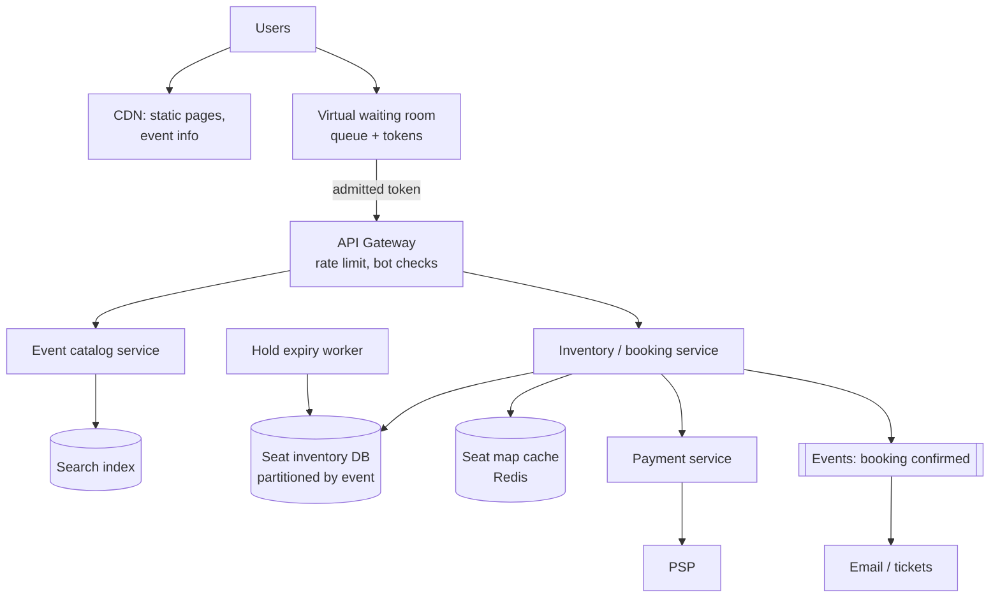

# 14. Design a Ticket Booking System (Ticketmaster / BookMyShow)

## Interview question

> Design a system for booking seats at concerts and events. Users browse events, view a seat map, select seats, and pay. Popular events sell 50,000 seats in minutes with 10M users trying at once. No seat may ever be sold twice.

## Clarifying questions

| Question | Assumed answer |
|----------|----------------|
| Seat types? | Reserved seats (seat map) and general admission |
| Hold time? | Selected seats held for 10 minutes while the user pays |
| Peak? | 10M users arriving within minutes of a big on-sale |
| Payments? | Via external PSP |
| Bots / scalpers? | Must mitigate |
| Fairness? | Roughly first-come-first-served |

## Requirements

**Functional:** search/browse events; view seat availability; hold seats; pay & confirm; release on timeout; view tickets.
**Non-functional:** **strong consistency for seat inventory** (no double-sell); high availability for browsing; survive extreme spikes; fair access; bot resistance.

## Estimation

- Normal: ~10k bookings/day — trivial.
- On-sale spike: 10M users, each refreshing seat maps and attempting holds → millions of reads/s, but only 50k seats → at most ~50k successful holds. **The problem is contention and load shedding, not storage.**
- Seat inventory: 50k rows per event — small enough for one DB partition.

## API

```http
GET  /v1/events?city=&date=&q=
GET  /v1/events/{id}/seats                 → availability map (cached, slightly stale OK)
POST /v1/events/{id}/holds  { seat_ids: [...] }  → { hold_id, expires_at } | 409 seats taken
POST /v1/holds/{hold_id}/checkout  Idempotency-Key: ...  { payment_token }
       → { booking_id, status: CONFIRMED }
DELETE /v1/holds/{hold_id}
```

## Data model

```sql
events(event_id, venue_id, name, starts_at, on_sale_at)
seats(event_id, seat_id, section, row, number, price_tier,
      status ENUM('AVAILABLE','HELD','SOLD'),
      hold_id NULL, hold_expires_at NULL, booking_id NULL, version INT,
      PRIMARY KEY (event_id, seat_id))
holds(hold_id, user_id, event_id, seat_ids, expires_at, status)
bookings(booking_id, user_id, event_id, seat_ids, amount, payment_id, status)
```

Seat inventory lives in a relational DB (PostgreSQL) partitioned by `event_id` — ACID transactions are exactly what's needed.

## High-level design



## Deep dive 1: preventing double booking

**Option A — conditional update (chosen):** holding seats is a single atomic statement:
```sql
UPDATE seats
SET status='HELD', hold_id=:h, hold_expires_at=now()+interval '10 min'
WHERE event_id=:e AND seat_id = ANY(:seats)
  AND (status='AVAILABLE' OR (status='HELD' AND hold_expires_at < now()));
-- succeed only if rows_affected == len(:seats); else rollback → 409
```
The row-level locks inside the transaction guarantee two users can't both win the same seat.

**Option B — pessimistic `SELECT ... FOR UPDATE`** then update: same guarantee, holds locks longer.

**Option C — distributed lock in Redis per seat** (`SET seat:{id} hold NX PX 600000`): fast, but you now have two sources of truth; the DB still needs a final guarded write at checkout. Use Redis as a fast pre-filter at most.

**Checkout:** `UPDATE seats SET status='SOLD', booking_id=:b WHERE hold_id=:h AND status='HELD' AND hold_expires_at > now()`. If the hold expired, the payment must not be captured — authorize first, confirm seats, then capture (or refund on failure).

## Deep dive 2: hold expiration

- Lazy: the conditional update treats expired holds as available (see query above) — correct even if the worker is slow.
- Active: a worker (or delayed queue) releases expired holds so the seat map shows them as available again.

## Deep dive 3: surviving the on-sale spike

- **Virtual waiting room:** before the sale, users join a queue (served from edge/CDN with a lightweight service). At on-sale, users are admitted at a controlled rate (e.g., 5k/min) with a signed, short-lived access token. Protects backend, gives fairness (randomize position for users who arrived before the start).
- **Seat map reads** served from cache, refreshed every ~1–2 s; slight staleness is fine because the hold operation is authoritative.
- **Best-available assignment** for GA or "pick best seats for me": a single-threaded allocator per event section (e.g., one queue consumer per section) avoids lock contention entirely.
- **Load shedding:** reject with "try again" rather than letting DB connection pools saturate.

## Deep dive 4: bots

- CAPTCHA / proof-of-work at waiting room entry, device fingerprinting, per-account and per-card purchase limits, verified-fan presale codes, anomaly detection on behavior (speed, patterns).

## Trade-offs

| Choice | Pro | Con |
|--------|-----|-----|
| RDBMS with row locks | Correctness, simple | Hot partition per popular event → mitigated by waiting room |
| Cached seat map | Massive read offload | Users may pick a seat that was just taken (409 → refresh) |
| Waiting room | Protects system, fair | Users wait; extra component |
| Short hold time | Seats recycle faster | Pressure on users during payment |

## Follow-up interview questions

**Q: Payment succeeds but the seat confirmation fails. What happens?**
A: Use authorize → confirm seats → capture. If seat confirmation fails, void the authorization. If capture fails after confirming, retry with the same idempotency key; reconciliation catches anything left inconsistent.

**Q: How do you shard when one event has 500k seats (stadium festival)?**
A: Partition seats by (event_id, section) so different sections lock independently; holds spanning sections use a short transaction across partitions or are restricted to one section.

**Q: How do you show real-time seat availability to users?**
A: Push seat status deltas via WebSocket/SSE from a pub/sub channel per event (or per section), with periodic full-map refreshes; clients render optimistically.

**Q: Why not just use eventual consistency for higher scale?**
A: Overselling seats is a business-critical failure (refunds, angry customers, legal). Inventory is small per event, so strong consistency is affordable — the scale problem is solved by admission control, not by weakening consistency.
