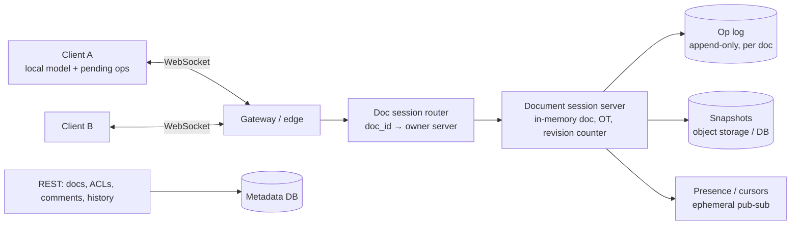

# 15. Design a Collaborative Document Editor (Google Docs)

## Interview question

> Design a real-time collaborative document editor. Multiple users edit the same document simultaneously and see each other's changes and cursors within ~100 ms. Support offline edits, version history, comments, and sharing.

## Clarifying questions

| Question | Assumed answer |
|----------|----------------|
| Document type? | Rich text (paragraphs, formatting, lists, tables) |
| Concurrent editors per doc? | Typically < 10, up to ~100 |
| Scale? | 100M docs edited monthly, 10M concurrently open sessions at peak |
| Offline? | Yes, edits merge on reconnect |
| History? | Full version history, named versions |

## Requirements

**Functional:** open/edit docs; real-time sync of edits and cursors; comments; sharing & permissions; version history; offline editing.
**Non-functional:** convergence (all users end with the same document); low latency (local edits are instant); durability (never lose a keystroke after ack); scales to many docs.

## Estimation

- 10M open sessions; active typists send ~2–5 ops/s in bursts → ~5M ops/s peak globally, but each doc's op rate is small.
- Op ~100 B → ~0.5 GB/s of op traffic; op logs compacted into snapshots.
- WebSocket servers: ~50k connections each → ~200 servers.

## The core problem: concurrent edits

Doc = "abc". Alice inserts "X" at index 1 (→ "aXbc"); concurrently Bob deletes index 2, the "c" (→ "ab"). If Alice's client applies Bob's `delete(2)` naively on "aXbc", it deletes "b" and ends with "aXc", while the intended result is "aXb". Applying position-based ops in different orders without adjustment makes replicas diverge. Two families of solutions:

### Operational Transformation (OT) — Google Docs
- Ops are position-based (`insert(pos, text)`, `delete(pos, len)`).
- A central server defines a total order. When a client's op was based on an older revision, it's **transformed** against the ops it missed: e.g., if a concurrent insert happened before my position, shift my position right.
- Client keeps a pending/sent buffer and transforms incoming server ops against its local unacknowledged ops.
- Pros: compact ops, proven at scale. Cons: transform functions are tricky for rich text; needs a central server per doc.

### CRDTs — Figma (variant), Yjs, Automerge
- Each character/element gets a unique ID (e.g., (site_id, counter)) and is positioned relative to neighbors; deletes are tombstones.
- Ops commute: any order of application converges — **no central server required**, natural for offline and P2P.
- Cons: metadata overhead (IDs, tombstones) → needs garbage collection/compaction; more memory.

**Chosen:** OT with a central per-document server (well understood for rich text, compact) — or CRDT (Yjs) if offline-first and P2P matter more. Name both and pick one with reasons.

## High-level design

## Deep dive 1: the session server

- Each open document is owned by exactly one session server (consistent hashing on `doc_id` + a lease in a coordination service so ownership is unambiguous).
- Flow: client sends `(op, base_revision)` → server transforms against ops since `base_revision` → assigns `revision = n+1` → **appends to op log (durable)** → acks the author → broadcasts to other clients.
- Clients apply local ops immediately (optimistic), so typing never waits for the network.
- If the owner crashes, another server acquires the lease, loads latest snapshot + op log tail, and clients reconnect and resend unacked ops (deduped by `(client_id, client_seq)`).

## Deep dive 2: storage & history

- **Op log:** append-only `(doc_id, revision, op, author, ts)` — Bigtable/Cassandra or a sharded SQL table.
- **Snapshots:** every N ops (e.g., 1,000) or minutes, write the full document state. Loading a doc = latest snapshot + replay remaining ops.
- **Version history:** derived from the op log (group ops into versions by time/author). Named versions are pointers to revisions.
- Old ops can be compacted into snapshots after a retention period to save space.

## Deep dive 3: cursors & presence

- Cursor positions are ephemeral: broadcast via the session server (or a pub/sub channel per doc), never persisted, throttled to ~10/s.
- Cursor positions must also be transformed by incoming ops (or anchored to CRDT element IDs).

## Deep dive 4: offline editing

- Client stores the doc and queued ops locally (IndexedDB).
- On reconnect, sends ops with the old base revision; server transforms them against everything that happened meanwhile. Large divergences can still produce surprising (but convergent) merges; CRDTs handle this more gracefully.

## Comments & permissions

- Comments anchored to ranges; anchors are transformed with ops (or attached to element IDs) so they follow the text.
- ACLs checked on session join and on every op (a user downgraded to viewer is disconnected from write access immediately).

## Trade-offs

| Choice | Pro | Con |
|--------|-----|-----|
| OT + central server | Compact, simple clients | Server per doc is a coordination point |
| CRDT | Offline/P2P, no transform logic | Metadata overhead, GC complexity |
| Op log + snapshots | Full history, fast load | Storage management |
| Single owner per doc | Simple ordering | Hot docs (1000s of editors) need special handling (view-only fan-out tier) |

## Follow-up interview questions

**Q: A doc is viewed by 100k people (a viral announcement). How do you scale?**
A: Separate editors from viewers. Editors connect to the session server; viewers get ops via a fan-out tier (pub/sub, CDN-backed polling of revisions), with read-only sessions that never send ops.

**Q: How do you guarantee no keystrokes are lost?**
A: Ops are persisted to the op log before ack; clients keep unacked ops and resend after reconnect; server dedupes by client sequence numbers.

**Q: How would you implement undo in a collaborative setting?**
A: Per-user undo: invert *my* last op and transform it against all ops applied since, so undo doesn't revert other users' changes.

**Q: How do you search across documents?**
A: Asynchronously index snapshots into a search engine with ACL metadata (principals) for permission-filtered queries.
