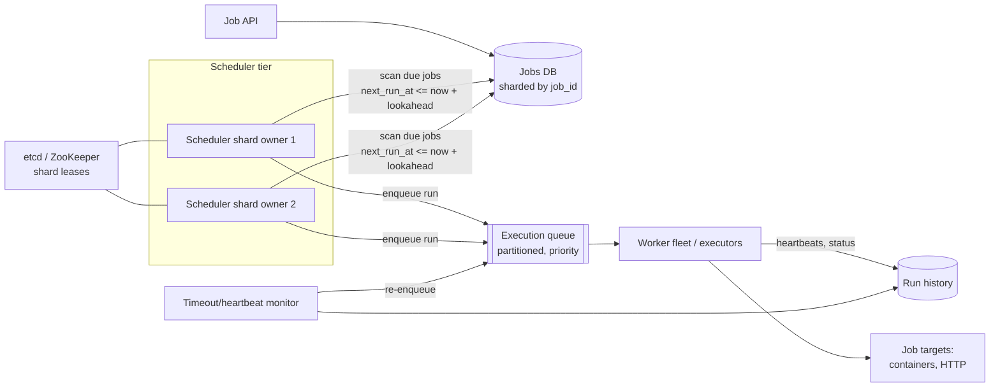

# 16. Design a Distributed Job Scheduler (cron at scale)

## Interview question

> Design a service that lets internal teams schedule jobs — one-off ("run at 3 pm tomorrow") and recurring (cron expressions) — and runs them reliably on a worker fleet. 10M scheduled jobs, up to 100k job executions per second at peak (e.g., top of the hour).

## Clarifying questions

| Question | Assumed answer |
|----------|----------------|
| What is a "job"? | A container/command or an HTTP callback with a payload |
| Precision? | Start within ~1 s of the scheduled time |
| Guarantee? | At-least-once execution; jobs should be idempotent; optional "at-most-once" mode |
| Job duration? | Seconds to hours |
| Dependencies (DAGs)? | Follow-up |
| Retries? | Configurable retry policy with backoff |

## Requirements

**Functional:** create/update/delete/pause schedules; trigger runs on time; retries & timeouts; run history & logs; manual trigger.
**Non-functional:** no missed runs (even if components fail); no duplicate runs in normal operation; horizontal scale; handle thundering herd at `0 * * * *`.

## Estimation

- 10M schedules × ~200 B metadata = 2 GB — fits easily in a DB.
- Peak: 100k executions/s at the top of the hour; average much lower.
- Run history: 1B runs/day × 300 B = 300 GB/day → time-partitioned table, TTL 30–90 days.

## API

```http
POST /v1/jobs
{ "name": "nightly-report", "schedule": "0 2 * * *", "timezone": "America/New_York",
  "target": { "type": "http", "url": "https://svc/report", "timeout_s": 600 },
  "retry": { "max_attempts": 3, "backoff": "exponential" },
  "concurrency": "forbid" }
GET  /v1/jobs/{id}/runs
POST /v1/jobs/{id}:trigger
```

## Data model

```sql
jobs(job_id PK, owner, schedule, timezone, target, retry_policy, concurrency_policy,
     next_run_at, status, version)
-- index on (next_run_at) for due-job scans, partitioned into shards

job_runs(run_id PK, job_id, scheduled_at, started_at, finished_at,
         attempt, status, worker_id, output_ref)
UNIQUE(job_id, scheduled_at)    -- prevents duplicate runs of the same tick
```

## High-level design



## Deep dive 1: finding due jobs

- Split jobs into N logical shards (e.g., 1,024) by `hash(job_id)`. Scheduler instances acquire **leases** on shards via etcd; exactly one owner per shard at a time (with fencing tokens).
- Each owner loops: `SELECT ... WHERE shard=? AND next_run_at <= now() + 30s ORDER BY next_run_at LIMIT 1000`, loads them into an **in-memory timer wheel / min-heap**, and fires at the exact time.
- On firing, in one transaction: insert `job_runs(job_id, scheduled_at)` (unique constraint dedupes), compute and update `next_run_at` from the cron expression → then enqueue the run.
- Alternative for very large scale: time-bucketed tables (`bucket = minute`) so each tick reads only its bucket.

## Deep dive 2: exactly-once-ish triggering

- Duplicate firing (e.g., during shard lease handover) is prevented by `UNIQUE(job_id, scheduled_at)` — the second insert fails.
- Missed firing (scheduler down) is prevented because `next_run_at` isn't advanced until the run row is created; a new owner picks up overdue jobs. **Misfire policy** per job: run once immediately, run all missed, or skip.
- Use the **transactional outbox** pattern so "create run + enqueue" is atomic.

## Deep dive 3: execution

- Workers pull from the queue (pull model naturally balances load), mark the run `RUNNING` with a **lease/heartbeat**.
- If heartbeats stop (worker died), the monitor marks the attempt failed and re-enqueues per retry policy → at-least-once execution. Jobs should be idempotent; pass `run_id` as an idempotency key.
- **Timeouts** enforced by the worker and by the monitor.
- **Concurrency policy:** `allow`, `forbid` (skip if previous run still running), `replace`.
- Isolation: run untrusted job code in containers with resource limits; per-team quotas.

## Deep dive 4: thundering herd

Many jobs are scheduled for `0 * * * *` or midnight.
- Encourage/auto-apply **jitter** (H-style cron like Jenkins: spread "hourly" jobs over the hour by hash).
- Queue absorbs bursts; workers autoscale on queue depth; priorities so critical jobs run first.
- Pre-fetch (lookahead) so schedulers aren't scanning the DB at the exact second.

## Time zones & DST

- Store schedule + timezone; compute next run in the job's timezone. DST transitions: a 2:30 am job may not exist (spring forward) or occur twice (fall back) — define policy (run once).

## Trade-offs

| Choice | Pro | Con |
|--------|-----|-----|
| DB polling + in-memory timers | Simple, durable | Polling cost; lookahead tuning |
| Queue between scheduler and workers | Decoupling, burst absorption | Extra hop latency |
| At-least-once | No missed work | Requires idempotent jobs |
| Shard leases | Horizontal scale, no double scheduling | Lease handover edge cases → fencing |

## Follow-up interview questions

**Q: How would you support job dependencies (DAGs, like Airflow)?**
A: Model a workflow as a DAG; a run creates task instances; a task is enqueued when all upstream tasks succeed. Store task state in the DB; the scheduler evaluates readiness on task completion events.

**Q: What if the database is down?**
A: Schedulers keep firing jobs already loaded in memory for the lookahead window but cannot persist new runs; to stay safe, they stop firing when they can't record the run (prefer delayed over duplicated), and catch up via misfire policy once the DB recovers.

**Q: How do you guarantee at-most-once for non-idempotent jobs?**
A: Mark the run `STARTED` before executing and never retry automatically once started; if the worker dies mid-run, mark it `UNKNOWN` and alert a human. You trade possible missed runs for no duplicates.

**Q: How do you give users second-level precision for 100k jobs/s?**
A: Hierarchical timer wheels in memory per shard, lookahead loading, many shards across scheduler instances, and a low-latency queue — the DB is only touched once per firing.
