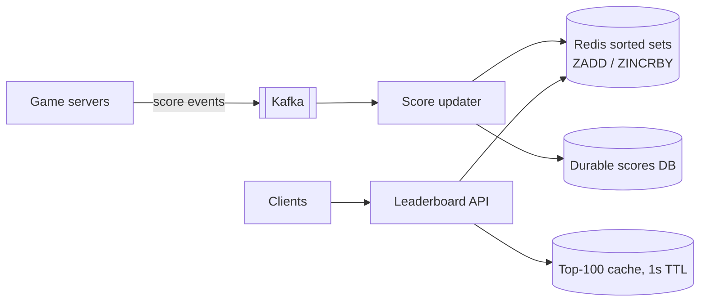
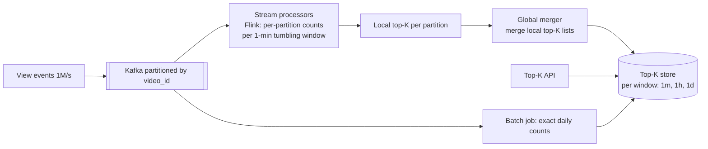

# 17. Design a Real-time Leaderboard & Top-K (Heavy Hitters)

## Interview question

> Part A: Design a real-time leaderboard for a mobile game with 50M players: show the global top 100, and any player's own rank, updated in real time as scores change.
> Part B: Design a service that returns the top 100 most-viewed videos (or trending hashtags) in the last 1 minute / 1 hour / 1 day, from a stream of 1M events/second.

## Clarifying questions

| Question | Assumed answer |
|----------|----------------|
| Leaderboard scope? | Global, plus per-region and friends leaderboards; seasonal resets |
| Rank precision? | Exact for top 10k; approximate (percentile) OK for the long tail |
| Top-K accuracy? | Approximate top-K is fine for trending; exact counts for the top items are nice to have |
| Freshness? | Leaderboard: seconds. Top-K: within ~1 minute |

---

## Part A: Game leaderboard

### Estimation
- 50M players, ~10k score updates/s, ~50k rank reads/s.
- Sorted set entry ~100 B → 50M × 100 B = **5 GB** — fits in one Redis instance's memory, though CPU/QPS may require sharding/replicas.

### Design

- **Redis sorted set** (skip list + hash): `ZADD lb:season42 score player`, `ZREVRANGE lb 0 99 WITHSCORES` for top 100 (O(log n + k)), `ZREVRANK lb player` for a player's rank (O(log n)).
- Tie-breaking: encode `score × 2^32 + (MAX_TS − achieved_at)` so earlier achievers rank higher.
- Durability: the DB (or Kafka log) is the source of truth; Redis can be rebuilt by replay.
- Seasons: new key per season; old ones archived.

### Scaling beyond one node
- **Read replicas** for read QPS; cache top-100 for 1 s.
- **Sharding by score range** (not by player): shard 1 holds scores 0–1000, shard 2 1000–5000, … A player's global rank = rank within shard + sizes of all higher shards (kept as counters). Player moving between ranges → remove + add.
- **Approximate ranks for the long tail:** maintain a histogram of score buckets; rank ≈ number of players in higher buckets. "You are in the top 12%" is enough for most players.
- **Friends leaderboard:** fetch friend list (~hundreds) and their scores (`ZMSCORE`), sort in the app — no need for a per-user sorted set.

---

## Part B: Top-K heavy hitters over a stream

### Estimation
- 1M events/s; ~100M distinct video IDs per day. Exact counting of every key in every window per machine is expensive → use streaming aggregation + sketches.

### Design

### Deep dive: counting
- **Partition by key:** all events for a video go to the same processor, so local counts are exact for that key. Each processor emits its local top-K per window; the merger merges N lists (correct because each key lives in exactly one partition).
- **Hot keys:** a viral video overloads one partition → pre-aggregate at the producer/first stage (combine counts per key per second) before shuffling.
- **Memory-bounded approximate counting:**
  - **Count-Min Sketch:** d × w counter array; estimate = min over d hashed counters. Overestimates only; error ≤ ε·N with w = e/ε.
  - **Space-Saving / Misra-Gries:** keep k counters; when a new key arrives and counters are full, replace the minimum. Guarantees to contain all items with frequency > N/k.
  - Combine: CMS for counts + a min-heap of size K for candidates.
- **Sliding windows:** keep per-minute buckets; 1-hour top-K = merge last 60 minute-buckets' counts (keep top ~10K per minute rather than top 100 to reduce merge error), or use a sliding window with incremental add/expire.
- **Lambda-style correction:** fast approximate stream results, then a batch job computes exact daily results to overwrite.

## Trade-offs

| Choice | Pro | Con |
|--------|-----|-----|
| Redis sorted set | Simple, exact, O(log n) | Single-key memory/CPU limits |
| Score-range sharding | Scales global rank | Rebalancing when distribution shifts |
| Approximate tail ranks | Cheap | Not exact for most players |
| Count-Min Sketch | Fixed tiny memory | Overcounts collisions |
| Merge of local top-K | Scales horizontally | Approximate unless partitioned by key |

## Follow-up interview questions

**Q: Why not `SELECT ... ORDER BY score DESC LIMIT 100` in SQL?**
A: Works for top-100 with an index, but "what's my rank?" requires `COUNT(*) WHERE score > mine` — O(n) per query at 50M rows, too slow at 50k QPS. Sorted sets give O(log n) rank.

**Q: How do you prevent cheating?**
A: Scores computed/validated server-side, plausibility checks (score rate limits), anomaly detection, and shadow-banned players excluded from public boards.

**Q: Why can't you just merge top-100 from each partition if events are partitioned randomly?**
A: A key with moderate counts on every partition might be globally #1 but appear in no local top-100. Partition by key, or keep much larger local lists, to make the merge correct.

**Q: How do you handle trending (velocity) vs. popular (absolute count)?**
A: Trending = count in current window relative to baseline (e.g., z-score vs. same hour last week); compute both and rank by the ratio with a minimum count threshold.
