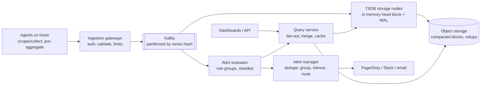

# 18. Design a Metrics Monitoring & Alerting System (Datadog / Prometheus)

## Interview question

> Design a system that collects metrics (CPU, latency, request counts, custom business metrics) from 100k hosts and services, stores them, lets engineers query and graph them on dashboards, and fires alerts when thresholds are breached.

## Clarifying questions

| Question | Assumed answer |
|----------|----------------|
| Data types? | Metrics (time series). Logs and traces are out of scope |
| Scale? | 100k hosts × ~1,000 series each = **100M active time series** |
| Resolution? | 10 s |
| Retention? | Raw 15 days; 1-min rollups for 90 days; 1-hour rollups for 2 years |
| Query latency? | Dashboards < 1 s for typical queries |
| Alerting latency? | Within ~1 minute of the condition |

## Requirements

**Functional:** ingest metrics with labels (`http_requests_total{service="api", status="500"}`); query with aggregation (sum, rate, percentiles) over time ranges; dashboards; alert rules with notifications.
**Non-functional:** high write throughput; the monitoring system must be **more available than what it monitors**; cost-efficient storage; tolerate late/out-of-order data.

## Estimation

- 100M series / 10 s = **10M data points/s** ingest.
- Raw point = 16 B (8 B timestamp + 8 B value); with Gorilla compression ≈ **1.4 B/point**.
- Per day: 10M × 86,400 × 1.4 B ≈ **1.2 TB/day** compressed → 15 days ≈ 18 TB (× replication).

## Data model

```
series identity: metric name + sorted label set → series_id (hash)
http_requests_total{service="api", region="us-east", status="500"}

samples: (series_id, timestamp, value)
inverted index: label=value → posting list of series_ids
```

**Cardinality** (number of unique label combinations) is the main scaling risk: a label like `user_id` explodes series count. Enforce per-tenant cardinality limits.

## High-level design



## Deep dive 1: write path & TSDB storage

- Agents batch and compress; gateways write to Kafka (buffer for spikes and replay if storage nodes fall behind).
- Storage nodes own series shards (consistent hashing on series_id, replication factor 2–3).
- **Head block in memory** (last ~2 h) with a **WAL** for crash recovery; then flushed to immutable on-disk/object-storage blocks.
- **Gorilla compression:** timestamps via delta-of-delta (regular intervals → ~1 bit), values via XOR with previous value (slowly changing values → few bits). ~12× compression.
- Columnar, time-partitioned blocks make range scans and deletions (retention) cheap: drop whole blocks.

## Deep dive 2: downsampling & retention

- Background compaction merges small blocks and computes **rollups** (min, max, sum, count per 1 min and 1 h) so long-range queries ("last 6 months") read 360× fewer points.
- Query planner chooses resolution based on time range and pixel width of the graph.
- Percentiles can't be averaged across rollups → store histograms or mergeable sketches (t-digest / DDSketch) for latency metrics.

## Deep dive 3: query path

- Parse query (PromQL-like) → resolve label matchers via inverted index → fetch series chunks from relevant shards and time blocks → aggregate.
- **Push down** aggregation to storage nodes (partial sums per node) to reduce data transfer.
- Cache results by (query, aligned time range) — dashboards re-run the same queries every refresh.
- Limits: max series per query, max time range at raw resolution, query timeouts — one bad query must not take down the cluster.

## Deep dive 4: alerting

- Rules evaluated every 30–60 s: `rate(http_5xx[5m]) / rate(http_total[5m]) > 0.02 for 5m`.
- Evaluators are sharded by rule group and run close to the data; they read from the in-memory head for fresh data.
- **Alert manager:** deduplicates (multiple evaluator replicas fire the same alert), groups related alerts (one page for 50 hosts), supports silences & inhibition (don't page for downstream services when the DB is down), routes by team/severity.
- **Meta-monitoring:** a separate, minimal system monitors the monitoring system (dead-man's switch alert that must fire continuously; absence pages someone).

## Deep dive 5: reliability

- Ingestion backpressure: Kafka absorbs storage outages; agents buffer locally for short gaps.
- Late/out-of-order samples accepted within a window (e.g., 1 h).
- Run the monitoring stack in multiple regions/cells; alerting must not depend on the same infrastructure as production services.

## Push vs pull

| Pull (Prometheus scrapes) | Push (agents send) |
|---------------------------|--------------------|
| Server controls rate; easy "is target up?" | Works for short-lived jobs, behind NAT, serverless |
| Needs service discovery | Needs ingestion auth & rate limits |

Large SaaS systems mostly use push via agents; many use pull locally inside the agent.

## Trade-offs

| Choice | Pro | Con |
|--------|-----|-----|
| Kafka in front of storage | Durability, replay, decoupling | Extra latency/cost |
| Rollups | Fast long queries, cheap storage | Lose detail; percentiles need sketches |
| Strict cardinality limits | Protects the system | Users lose some label detail |
| Object storage for old blocks | Cheap, durable | Slower historical queries → cache |

## Follow-up interview questions

**Q: How do you compute p99 latency across 1,000 hosts?**
A: You can't average per-host p99s. Each host emits a histogram (fixed buckets) or a mergeable sketch (DDSketch, t-digest); the query merges them and computes p99 from the merged distribution.

**Q: An engineer adds `request_id` as a label and cardinality explodes. What happens?**
A: Per-tenant/per-metric series limits at ingestion reject new series beyond the limit and emit a warning; dashboards show which metric caused it. That data belongs in logs/traces, not metrics.

**Q: How do you avoid alert fatigue?**
A: Alert on symptoms (SLO burn rates) instead of causes, require `for` durations, group and dedupe, route by severity (page vs ticket), and review noisy alerts regularly.

**Q: How would you add anomaly detection?**
A: Seasonal baselines (e.g., same time last week, STL decomposition or simple forecasting models) computed in batch; alert when actuals deviate by k standard deviations for a sustained period; let users tune sensitivity.
