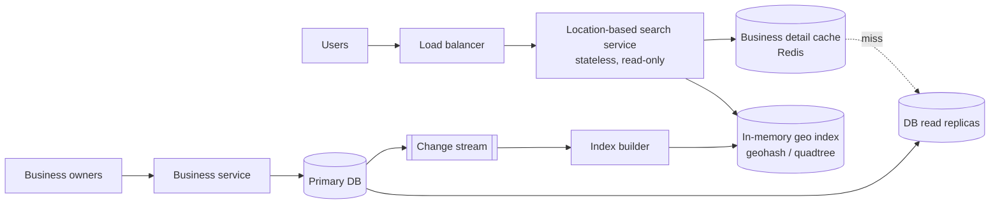

# 19. Design a Proximity Service (Yelp / Google Places "Nearby")

## Interview question

> Design a service that returns businesses (restaurants, gas stations, shops) near a user's location, within a chosen radius, optionally filtered by category and sorted by distance or rating. 100M daily users, 200M businesses worldwide.

## Clarifying questions

| Question | Assumed answer |
|----------|----------------|
| Search radius? | 0.5, 1, 2, 5, 20 km options |
| Business updates? | Owners add/edit businesses; changes visible within minutes (not real time) |
| Read/write ratio? | Extremely read-heavy |
| Results? | Top ~20 by distance or relevance, paginated |
| Moving objects (like Uber drivers)? | No — businesses are static (contrast with [Ride Sharing](09-ride-sharing.md)) |

## Requirements

**Functional:** search nearby businesses by (lat, lng, radius, filters); view business details; owners CRUD businesses.
**Non-functional:** search p99 < 200 ms; highly available; business updates eventually consistent; scales with read traffic.

## Estimation

- Searches: 100M users × 5 searches/day = 500M/day ≈ **5,800 QPS**, peak ~15k QPS.
- Business data: 200M × ~1 KB = **200 GB** of details — fits a replicated (optionally sharded) DB easily.
- Geo index: 200M × (id 8 B + geohash/cell 8 B) ≈ **3.2 GB** — fits in memory on every search server.

## API

```http
GET /v1/search/nearby?lat=37.776&lng=-122.416&radius=2000&category=coffee&limit=20&cursor=...
→ { "businesses": [ { "id": 42, "name": "...", "distance_m": 340, "rating": 4.6 } ], "next_cursor": "..." }

GET  /v1/businesses/{id}
POST /v1/businesses        PUT /v1/businesses/{id}        DELETE /v1/businesses/{id}
```

## Data model

```sql
businesses(business_id PK, name, category, lat, lng, address, rating, hours, ...)   -- source of truth
geo_index(geohash_6 CHAR(6), business_id)  -- or (h3_cell, business_id); index on cell
```

## High-level design



Search and writes are separate services: search is read-only and massively replicated; writes are rare and go to the primary DB, then propagate to the index asynchronously (minutes is acceptable).

## Deep dive 1: geospatial indexing options

| Option | How it works | Pros | Cons |
|--------|--------------|------|------|
| 2D range query on lat/lng | `WHERE lat BETWEEN … AND lng BETWEEN …` | Simple | Two independent indexes intersect poorly; slow at scale |
| **Geohash** | Encode lat/lng into a base-32 string; shared prefix = nearby. Precision 6 ≈ 1.2 km × 0.6 km cell | Simple string prefix lookups, easy sharding | Boundary issues (close points in different cells); non-uniform cell sizes by latitude |
| **Quadtree** | Recursively split a region into 4 until each leaf has ≤ N businesses (e.g., 100) | Adapts to density (Manhattan vs desert) | In-memory tree; rebuild on changes |
| Google S2 / H3 | Hierarchical cells on a sphere (S2: Hilbert curve; H3: hexagons) | Accurate, flexible region covering | More complex libraries |

**Chosen:** geohash (easy to explain and shard) or a quadtree held in memory — mention both and S2/H3 as production-grade alternatives.

### Geohash search algorithm

1. Choose precision from the radius (e.g., 2 km → precision 5 or 6).
2. Compute the user's geohash and its **8 neighbors** (fixes the boundary problem where a nearby business sits just across a cell edge).
3. Fetch business IDs in those 9 cells.
4. Compute exact distances (haversine), filter by radius and category, sort, return top N.
5. If too few results, drop one precision level (bigger cells) and repeat.

### Quadtree sizing
200M businesses / 100 per leaf = 2M leaves; ~0.67M internal nodes; each node ~ 100 B + leaf ID lists (~1.6 GB of IDs) → **~2 GB** per server. Build takes minutes at startup → servers warm up before receiving traffic (blue/green or rolling with readiness checks).

## Deep dive 2: scaling reads

- The geo index is small → **replicate it fully** on every search server rather than sharding. Add servers for QPS.
- Business details: cache hot businesses in Redis (by `business_id`), read replicas behind it.
- Cache popular search results: key = (geohash_6, category, radius), short TTL — dense city centers get repeated queries.
- Multi-region deployment with data served from the nearest region; also helps with data-residency laws.

## Deep dive 3: updates

- Owner edits → primary DB → change data capture → index builder updates geohash entries (remove from old cell, add to new) → pushed to search servers (or nightly full rebuild + incremental deltas).
- Business detail cache invalidated on write.

## Trade-offs

| Choice | Pro | Con |
|--------|-----|-----|
| Full index replication | Simple, fast, no scatter-gather | Each server needs ~GBs of RAM and a rebuild path |
| Geohash | Simple prefix queries | Edge effects (solved with neighbors), uneven cells |
| Quadtree | Density-adaptive | In-memory structure, more complex updates |
| Eventual consistency for updates | Simple, scalable | New business appears after minutes |

## Follow-up interview questions

**Q: Why not just use PostGIS?**
A: PostGIS (R-tree/GiST indexes) works well up to moderate scale and is a fine answer for a smaller system. At 15k QPS globally, an in-memory replicated index on stateless servers is cheaper and faster, and keeps the DB free for writes.

**Q: How do you rank results beyond distance?**
A: Fetch candidates by geo filter, then rank with a scoring function: distance decay × rating × popularity × personalization (past visits, cuisine preferences), possibly an ML ranker on the top few hundred.

**Q: How does this differ from Uber's driver lookup?**
A: Drivers move every few seconds (500k updates/s) so the index must handle constant writes — in-memory cells keyed by H3 with frequent updates. Businesses are static, so a mostly read-only, fully replicated index is ideal.

**Q: What about "search this area" when a user pans the map?**
A: Query by bounding box: cover the box with geohash/S2 cells at an appropriate level and return the top-ranked businesses within it, capping results per request.
