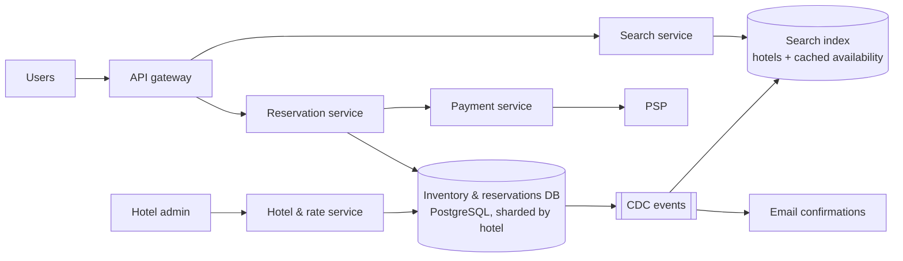

# 20. Design a Hotel Reservation System (Booking.com / Airbnb)

## Interview question

> Design a hotel booking system: users search hotels by city and dates, see prices and availability, and reserve rooms. Hotels manage inventory and rates. 5,000 hotels, 1M rooms, and the system must never overbook beyond the allowed limit.

## Clarifying questions

| Question | Assumed answer |
|----------|----------------|
| Book a specific room or a room type? | Room **type** (e.g., "Deluxe King"); room number assigned at check-in |
| Overbooking? | Hotels may allow a configurable overbooking %, e.g., 10% |
| Payment? | Pay at booking via PSP (see [Payment System](12-payment-system.md)) |
| Cancellations? | Yes, with policy rules |
| Pricing? | Dynamic per date, set by hotel / revenue management |
| Scale? | ~3 reservations/s average, peaks 10×; searches far more frequent |

## Requirements

**Functional:** search availability and prices; view hotel/room details; reserve; cancel; hotel admin manages rooms, inventory, and rates.
**Non-functional:** **no double booking / overbooking beyond the limit**; high concurrency during peak seasons; search latency < 500 ms; reservation strongly consistent.

## Estimation

- Reservations: 1M rooms × 70% occupancy / 3-night average stay ≈ 240k reservations/day ≈ **3 TPS** (peak ~30).
- Searches/views: ~100× reservations → ~300 QPS (peak 3k).
- Inventory rows: 5,000 hotels × ~20 room types × 2 years × 365 days = **73M rows** — fine for a relational DB, shard by hotel if needed.

## API

```http
GET  /v1/hotels/search?city=paris&check_in=2026-12-20&check_out=2026-12-23&guests=2
GET  /v1/hotels/{id}/availability?check_in=...&check_out=...
POST /v1/reservations
     Idempotency-Key: 7f3a...
     { "hotel_id": 12, "room_type_id": 4, "check_in": "2026-12-20", "check_out": "2026-12-23", "guests": 2 }
     → { "reservation_id": "r-981", "status": "PENDING_PAYMENT", "total": 54000, "hold_expires_at": "..." }
POST /v1/reservations/{id}/cancel
```

## Data model

```sql
hotels(hotel_id PK, name, city, address, ...)
room_types(room_type_id PK, hotel_id, name, capacity, ...)

-- One row per room type per night: the heart of the design
room_type_inventory(
  hotel_id, room_type_id, date,
  total_inventory INT,        -- rooms of this type
  total_reserved  INT,        -- booked count
  PRIMARY KEY (hotel_id, room_type_id, date)
)

rates(hotel_id, room_type_id, date, price_cents)
reservations(reservation_id PK, user_id, hotel_id, room_type_id, check_in, check_out,
             status, amount_cents, idempotency_key UNIQUE, created_at)
```

## High-level design



## Deep dive 1: preventing overbooking (concurrency)

A stay of 3 nights must reserve **all 3 nights atomically**. Two users clicking "book" for the last room at the same moment must not both succeed.

**Option A — conditional update in one transaction (chosen):**
```sql
BEGIN;
UPDATE room_type_inventory
SET total_reserved = total_reserved + 1
WHERE hotel_id = :h AND room_type_id = :rt
  AND date >= :check_in AND date < :check_out
  AND total_reserved + 1 <= total_inventory * 1.10;   -- 10% overbooking allowance
-- if rows_affected != number_of_nights → ROLLBACK (sold out on some night)
INSERT INTO reservations (...) VALUES (...);
COMMIT;
```
Row locks taken by the UPDATE serialize concurrent bookings for the same nights.

**Option B — optimistic locking:** add a `version` column; read, then `UPDATE … WHERE version = :v`; retry on conflict. Great when contention is low (true for hotels most of the time).

**Option C — database constraint:** `CHECK (total_reserved <= total_inventory * 1.1)` as a final safety net — even buggy code can't overbook.

Avoid distributed locks in Redis as the source of truth; the DB transaction is simpler and correct at this scale.

## Deep dive 2: double-click / retries

Users double-click, mobile networks retry. Use an **idempotency key** generated when the booking page loads; `reservations.idempotency_key` is UNIQUE, so the second insert fails and the API returns the existing reservation.

## Deep dive 3: reservation lifecycle with payment

```
PENDING_PAYMENT (inventory held, expires in 15 min) → PAID → CHECKED_IN → COMPLETED
          ↘ EXPIRED (inventory released)       ↘ CANCELLED (inventory released, refund per policy)
```
- Hold inventory at reservation creation; a sweeper (or delayed queue) releases expired holds by decrementing `total_reserved`.
- Payment and reservation are in different services → use a saga: reserve → pay → confirm; on payment failure, compensate by releasing inventory.

## Deep dive 4: search at scale

- Search shouldn't hit the transactional DB for every query. Maintain a search index (Elasticsearch) with hotel info and **cached availability/price per date**, updated via CDC within seconds.
- Search results may be slightly stale; the reservation step re-checks authoritatively. Tell the user "only 1 room left" based on cached data, but only confirm after the transaction.
- Cache rates and hotel details aggressively (CDN for images).

## Scaling

- Shard inventory and reservations by `hotel_id` — every booking transaction touches a single hotel, so no cross-shard transactions.
- Read replicas for hotel detail pages; caching for rates.
- For aggregator-scale (millions of properties, channel managers syncing with other OTAs), inventory updates arrive from external systems → idempotent upserts and reconciliation.

## Trade-offs

| Choice | Pro | Con |
|--------|-----|-----|
| Room-type inventory per night | Small table, simple atomic update | Room assignment happens later |
| Pessimistic row locks | Simple, correct | Contention on very hot dates (rare for hotels) |
| Optimistic locking | No lock waits | Retries under contention |
| Cached availability in search | Fast search | Stale counts; re-validate at booking |

## Follow-up interview questions

**Q: How would this change for Airbnb, where each listing is a unique unit?**
A: Inventory is per listing per night with capacity 1 — a booking is "insert a row per night with a UNIQUE (listing_id, date)" or an exclusion constraint on date ranges (`EXCLUDE USING gist (listing_id WITH =, daterange WITH &&)` in PostgreSQL). Double booking is prevented by the constraint.

**Q: How do you handle price changes between search and booking?**
A: Quote a price with a short-lived signed token at the review step; the booking validates the token. If expired or the price changed, show the new price before charging.

**Q: A holiday sale creates heavy contention on the same dates. What then?**
A: Queue booking requests per (hotel, date range) to serialize them, use a waiting room for extreme spikes, and keep the transaction short (no external calls inside it).
