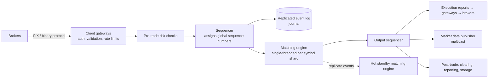

# 21. Design a Stock Exchange (Order Matching Engine)

## Interview question

> Design an electronic stock exchange: brokers submit buy and sell orders, the exchange matches them, publishes trades and market data in real time, and guarantees fairness and correctness. Target: 100 symbols at launch, 1 billion orders/day, matching latency in microseconds to low milliseconds.

## Clarifying questions

| Question | Assumed answer |
|----------|----------------|
| Order types? | Limit and market orders; cancels. (Stop orders etc. are follow-ups.) |
| Who connects? | Brokers (not retail users directly) via a FIX-like protocol |
| Fairness? | Price-time priority; deterministic, auditable |
| Latency? | Order → acknowledgment in sub-millisecond inside the exchange |
| Availability? | Trading hours are critical; failover in seconds without losing orders |
| Risk checks? | Basic pre-trade checks (limits, available funds) |

## Requirements

**Functional:** place/cancel orders; match orders; report executions to both sides; publish market data (order book, trades, candles); end-of-day reporting.
**Non-functional:** very low and predictable latency; **determinism** (same input sequence → same output); no lost or duplicated orders; strict ordering; fairness; full audit trail.

## Estimation

- 1B orders/day concentrated in 6.5 trading hours ≈ 1B / 23,400 s ≈ **43k orders/s** average; peaks 10×+ (~500k/s) at open/close.
- Each order event ~ 100 B → 100 GB/day of event log.

## Core concept: the order book

Per symbol, two sorted sides:
```
BUY (bids)                      SELL (asks)
price  qty   time               price  qty   time
100.02 300   09:30:01.001       100.03 200   09:30:00.950
100.01 500   09:30:00.700       100.04 700   09:30:01.200
100.00 100   09:30:01.500       100.05 100   09:30:00.300
```
- **Matching:** an incoming buy at ≥ best ask trades against the lowest asks first; at the same price, the earliest order first (**price-time priority**).
- Data structure: for each side, price levels in a sorted map (or array indexed by tick), each level a FIFO doubly-linked list of orders; plus a hash map `order_id → node` for O(1) cancels.

## High-level design



## Deep dive 1: why single-threaded matching

- Matching for a symbol must be strictly sequential to be deterministic and fair. Locks and thread contention add latency and nondeterminism.
- A **single-threaded event loop per shard** (one CPU core pinned, data in L1/L2 cache, no allocations on the hot path) processes millions of events/s — the LMAX Disruptor style.
- Scale out by **sharding symbols** across matching engine instances (AAPL on engine 1, MSFT on engine 2…).

## Deep dive 2: sequencing and the event log (event sourcing)

- Every incoming command (new order, cancel) gets a monotonically increasing **sequence number** and is written to a replicated **journal** before (or in parallel with, with careful acknowledgment) being processed.
- The matching engine is a **deterministic state machine**: replaying the journal from the start (or from a snapshot) rebuilds the exact order book. This gives:
  - **Recovery:** a crashed engine restarts from snapshot + replay.
  - **Hot standby:** a secondary consumes the same sequenced stream and stays in identical state; failover is near-instant.
  - **Audit:** the log is the complete legal record.
- Outputs (fills, book updates) are also sequenced so downstream consumers can detect gaps and request retransmission.

## Deep dive 3: low latency techniques

| Technique | Why |
|-----------|-----|
| Colocated, single-machine critical path; minimal network hops | Each hop costs microseconds |
| Kernel bypass networking (DPDK, RDMA), busy-polling | Avoid OS syscalls and interrupts |
| Lock-free ring buffers between stages | No locks, cache-friendly |
| Pre-allocated object pools; no GC on hot path (or C++/Rust) | Avoid pauses |
| CPU pinning, NUMA awareness | Predictable latency |
| Binary protocols instead of JSON | Parsing cost |

Measure **tail latency (p99.9)**, not averages — predictability matters as much as speed.

## Deep dive 4: market data

- After each match, publish order book changes (L1: best bid/ask; L2: depth per price level; L3: every order) and trades.
- **UDP multicast** to many subscribers simultaneously with sequence numbers; gap recovery via a TCP retransmit service and periodic snapshots.
- Candlestick (OHLC) charts computed downstream by stream processors.

## Deep dive 5: risk and correctness

- Pre-trade risk: order size/price sanity (fat-finger checks, price bands), credit limits per broker, self-trade prevention.
- Circuit breakers: halt trading on a symbol when price moves > X% in Y minutes.
- Post-trade: clearing & settlement (T+1), reconciliation against the journal.
- Determinism testing: replay production journals against new engine versions and diff the outputs.

## Trade-offs

| Choice | Pro | Con |
|--------|-----|-----|
| Single-threaded per shard | Deterministic, no locks, fast | A very hot symbol is limited by one core |
| Event sourcing | Recovery, audit, standby replicas | Log storage and replay tooling |
| Hot standby | Seconds-level failover | Double hardware |
| Colocation, one data center critical path | Lowest latency | Disaster recovery to another site is asynchronous |

## Follow-up interview questions

**Q: How do you guarantee fairness between brokers?**
A: Every order is timestamped and sequenced at a single sequencer; matching follows price-time priority strictly on that sequence. Some exchanges also equalize cable lengths in colocation so no participant has a physical advantage.

**Q: What happens if the matching engine crashes mid-day?**
A: The hot standby, which processed the identical sequenced input, takes over. If both fail, a new engine loads the latest snapshot and replays the journal to rebuild the book exactly, then resumes.

**Q: How would you support a market order when the book is thin?**
A: Match against available levels until filled or until a price protection band is reached; cancel the remainder (IOC behavior) to prevent executions at absurd prices.

**Q: How is this different from a crypto exchange?**
A: Similar core (matching engine, order book), plus custody of user funds (hot/cold wallets), 24/7 operation, direct retail users, and blockchain deposit/withdrawal pipelines.
