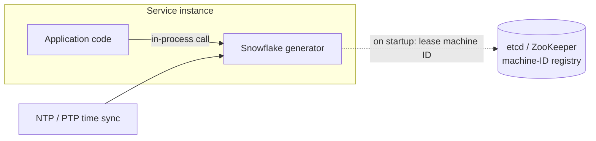

# 22. Design a Distributed Unique ID Generator (Twitter Snowflake)

## Interview question

> Design a service that generates unique IDs for a distributed system (tweets, orders, messages). It must produce 10,000+ IDs per second per node across many data centers, IDs must fit in 64 bits, and they should be roughly sortable by time.

## Clarifying questions

| Question | Assumed answer |
|----------|----------------|
| Uniqueness | Globally unique, always |
| Ordering | Roughly time-ordered (k-sortable); strict global order not required |
| Size | 64-bit integer (fits a `BIGINT` column and JSON numbers carefully) |
| Throughput | > 10k IDs/s per node; thousands of nodes |
| Availability | Must keep working if a coordinator is down |

## Requirements

**Functional:** `next_id() → int64`, unique across all nodes and data centers.
**Non-functional:** low latency (in-process, microseconds), high availability (no single point of failure), sortable by creation time, no coordination per ID.

## Options

| Approach | How | Pros | Cons |
|----------|-----|------|------|
| DB auto-increment | One DB sequence | Simple, ordered | Single point of failure and bottleneck |
| Multi-master auto-increment | N DBs, each increments by N starting at a different offset | Scales a bit | Hard to add servers; IDs not time-ordered across servers |
| UUID v4 | 122 random bits | No coordination at all | 128 bits; not sortable → poor B-tree index locality |
| UUID v7 / ULID | 48-bit ms timestamp + random | Sortable, no coordination | 128 bits (doesn't meet the 64-bit requirement) |
| Ticket server (Flickr) | Central DB hands out IDs (often in ranges) | Simple, numeric | Central dependency; ranges reduce load |
| **Snowflake (chosen)** | Timestamp + machine ID + per-ms sequence in 64 bits | Fast, local, sortable, 64-bit | Needs unique machine IDs and sane clocks |

## Snowflake layout (64 bits)

```
| 1 bit | 41 bits: timestamp (ms since custom epoch) | 5 bits: datacenter | 5 bits: machine | 12 bits: sequence |
  sign     ~69 years of milliseconds                   32 DCs              32 per DC          4096 per ms per node
```

- **Throughput:** 4,096 IDs per millisecond per node = **4M IDs/s per node**.
- **Lifetime:** 2⁴¹ ms ≈ 69 years from the chosen epoch (pick a recent custom epoch, e.g., 2025-01-01, not 1970).
- Bit split is adjustable: e.g., 10 bits of machine ID (1,024 nodes) and fewer DC bits.

```python
import threading, time

EPOCH_MS = 1735689600000  # 2025-01-01T00:00:00Z

class Snowflake:
    def __init__(self, datacenter_id: int, machine_id: int):
        assert 0 <= datacenter_id < 32 and 0 <= machine_id < 32
        self.node = (datacenter_id << 17) | (machine_id << 12)
        self.last_ms = -1
        self.seq = 0
        self.lock = threading.Lock()

    def next_id(self) -> int:
        with self.lock:
            now = int(time.time() * 1000)
            if now < self.last_ms:                     # clock moved backwards
                raise RuntimeError("clock moved backwards; refusing to generate IDs")
            if now == self.last_ms:
                self.seq = (self.seq + 1) & 0xFFF
                if self.seq == 0:                      # 4096 used this ms → wait for next ms
                    while now <= self.last_ms:
                        now = int(time.time() * 1000)
            else:
                self.seq = 0
            self.last_ms = now
            return ((now - EPOCH_MS) << 22) | self.node | self.seq
```

## High-level design



Usually a **library** embedded in each service (no network hop), or a tiny sidecar/service if many languages need it.

## Deep dive 1: assigning machine IDs

- Static config is error-prone (two nodes with the same ID → duplicate IDs).
- **Lease from a coordinator:** on startup, claim a free ID in etcd/ZooKeeper with a lease (ephemeral node) that's renewed while alive. Coordinator only matters at startup, not per ID.
- In Kubernetes, StatefulSet ordinal (`pod-7` → 7) is a simple alternative.

## Deep dive 2: clock problems

- **Clock moving backwards** (NTP adjustment, VM migration) could produce duplicates. Options: refuse to generate until the clock catches up (small jumps: wait; large: fail and alert), or keep the last timestamp and keep incrementing a logical clock.
- Use NTP/PTP with slewing (gradual adjustment) instead of stepping clocks.
- IDs are only **roughly** time-ordered across machines because clocks differ by milliseconds — fine for most use cases.

## Deep dive 3: sequence exhaustion

If a node needs > 4,096 IDs in one ms, it waits until the next millisecond — at most 1 ms of delay. If that's common, reallocate bits (more sequence bits, fewer machine bits).

## Trade-offs

| Choice | Pro | Con |
|--------|-----|-----|
| Time in high bits | Sortable; great index locality | Leaks creation time (sometimes undesirable); predictable |
| Embedded library | Zero network latency | Every service needs a machine ID |
| 64-bit | Compact, fast joins/indexes | Bit budget constrains nodes/throughput/lifetime |
| JavaScript clients | — | JS numbers lose precision above 2⁵³: send IDs as strings in JSON |

## Follow-up interview questions

**Q: Why are sortable IDs better for databases than random UUIDs?**
A: New rows append to the end of the B-tree index (good cache locality, fewer page splits). Random UUIDs scatter inserts across the whole index, causing more I/O and fragmentation.

**Q: Can you extract the creation time from a Snowflake ID?**
A: Yes: `(id >> 22) + EPOCH_MS`. Useful for debugging and time-range queries — and a reason not to use them where creation time must be secret.

**Q: How would you make IDs non-guessable for public URLs?**
A: Don't expose raw Snowflakes; encode them with a reversible permutation/cipher (e.g., Feistel network or hashids) or use a random 128-bit public ID mapped to the internal ID.

**Q: What if you need strictly increasing IDs globally?**
A: That requires a single sequencer (or consensus), which becomes a throughput and availability bottleneck — usually not worth it. Ask why strict order is needed; per-entity ordering (e.g., per conversation sequence) often suffices.
