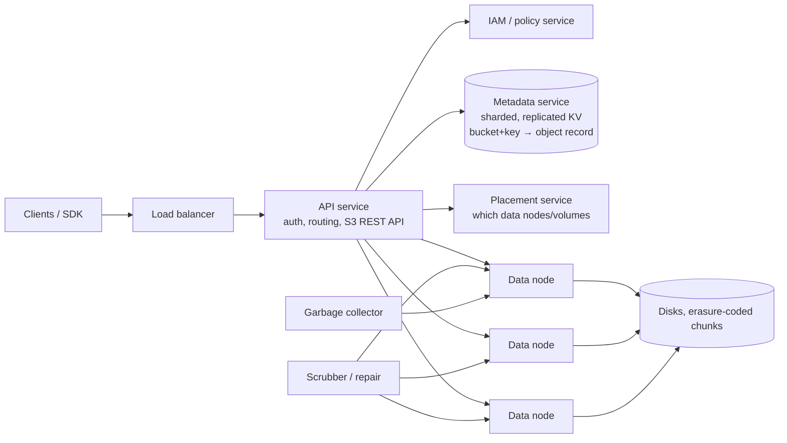

# 23. Design an Object Storage Service (Amazon S3)

## Interview question

> Design an S3-like object storage service: users create buckets and PUT/GET objects (from bytes to terabytes) over HTTP. It must be extremely durable (11 nines), highly available, and scale to exabytes and millions of requests per second.

## Clarifying questions

| Question | Assumed answer |
|----------|----------------|
| Object sizes? | Mostly small (KB–MB), some huge (GB–TB) via multipart upload |
| Operations? | Bucket CRUD, PUT/GET/DELETE object, LIST by prefix, versioning |
| Consistency? | Strong read-after-write for objects and listings (as S3 offers today) |
| Durability? | 99.999999999% (11 nines) |
| Availability? | 99.99% |
| Mutable objects? | No in-place edits: objects are immutable; overwrite = new version |

## Requirements

**Functional:** buckets; put/get/delete/list objects; multipart upload; versioning; access control (bucket policies, presigned URLs).
**Non-functional:** 11-nines durability, high availability, horizontal scale for storage and request rate, cost efficiency.

## Estimation

- Store 100 PB of user data. With 3× replication = 300 PB raw; with erasure coding (8+4) = **150 PB raw**.
- 10 billion objects × ~1 KB metadata = **10 TB metadata** → sharded metadata store.
- Request rate: e.g., 1M req/s globally; most are GETs of small objects.

## Key idea: separate metadata from data

| Plane | Holds | Requirements |
|-------|-------|--------------|
| **Metadata** | Bucket and object names, sizes, versions, ACLs, where the bytes live | Small records, strongly consistent, transactional, sorted (for LIST by prefix) |
| **Data** | The object bytes | Huge volume, immutable, durability, throughput |

## High-level design

## PUT flow

1. Client `PUT /bucket/photos/cat.jpg` → API authenticates (signature V4) and authorizes.
2. API asks the placement service for a set of data nodes in different failure domains (racks/AZs).
3. API streams the bytes, splitting into chunks, computing checksums, and writing erasure-coded fragments to data nodes.
4. Once enough fragments are durably written (e.g., all 12 of 8+4, or a quorum then background completion), API **commits the metadata record** (bucket, key, version_id, size, checksum, chunk locations).
5. Respond 200 with the ETag. Committing metadata last means a crash mid-upload leaves only orphaned chunks (cleaned by GC), never a visible half-object.

GET: look up metadata → fetch fragments (any 8 of 12 reconstruct) → stream to client.

## Deep dive 1: durability

- **Replication** (3 copies across AZs): simple, fast reads, 200% overhead.
- **Erasure coding** (Reed–Solomon k data + m parity, e.g., 8+4): tolerates any 4 lost fragments with 50% overhead. Costs CPU and more network reads on failure. Common approach: replicate fresh/small objects, erasure-code older/larger data.
- **Checksums** end to end (client-supplied MD5/CRC, per-chunk checksums on disk).
- **Scrubbers** continually read data to detect silent corruption (bit rot) and repair from parity.
- **Fast repair**: when a disk dies, rebuild its fragments from peers in parallel across many nodes — durability math depends on repair being much faster than the next failure.
- Spread fragments across racks, power domains, and AZs.

## Deep dive 2: metadata service

- Key: `(bucket_id, object_key, version_id)`; value: size, ETag, content-type, chunk map, ACL, timestamps.
- Must support **LIST with prefix and pagination** → sorted keys → range-partitioned store (like Bigtable/Spanner/FoundationDB), split ranges as they grow; avoid hot prefixes (e.g., keys starting with dates).
- Strong consistency via consensus-replicated shards (Raft/Paxos) gives read-after-write and consistent listings.

## Deep dive 3: data node storage layout

- Storing each small object as a separate file wastes inodes and seeks. Instead **append objects into large immutable volume files** (like Facebook Haystack): index maps object → (volume, offset, length).
- Deletes mark entries; **compaction** later rewrites volumes to reclaim space.
- Large objects: **multipart upload** — client uploads parts (5 MB–5 GB) in parallel and retries parts independently, then a `CompleteMultipartUpload` call atomically stitches them in metadata.

## Deep dive 4: features

- **Versioning:** each PUT creates a new version_id; DELETE inserts a delete marker; old versions retained per lifecycle policy.
- **Lifecycle policies:** transition to colder tiers (infrequent access, archive/tape) and expire objects.
- **Presigned URLs:** time-limited signed URLs let clients upload/download directly without credentials.
- **Access control:** IAM policies, bucket policies, block-public-access defaults; encryption at rest (per-object keys wrapped by KMS).

## Trade-offs

| Choice | Pro | Con |
|--------|-----|-----|
| Erasure coding | ~1.5× overhead vs 3× | CPU, slower degraded reads, more complex repair |
| Commit metadata last | No partial objects visible | Orphaned chunks need GC |
| Immutable objects | Simple caching, replication, consistency | Edits require rewriting the object |
| Strongly consistent metadata | Intuitive semantics | Consensus latency on writes |

## Follow-up interview questions

**Q: How do you compute 11 nines of durability?**
A: Model annual disk failure rate, fragments per object, failure-domain independence, and mean time to repair. With 8+4 coding across independent domains and repair within hours, the probability of losing ≥ 5 fragments of one object before repair is astronomically small — plus scrubbing for silent errors and multi-AZ placement for site failures.

**Q: Why not use a distributed file system like HDFS?**
A: HDFS is optimized for large files and batch analytics with a central NameNode for metadata; object stores need a flat namespace for billions of small objects, HTTP APIs, multi-tenant access control, and scalable metadata.

**Q: How do you serve a viral public object?**
A: Put a CDN in front; within the service, cache hot objects in memory on API/front-end nodes and replicate hot fragments.

**Q: How do you handle LIST on a bucket with a billion objects?**
A: Range scans over the sorted metadata shard(s) for that prefix with continuation tokens (start-after key), limited page sizes; prefix "directory" emulation via delimiter grouping.
