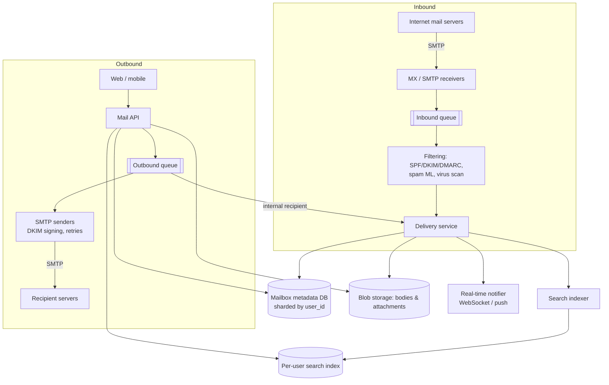

# 24. Design an Email Service (Gmail)

## Interview question

> Design a web-based email service like Gmail for 1 billion users: send and receive email (interoperating with the rest of the internet over SMTP), store mail with search, labels/folders, attachments, and spam filtering.

## Clarifying questions

| Question | Assumed answer |
|----------|----------------|
| Clients? | Web and mobile apps; IMAP/POP for third-party clients as a follow-up |
| Features? | Send, receive, read, search, labels, threads, attachments, spam filtering |
| Storage per user? | Up to 15 GB |
| Volume? | 1B users, ~40 emails received/day each, ~10 sent |
| Real time? | New mail appears within seconds |

## Requirements

**Functional:** send/receive (internal and external via SMTP); mailbox views (inbox, labels, threads); full-text search; attachments; spam/virus filtering; read/unread/star.
**Non-functional:** durability (losing email is unacceptable), high availability, low-latency mailbox loading, scale to exabytes, strong per-user consistency (an email you send appears in "Sent" immediately).

## Estimation

- Incoming: 1B × 40 = 40B emails/day ≈ **460k emails/s**, peak ~1M/s (a large share is spam).
- Metadata: 40B/day × 1 KB = 40 TB/day.
- Bodies + attachments: avg ~100 KB including attachments → 4 PB/day before dedup/compression → exabyte-scale storage over years.

## Email protocols in one minute

- **SMTP:** server-to-server delivery (and client-to-server submission). Sender's server looks up the recipient domain's **MX record** in DNS and connects to that mail server.
- **IMAP/POP3:** protocols for third-party clients to read mail. Our web/mobile apps use our own HTTP API instead.
- **Authentication:** SPF, DKIM (signatures), DMARC (policy) prove a message really came from the claimed domain — key anti-spoofing signals.

## High-level design



## Data model

```
messages(user_id, message_id, thread_id, from, to, subject, snippet, received_at,
         labels SET, is_read, blob_ref, attachment_refs, size)        -- partition by user_id
threads(user_id, thread_id, last_message_at, message_ids, labels)
labels(user_id, label_id, name, unread_count)
```

Mailbox queries are almost always "for this user": `WHERE user_id = ? AND label = INBOX ORDER BY received_at DESC LIMIT 50` → partition everything by `user_id` (Bigtable/Cassandra-style wide rows, or sharded SQL).

## Deep dive 1: receiving mail

1. MX servers accept the SMTP connection; reject early on bad reputation (IP blocklists, rate limits) to save resources.
2. Message is persisted to a durable queue **before** returning `250 OK` to the sender — once we say OK, we own delivery.
3. Filtering pipeline: authentication checks, spam classifier (content, sender reputation, user feedback "Report spam"), malware scanning of attachments, phishing link checks.
4. Delivery service: store body/attachments in blob storage, write metadata (labels: INBOX or SPAM, thread assignment), index for search, notify online clients.
5. Mailing to a group/list → fan-out to each recipient's mailbox (store the blob once, reference from many mailboxes).

## Deep dive 2: sending mail

- API writes the message to the sender's "Sent" (immediately visible) and enqueues it.
- Internal recipients: delivered directly through the delivery service.
- External: SMTP senders DKIM-sign, connect to the recipient's MX, and **retry with backoff** for up to days on temporary failures (4xx); permanent failures (5xx) generate a bounce message back to the sender.
- Outbound reputation matters: rate-limit new accounts, detect compromised accounts sending spam, separate IP pools.

## Deep dive 3: storage

- **Blobs** (bodies, attachments) in object storage; **dedupe attachments** by content hash (the same PDF sent to 1,000 people stored once).
- Compress bodies; tier old mail to colder storage.
- Metadata in a strongly consistent per-user partition so the user's own actions (archive, label, delete) are immediately reflected.

## Deep dive 4: search

- Per-user inverted index (sharded by user_id) over subject, body, sender, attachment names; supports operators like `from:`, `has:attachment`, `before:`.
- Index asynchronously after delivery (seconds of lag acceptable).
- A per-user index keeps queries small and enforces privacy isolation; a global index would be enormous and wasteful because nobody searches other people's mail.

## Deep dive 5: threading & real time

- Threads grouped by `In-Reply-To` / `References` headers and normalized subject.
- Clients keep a WebSocket/long-poll (or mobile push) to get "new mail" events; then sync changes since their last history ID (pull-based sync, like [Chat](04-chat-system.md) and [File Storage](11-file-storage.md)).

## Trade-offs

| Choice | Pro | Con |
|--------|-----|-----|
| Partition by user | Fast mailbox queries, isolation | Large mailing-list fan-out means many writes |
| Store blob once, reference many | Saves storage | Reference counting / GC complexity |
| Queue before 250 OK | No lost mail | Extra latency on accept (milliseconds) |
| Per-user search index | Small, private, fast | Many small indexes to manage |

## Follow-up interview questions

**Q: How do you avoid losing an email if a server crashes after accepting it?**
A: Persist to a replicated queue/log before acknowledging SMTP `250 OK`; delivery workers are idempotent (dedupe by message ID + recipient) so retries don't create duplicates.

**Q: How does spam filtering learn?**
A: Signals: authentication results, sender/IP/domain reputation, content features, URL reputation, and user actions (report spam / not spam) as labels. Models are retrained continually; per-user preferences adjust thresholds.

**Q: How do you support IMAP clients?**
A: Run IMAP front-end servers translating IMAP commands onto the same metadata/blob stores; map labels to IMAP folders and maintain IMAP UIDs per folder.

**Q: How do you delete a user's data (GDPR)?**
A: Delete metadata partition, search index, and drop references to blobs (GC removes blobs with no remaining references), plus purge backups within the retention window.
