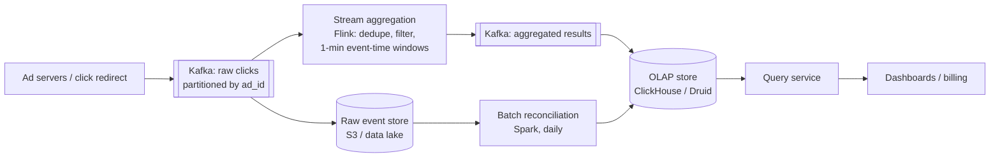

# 25. Design an Ad Click Event Aggregation System

## Interview question

> Advertisers are billed per click and watch dashboards of clicks per ad. Design a system that ingests 1 billion ad click events per day and computes, with very high accuracy, the number of clicks per ad per minute and the top 100 most-clicked ads in the last N minutes. Results feed billing and real-time bidding.

## Clarifying questions

| Question | Assumed answer |
|----------|----------------|
| Volume | 1B clicks/day, peak 50k/s |
| Latency | Aggregates available within a few minutes |
| Accuracy | Billing-grade: no double counting, no loss; small delay acceptable |
| Queries | Clicks per ad over time ranges, filtered by country/device; top-N ads per minute |
| Late events | Events can arrive minutes late (mobile offline, network delays) |
| Fraud | Filter bot/duplicate clicks |

## Requirements

**Functional:** aggregate clicks per (ad_id, minute) with filter dimensions; top-N most clicked ads per window; query API for dashboards and billing.
**Non-functional:** correctness (exactly-once counting), fault tolerance (replayable), scalability, late-data handling, end-to-end latency of minutes.

## Estimation

- 1B/day ≈ 11.6k events/s average, peak ~50k/s.
- Raw event ~ 200 B → 200 GB/day raw (kept for audits and recomputation).
- Aggregates: 2M ads × 1,440 minutes = ~2.9B rows/day worst case, far fewer in practice because most ads get no clicks in most minutes.

## Event

```json
{ "event_id": "c7a1…", "ad_id": 1288, "click_ts": "2026-10-18T09:30:12.231Z",
  "user_id_hash": "…", "ip": "…", "country": "US", "device": "ios" }
```

## High-level design



## Deep dive 1: streaming aggregation

- Kafka partitioned by `ad_id` so all clicks for an ad go to the same Flink task → local, exact counts per key.
- **Tumbling event-time windows** of 1 minute keyed by (ad_id, country, device).
- **Top-N:** each task computes local top-N per window; a second stage merges. Since partitioning is by ad_id, merging local top lists is exact (see [Leaderboard & Top-K](17-leaderboard-top-k.md)).
- Hot ads: pre-aggregate before the shuffle (combiner), or add salt to the key and sum later.

## Deep dive 2: event time vs processing time, and late data

- Count clicks in the minute they **happened** (event time), not when they arrived — otherwise outages shift counts across billing periods.
- **Watermarks** track event-time progress; a window closes when the watermark passes its end plus an **allowed lateness** (e.g., 5 minutes).
- Events later than that go to a side output and are fixed by the batch reconciliation job.

## Deep dive 3: exactly-once counting

Duplicates and losses come from retries at every hop. Defenses:
1. **Dedupe by event_id** in the stream job (keyed state with TTL ~1 hour).
2. **Flink checkpoints** (consistent snapshots of Kafka offsets + window state) → after a failure, state and offsets roll back together and replay.
3. **Transactional/idempotent sink:** write aggregates with Kafka transactions (two-phase commit tied to checkpoints) or upsert into the OLAP store keyed by (ad_id, window, dims) so replays overwrite rather than add.
4. **Reconciliation:** a daily batch job recomputes from raw events in the data lake and corrects any drift. Billing uses the reconciled numbers. This is the Lambda pattern: fast approximate stream path + slower exact batch path.

## Deep dive 4: click fraud & filtering

- Rules: same user/IP clicking the same ad repeatedly within seconds, known bot user agents, datacenter IPs.
- ML scoring in a separate stream; flagged clicks are excluded from billing aggregates but kept for analysis.
- Advertisers can be credited retroactively when fraud is detected later (reconciliation job recomputes).

## Deep dive 5: storage & queries

- OLAP columnar store (ClickHouse/Druid/Pinot) for fast filter + group-by over time ranges; pre-aggregated minute rows rolled up to hourly/daily.
- Query examples: clicks for ad 1288 in the last 24 h by country; top 100 ads in the last 5 minutes.
- Cache dashboard queries for a few seconds.

## Trade-offs

| Choice | Pro | Con |
|--------|-----|-----|
| Stream + batch reconciliation | Fast results and billing accuracy | Two code paths (or use Kappa: replay the stream for recompute) |
| Event-time windows | Correct attribution | Must wait for watermark; late-data handling |
| Partition by ad_id | Exact per-key counts, simple top-N | Hot keys need special care |
| Raw events retained | Audit, replay, recompute | Storage cost (cheap in object storage) |

## Follow-up interview questions

**Q: The Flink job crashes and restarts. How do you avoid double counting?**
A: Restore from the last checkpoint, which includes Kafka offsets and window state together; reprocessed events rebuild the same state. With a transactional or idempotent (upsert) sink, results written after the checkpoint are either rolled back or overwritten.

**Q: What's the difference between Lambda and Kappa architectures here?**
A: Lambda runs a streaming path for speed and a separate batch path for correctness. Kappa uses only streaming: to fix bugs or recompute, replay the retained Kafka log (or data lake) through the same streaming code. Kappa avoids two codebases but needs long retention and replay capacity.

**Q: How would you verify correctness continuously?**
A: Compare stream aggregates with batch recomputation per hour; alert on differences beyond a tiny threshold; track counts at each pipeline stage (ingested, deduped, filtered, written).
