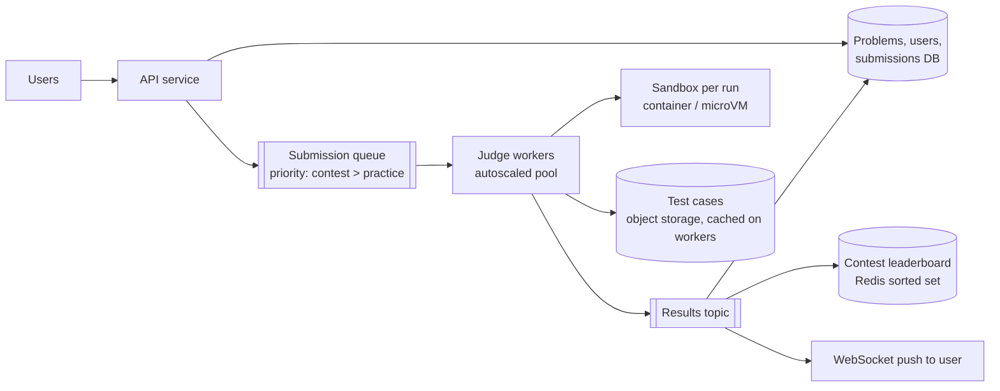

# 26. Design an Online Code Judge (LeetCode / HackerRank)

## Interview question

> Design a platform where users solve programming problems: they read a problem, write code in one of 20 languages, and submit it; the system runs it against hidden test cases and returns Accepted / Wrong Answer / Time Limit Exceeded within seconds. It also hosts timed contests with 50,000 simultaneous participants.

## Clarifying questions

| Question | Assumed answer |
|----------|----------------|
| Languages | ~20 (Python, Java, C++, Go, JavaScript, …) |
| Verdict latency | Typically < 5 s; contests may queue briefly |
| Scale | 1M submissions/day normally; contests spike to ~5k submissions/min |
| Security | Untrusted code — must be fully isolated |
| Features | Problems, submissions, verdicts, leaderboards, "Run" with custom input |

## Requirements

**Functional:** browse problems; run code on custom input; submit against hidden tests; get verdicts with runtime/memory; contests with live leaderboards.
**Non-functional:** **secure sandboxing**, fairness and consistent resource measurement, scalability for contest spikes, durability of submissions.

## Estimation

- 1M submissions/day ≈ 12/s average; contest peak ~5,000/min ≈ 83/s, each running up to ~50 test cases.
- Average execution ~2 CPU-seconds per submission (all tests) → peak 83 × 2 = ~170 CPU cores busy, plus compile time and headroom → a few hundred cores at peak, autoscaled.

## API

```http
POST /v1/problems/{id}/submissions   { "language": "python3", "code": "..." }
→ 202 { "submission_id": "s-123", "status": "QUEUED" }
GET  /v1/submissions/{id}            → { "status": "ACCEPTED", "runtime_ms": 48, "memory_kb": 15200, "passed": 50, "total": 50 }
POST /v1/run                         { "language": "...", "code": "...", "stdin": "..." }   # custom input
```

## High-level design



## Deep dive 1: sandboxing untrusted code (the most important part)

User code may try to fork-bomb, read files, open network connections, or escape the container. Defense in depth:

| Layer | Purpose |
|-------|---------|
| **Isolation:** gVisor, Firecracker microVMs, or nsjail/containers with seccomp | Kernel attack surface reduction; each run in a fresh sandbox |
| **No network** (no network namespace or egress) | Block exfiltration and downloading answers |
| **Resource limits** (cgroups): CPU time, wall time, memory, max processes, file size, open files | Stop fork bombs, infinite loops, memory hogs |
| **Read-only filesystem**, separate tmpfs scratch | No tampering with the judge |
| **Unprivileged user**, dropped capabilities | Limit damage |
| **Ephemeral**: destroy after each submission | No state leaks between users |

Compile in the same sandbox with its own time limit (compile errors are a verdict too).

## Deep dive 2: judging

1. Worker pulls a submission, fetches the problem's test cases (cached locally by version).
2. Compile (if needed) → run each test case with stdin, capture stdout, measure CPU time and peak memory.
3. Compare output with expected (exact match, whitespace-insensitive, or a **custom checker** program for problems with multiple valid answers / floating-point tolerance).
4. Stop at the first failure (practice) or run all (partial scoring contests).
5. Verdicts: `ACCEPTED`, `WRONG_ANSWER`, `TIME_LIMIT_EXCEEDED`, `MEMORY_LIMIT_EXCEEDED`, `RUNTIME_ERROR`, `COMPILE_ERROR`.

**Fair timing:** measure CPU time, not wall time; pin runs to dedicated cores; avoid noisy neighbors; per-language time multipliers (e.g., Python gets more time than C++).

## Deep dive 3: handling contest spikes

- Queue absorbs bursts; workers autoscale on queue depth (pre-warm before scheduled contests — contest times are known in advance!).
- Priority queue: contest submissions before practice submissions.
- Per-user rate limits (e.g., 1 submission per 10 s) to prevent spam.
- Warm sandbox pools (pre-booted microVMs/containers per language) cut startup latency from seconds to milliseconds.

## Deep dive 4: contest leaderboard

- Score = problems solved, tie-broken by penalty time (time of each accepted submission + penalty per wrong attempt).
- Encode into a single sortable score in a **Redis sorted set**: `score = solved × 10^9 − penalty_seconds`.
- Push leaderboard updates via WebSocket; freeze the public board in the last hour (common in contests) while computing internally.

## Deep dive 5: plagiarism & integrity

- Post-contest similarity detection (token-based fingerprinting like MOSS, AST comparison).
- Hidden test cases never sent to clients; rate-limit custom-run outputs to prevent extracting tests.

## Trade-offs

| Choice | Pro | Con |
|--------|-----|-----|
| microVMs (Firecracker) | Strong isolation | More overhead than plain containers (mitigated by warm pools) |
| Containers + seccomp + gVisor | Lighter weight | Larger kernel attack surface without gVisor |
| Stop at first failing test | Saves compute | Less feedback for users |
| Async verdicts via queue | Absorbs spikes | Users wait in queue during peaks |

## Follow-up interview questions

**Q: A user submits `while(true) fork()`. What happens?**
A: The cgroup `pids.max` limit stops process creation, the CPU/wall-time limit kills the run, the verdict is runtime error / TLE, and the sandbox is destroyed. No other submission is affected.

**Q: How do you keep runtime measurements consistent across workers?**
A: Use identical worker hardware, CPU pinning, disable turbo/frequency scaling variance, measure CPU time via cgroups, run one submission per core, and calibrate per-language multipliers.

**Q: How would you support "Run" with custom input at high volume?**
A: Same pipeline with a separate lower-priority queue, stricter limits, and shorter timeouts; results streamed back over WebSocket.
