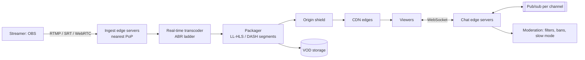

# 27. Design a Live Streaming Platform with Live Chat (Twitch / YouTube Live)

## Interview question

> Design a platform where creators broadcast live video and millions of viewers watch with a few seconds of delay, plus a live chat for each stream. The most popular streams have 2 million concurrent viewers and 50,000 chat messages per minute.

## Clarifying questions

| Question | Assumed answer |
|----------|----------------|
| Latency target | 2–5 s glass-to-glass for normal mode; sub-second "ultra-low latency" as a follow-up |
| Scale | 100k concurrent live streams, 10M concurrent viewers total, top stream 2M viewers |
| Quality | Adaptive bitrate: 160p–1080p60 (some 4K) |
| VOD | Streams saved for replay |
| Chat | Per-stream chat with moderation, emotes |

## Requirements

**Functional:** go live (ingest); transcode to multiple qualities; watch with ABR; live chat; save VOD; follower notifications.
**Non-functional:** low latency, smooth playback (minimal rebuffering), massive fan-out for popular streams, cost efficiency (bandwidth and transcoding dominate).

## Estimation

- Ingest: 100k streams × 6 Mbps = **600 Gbps** inbound.
- Egress: 10M viewers × ~3 Mbps average = **30 Tbps** → only possible with CDNs/edge caches.
- Transcoding: each stream → ~5 renditions in real time → ~100k × (1 GPU/hardware encoder slot per stream or a fraction of one) → large transcoding fleet; skip transcoding for small streams (pass-through only).
- Chat: top stream 50k msgs/min ≈ 830 msgs/s fanned out to 2M viewers = **1.7 billion message deliveries/s** worst case → needs batching and sampling.

## High-level design

## Deep dive 1: ingest

- Streamers connect to the **closest ingest PoP** (anycast/DNS) over RTMP (most common), SRT (better over bad networks), or WebRTC.
- Authenticate with a stream key; ingest servers forward the stream over the provider's backbone to transcoding.
- Health monitoring of the incoming bitrate; reconnection support without ending the broadcast.

## Deep dive 2: real-time transcoding and packaging

- Decode once, encode into an ABR ladder (e.g., 1080p60 6 Mbps, 720p 3 Mbps, 480p 1.5 Mbps, 360p, 160p) using hardware encoders (NVENC/QuickSync/ASICs).
- Cut into short segments (2 s) — or **LL-HLS partial segments** (~200–500 ms) for low latency — and update playlists continuously.
- Cost control: only transcode popular streams; small streams get source-quality pass-through.

## Deep dive 3: delivery and latency

Glass-to-glass latency comes from: encoder buffering + ingest + transcode + segment duration + CDN propagation + player buffer.
- Standard HLS (6 s segments, 3-segment buffer) → 20–30 s latency.
- **Low-latency HLS/DASH** (partial segments, preload hints, blocking playlist reload) → 2–5 s.
- **WebRTC** → < 1 s, but harder to scale to millions (needs SFU fan-out trees instead of HTTP caching).
- The CDN caches each segment at the edge; 2M viewers of one stream mostly hit edge caches — the origin sees one request per edge per segment (**request collapsing** at the origin shield).

## Deep dive 4: live chat at scale

- Viewers connect via WebSocket to chat edge servers; each edge subscribes to the channels its connected viewers are in (pub/sub: Redis/NATS/Kafka or a custom tree).
- Message flow: send → validation & moderation (blocked words, rate limits, slow mode, follower-only mode, bans) → publish to the channel topic → every subscribed edge → fan out to its local viewers.
- **Batching:** edges deliver messages in batches every ~100–200 ms instead of one frame per message.
- **Huge channels:** at 830 msgs/s nobody can read everything — the UI shows a sampled/throttled stream (e.g., max 50 msgs/s rendered per client), while all messages are stored for moderation/replay.
- Chat history is stored (Cassandra keyed by channel + time bucket) for VOD replay with synced chat.

## Deep dive 5: VOD and clips

- Segments written to object storage as they're produced → the VOD is available immediately after the stream ends (or even while live, for "rewind").
- Clips are references to time ranges, re-packaged on demand.

## Trade-offs

| Choice | Pro | Con |
|--------|-----|-----|
| LL-HLS over CDN | Scales to millions on standard CDNs; 2–5 s | Not sub-second |
| WebRTC | Sub-second, interactive | Expensive fan-out, harder to scale |
| Transcode only popular streams | Big cost savings | Small streamers' viewers on slow networks get one quality |
| Chat sampling for huge channels | Keeps clients usable | Not every message is shown to every viewer |

## Follow-up interview questions

**Q: A streamer with 2M viewers goes live suddenly. What breaks first?**
A: Chat fan-out and CDN cache warm-up. Pre-scale chat edges for known big streamers, use origin request collapsing so the first segment requests don't stampede the origin, and rely on multi-CDN capacity.

**Q: How do you make chat and video feel in sync?**
A: Video is delayed by the stream latency while chat is near-instant. Clients can delay displaying chat by the measured stream latency, or show the stream's timestamp so moderators understand context.

**Q: How do you notify 1M followers that a streamer went live?**
A: Publish a "went live" event; a notification fan-out service sends push notifications in batches with rate control, prioritizing recently active followers (see [Notification System](05-notification-system.md)).
